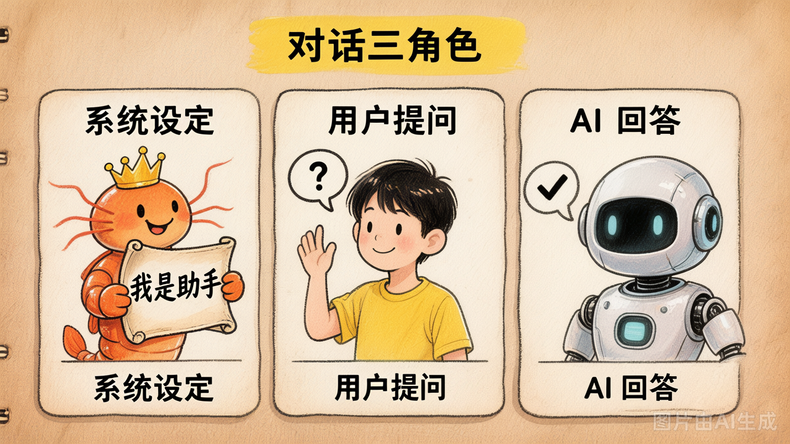
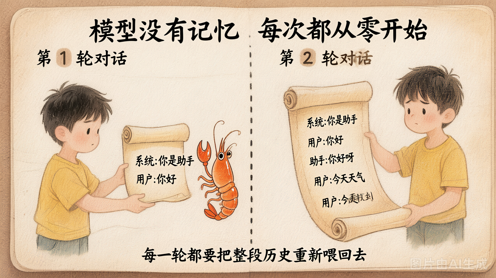

# 第 2 节 · 提示词与角色：System / User / Assistant

## 为什么同一个模型表现得像不同的"人"

你可能见过这种现象：同一个 LLM，有时候像严肃的技术助手，有时候像萌萌的猫娘——区别只在于**一行 system prompt**：

```python
# 正经模式
messages = [
    {"role": "system", "content": "你是一位专业的技术助手"},
    {"role": "user", "content": "你是谁？"}
]
# → "我是一个 AI 助手，可以帮你解决技术问题。"

# 猫娘模式
messages = [
    {"role": "system", "content": "你是一只猫娘，每句话以喵结尾"},
    {"role": "user", "content": "你是谁？"}
]
# → "我是一只可爱的猫娘喵～"
```

这是怎么做到的？答案是 **messages 协议**。

## Messages 协议

所有 OpenAI 兼容的 LLM API 都使用同一种输入格式：

```python
messages = [
    {"role": "system",    "content": "你是一个简洁的助手。"},
    {"role": "user",      "content": "什么是递归？"},
    {"role": "assistant", "content": "函数调用自身解决子问题。"},
    {"role": "user",      "content": "举个例子。"},
]
```

每条消息有 `role`（角色）和 `content`（内容）两个字段。模型每次都会看完**整个列表**，然后生成下一条 assistant 回复。

## 三种角色



| 角色 | 作用 | 由谁写 | 类比 |
|------|------|--------|------|
| `system` | 定义 AI 的身份、规则、约束 | 开发者 | 岗位说明书 |
| `user` | 用户的输入 | 用户 | 客户的提问 |
| `assistant` | AI 的历史回复 | AI 自己（或开发者伪造） | 过往的回答记录 |

> 后续（Day2）还会引入第 4 种角色 `tool`（工具调用结果），这里先不展开。

## 关键认知 1：模型没有记忆



这是一个朴素但重要的事实：**LLM 是无状态的，每次调用都是从零开始**。

```
第 1 轮调用:                    第 2 轮调用:
[system, user₁]                [system, user₁, assistant₁, user₂]
       ↓                              ↓
   assistant₁                      assistant₂
```

所谓"AI 记得我们刚才聊过什么" = **你的程序把历史 messages 重新传回去了**。

如果你不传历史，模型不会记得上一轮说了什么。ChatGPT 之所以"有记忆"，是因为前端自动帮你把历史对话拼进了 messages 列表——模型本身只会"看到什么就答什么"。

## 关键认知 2：System Prompt 是最便宜的行为定制

为什么一行 system prompt 就能彻底改变模型的表现？

因为在训练阶段（RLHF、SFT），模型看过大量这样的训练数据：

```
system: "你是一个Python专家"
user: "怎么排序？"
assistant: "可以用 sorted() 函数..."

system: "你只能用emoji回答"  
user: "怎么排序？"
assistant: "📋➡️🔢✨"
```

模型从中学会了一个规律：**system 里说什么，我就照做**。这不是什么魔法，是训练出来的行为模式。

## 关键认知 3：Assistant 角色可以伪造（Few-Shot Prompting）

你可以在 messages 里伪造几组"假的历史对话"作为示例，让模型照葫芦画瓢：

```python
messages = [
    {"role": "system", "content": "把英文单词翻译成中文，只输出中文。"},
    {"role": "user",      "content": "apple"},
    {"role": "assistant", "content": "苹果"},      # ← 你伪造的示例
    {"role": "user",      "content": "banana"},
    {"role": "assistant", "content": "香蕉"},      # ← 你伪造的示例
    {"role": "user",      "content": "cherry"},    # ← 真正要问的
]
# 模型输出："樱桃"
```

模型不会区分 assistant 消息是"真的历史"还是"你编的示例"——它只看模式。这就是 **few-shot prompting**，在很多任务上效果显著。

## 实际工程中的 System Prompt

在真实的 Agent / Copilot 项目中，system prompt 通常很长（几百到几千 token），会包含：

```python
system_prompt = """
你是一个代码审查助手。

## 规则
- 只关注安全问题和性能问题
- 不要评论代码风格
- 用中文回答

## 输出格式
每个问题按以下格式输出：
- 文件: xxx
- 行号: xxx
- 问题: xxx
- 建议: xxx

## 约束
- 如果没有发现问题，只输出"LGTM"
- 不要编造不存在的问题
"""
```

这些细致的规则定义了 AI 的**行为边界**——后面构建 Agent 时，system prompt 的设计是核心工作之一。

## 动手试试

运行 `demo_02_roles.py`，同一个问题（"什么是递归？"）挂三种 system prompt：

1. **严谨学者**：规范术语、配例子
2. **5 岁小朋友的语言**：简单比喻、短句
3. **只能用 emoji**：零文字

你会直观看到：**改一行 system prompt = 改变整个输出风格**。这就是后面所有 Agent 的基础——Agent 本质上就是"一个精心设计的 system prompt + 一组工具"。

## 小结

| 概念 | 一句话理解 |
|------|-----------|
| Messages 协议 | LLM 的统一输入格式，由角色+内容组成 |
| system | 定义 AI 的人格和规则 |
| user | 用户的输入 |
| assistant | AI 的历史回复（可伪造做 few-shot） |
| 模型无状态 | 每次调用必须全量传入历史 |
| Few-shot | 伪造几组示例，让模型照葫芦画瓢 |

---

下一节：聊了这么多，**这些消息到底要花多少钱**？Token 是什么？上下文窗口又是什么？
