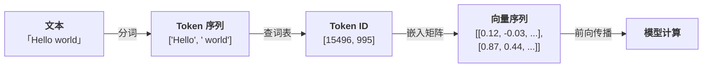
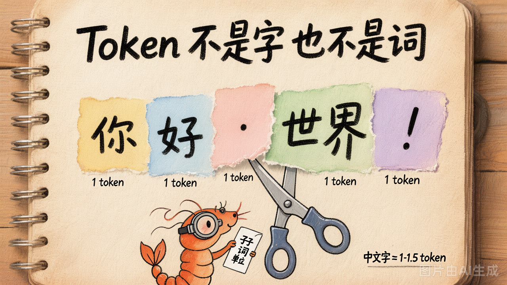

# 第 3 节 · Token、上下文窗口与成本

## 为什么需要 Token

计算机只能处理数字，不能直接理解文本。所以在文本进入 LLM 之前，必须先把它转换成数字序列——这个过程叫 **分词（Tokenization）**，切出来的每个最小单元叫 **Token（词元）**。

你可能会问：直接按字符（character）或按单词（word）切不就行了？两种朴素方案都有致命问题：

| 方案 | 做法 | 问题 |
|------|------|------|
| 按单词切 | 用空格/标点分隔 | 词表爆炸（英文有几十万单词），且遇到新词（如 "ChatGPT"）直接抓瞎 |
| 按字符切 | 每个字母/汉字单独一个 | 单个字符没有语义（"a" 本身什么意思？），模型学习效率极低 |

所以现代 LLM 采用了折中方案：**子词分词（Subword Tokenization）**。

### Token 和向量的关系

分词只完成了第一步——把文本拆成 token 序列。但模型做的是数学运算，它需要的是**数字向量**，不是字符串碎片。

所以完整的流程是：



每个 token 对应词表里的一个整数 ID（比如 `"Hello"` = 15496），然后通过一张**嵌入矩阵（Embedding Matrix）** 把这个 ID 映射为一个高维向量（通常 1024-12288 维）。

这个向量才是模型真正"看到"的东西——它编码了这个 token 的语义信息。语义相近的 token，向量也会相近（比如 `"king"` 和 `"queen"` 的向量距离就比 `"king"` 和 `"banana"` 的近得多）。

> [!NOTE]
>
> **为什么不直接跳过 token，直接把文字变成向量？** 因为你需要先确定"以什么为单位"来生成向量。按字符太细没语义，按单词太粗词表爆炸——Token 恰好是那个"正确的粒度"。分词决定了模型用什么粒度来理解和生成语言。

简单来说：**Token 是文本和向量之间的桥梁**。没有 token，模型无法知道该把哪些字符打包成一个语义单元去做向量化。


## Token 的简单原理：子词分词

核心思想一句话：**常见的词保持完整，罕见的词拆成有意义的碎片**。

比如 `"Tokenization"` 会被拆成 `"Token" + "ization"`——两个碎片各自有意义，合起来也能还原。而高频词 `"the"` 会作为一个整体保留。

最主流的算法叫 **BPE（Byte-Pair Encoding）**，GPT 系列就用它。原理很简单：

1. 初始化：把所有文本拆成最小的字符
2. 统计：哪两个相邻字符出现频率最高？
3. 合并：把这一对合并成一个新 token
4. 重复 2-3，直到词表大小达到预设值（如 100K）

```
训练语料: "low lower lowest"
第 1 轮: 频率最高的相邻对 = ('l', 'o') → 合并为 'lo'
第 2 轮: 频率最高的相邻对 = ('lo', 'w') → 合并为 'low'
第 3 轮: 频率最高的相邻对 = ('e', 'r') → 合并为 'er'
...
最终词表: ['low', 'er', 'est', ...]
```

这样做的好处：
- **词表可控**：不管语言多复杂，词表大小固定（通常 32K-100K）
- **不怕新词**：没见过的词总能拆成已知的子词组合
- **保留语义**：高频词完整保留，低频词的碎片也是有意义的片段

> [!TIP]
>
> 你不需要自己实现分词器——模型提供商已经训练好了。我们只需要理解"Token 是怎么来的"，就能更好地估算成本和管理上下文。


## 什么是 Token



**Token 不是字、不是词，是介于两者之间的"子词单位"（subword）。**

LLM 不直接处理字符串——它先把文本切成 token 序列，再对每个 token 做概率预测。你可以把 token 理解为模型世界里的"原子"。

### 不同语言的 Token 差异

| 文本 | 字符数 | Token 数 | 规律 |
|------|--------|---------|------|
| `"Hello, world!"` | 13 | 4 | 英文 1 词 ≈ 1 token |
| `"你好，世界！"` | 6 | 5-7 | 中文 1 字 ≈ 1-1.5 token |
| `"def foo(): return 1"` | 19 | 7-9 | 代码的标点缩进各算 token |
| `"🤖 AI"` | 4 | 3 | emoji 通常是 1-2 token |

**经验法则**：
- 英文：1 token ≈ 4 个字符 ≈ 0.75 个单词
- 中文：1 token ≈ 0.5-1 个汉字
- 代码：标点和缩进单独成 token，所以代码相对"贵"

### 如何查看 Token 切分

可以用 OpenAI 的 `tiktoken` 库来查看任意文本被切成了什么 token：

```python
import tiktoken

enc = tiktoken.get_encoding("cl100k_base")
text = "你好，世界！"

tokens = enc.encode(text)
pieces = [enc.decode([t]) for t in tokens]

print(f"Token 数: {len(tokens)}")
print(f"切分结果: {pieces}")
# → ['你', '好', '，', '世界', '！']
```

运行 `demo_03_tokens.py` 可以看到更多语言的切分对比。

## 为什么要在乎 Token

三个原因：

### 1. 计费按 Token

LLM API 的定价单位是 token，不是字符。典型价格（2025 年水平）：

| 模型 | 输入 ¥/1M token | 输出 ¥/1M token |
|------|-----------------|-----------------|
| GPT-4o | ¥18 | ¥72 |
| Claude 3.5 Sonnet | ¥22 | ¥108 |
| DeepSeek-V3 | ¥1 | ¥8 |
| 混元 Turbo S | 免费/极低 | 免费/极低 |

**算一笔账**：一次典型的 Coding Agent 调用（输入 5K + 输出 1K token），用 GPT-4o 大约 ¥0.16。一天跑 100 次 = ¥16，一个月 = ¥480。

这就是为什么做 Agent 必须关注**上下文管理**——不是什么都往里塞。

### 2. 上下文窗口按 Token 算

模型能"看到"多少内容，不是按字数算的，而是按 token 数。一个 128K 上下文的模型，能装进去的中文大约是 6-8 万字——听起来很多，但如果你把一整个代码仓库塞进去，很容易就爆了。

所以在构建 Agent 时，你需要精打细算：哪些信息必须放进上下文，哪些可以省略或摘要。

### 3. 生成延迟跟 Token 数线性相关

LLM 是逐个 token 生成的，每输出一个 token 就要做一次前向传播。输出 100 token 和输出 1000 token，延迟大约差 10 倍。

这意味着：如果你让模型"详细解释"，它会输出更多 token，响应时间也会明显变长。在 Agent 场景中，控制输出长度（比如要求模型只返回 JSON、只输出结论）是优化响应速度的关键手段。

## 上下文窗口：LLM 的"工作内存"


模型一次推理能"看"到的最大 token 数，叫**上下文窗口（context window）**。

| 模型 | 上下文窗口 |
|------|-----------|
| GPT-3.5 | 16K |
| GPT-4o | 128K |
| Claude 3.5 Sonnet | 200K |
| Gemini 2.0 Pro | 2M |
| DeepSeek-V3 | 128K |

### 三个容易搞错的点

#### 1. 输入 + 输出共享窗口

128K 上下文 ≠ 能输入 128K 再输出一堆。是 **输入 + 输出 ≤ 128K**，且输出还受 `max_output_tokens` 单独限制（通常 4K-16K）。

如果你给模型 100K 的输入，留给输出的空间只剩 28K——但实际上在此之前，大多数模型就会因为输出上限而截断了。

#### 2. 超出窗口 = 直接报错

API 不会"自动截断"，而是返回错误：

```
context_length_exceeded: This model's maximum context length is 128000 tokens.
However, your messages resulted in 134567 tokens.
```

ChatGPT 之所以聊久了会"忘事"，是因为前端**主动裁掉了早期消息**来避免超限——模型本身不会自动处理。

#### 3. 越长越笨（Lost in the Middle）


研究表明，大部分模型在上下文超过 50% 容量后，对**中间位置**的内容关注度显著下降。

也就是说，把关键信息放在一长段文本的正中间，模型很可能会忽略它。这被称为 **"Lost in the Middle"** 现象。

> 这意味着上下文管理不只是"塞得下"的问题，还要考虑"放在哪里模型能注意到"。

## 成本估算实例

```python
import tiktoken

enc = tiktoken.get_encoding("cl100k_base")

# 假设你要让 LLM 审查一个 500 行的 Python 文件
with open("my_code.py") as f:
    code = f.read()

n_tokens = len(enc.encode(code))
cost_per_call = n_tokens / 1_000_000 * 18  # GPT-4o 输入价格

print(f"文件: {len(code)} 字符 → {n_tokens} token")
print(f"单次审查输入成本: ¥{cost_per_call:.4f}")
print(f"每天审查 50 个文件: ¥{cost_per_call * 50:.2f}")
```

## 动手试试

运行 `demo_03_tokens.py` 会演示三件事：

1. **不同语言的 tokenization 对比**：英文、中文、日文、代码、emoji
2. **成本估算**：一份文档跑多少次要多少钱
3. **故意撑爆上下文窗口**：构造超长输入，看 API 怎么报错

## 小结

| 概念 | 一句话理解 |
|------|-----------|
| Token | LLM 的最小处理单位（子词） |
| 上下文窗口 | 一次推理能看多少 token，输入+输出共享 |
| Lost in the Middle | 长上下文的中间位置容易被忽略 |
| 计费单位 | 按 token 计费，不是按字符 |
| 经验法则 | 中文 1 字 ≈ 1-1.5 token，英文 1 词 ≈ 1 token |

---

下一节：模型挺能聊的，但**它有时候会编**——这就是幻觉。为什么会发生？怎么防？
