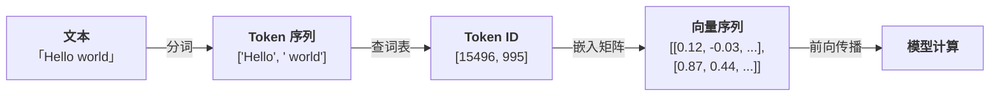

# 第 3 节 · Token、上下文窗口与成本

## 为什么需要 Token

计算机只能处理数字，不能直接理解文本。所以在文本进入 LLM 之前，必须先把它转换成数字序列——这个过程叫 **分词（Tokenization）**，切出来的每个最小单元叫 **Token（词元）**。

你可能会问：直接按字符（character）或按单词（word）切不就行了？两种朴素方案都有致命问题：

| 方案 | 做法 | 问题 |
|------|------|------|
| 按单词切 | 用空格/标点分隔 | 词表爆炸（英文有几十万单词），且遇到新词（如 "ChatGPT"）直接抓瞎 |
| 按字符切 | 每个字母/汉字单独一个 | 单个字符没有语义（"a" 本身什么意思？），模型学习效率极低 |

所以现代 LLM 采用了折中方案：**子词分词（Subword Tokenization）**。

### Token 和向量的关系

分词只完成了第一步——把文本拆成 token 序列。但模型做的是数学运算，它需要的是**数字向量**，不是字符串碎片。

所以完整的流程是：



每个 token 对应词表里的一个整数 ID（比如 `"Hello"` = 15496），然后通过一张**嵌入矩阵（Embedding Matrix）** 把这个 ID 映射为一个高维向量（通常 1024-12288 维）。

这个向量才是模型真正"看到"的东西——它编码了这个 token 的语义信息。语义相近的 token，向量也会相近（比如 `"king"` 和 `"queen"` 的向量距离就比 `"king"` 和 `"banana"` 的近得多）。

> [!NOTE]
>
> **为什么不直接跳过 token，直接把文字变成向量？** 因为你需要先确定"以什么为单位"来生成向量。按字符太细没语义，按单词太粗词表爆炸——Token 恰好是那个"正确的粒度"。分词决定了模型用什么粒度来理解和生成语言。

简单来说：**Token 是文本和向量之间的桥梁**。没有 token，模型无法知道该把哪些字符打包成一个语义单元去做向量化。


## Token 的简单原理：子词分词

核心思想一句话：**常见的词保持完整，罕见的词拆成更小的碎片**——这些碎片通常是词根、词缀之类对模型有用的统计单元。

比如 `"Tokenization"` 常常会被拆成 `"Token" + "ization"`——两个碎片各自有意义，合起来也能还原（具体切分取决于词表）。而高频词 `"the"` 会作为一个整体保留。

最主流的算法是 **BPE（Byte-Pair Encoding）家族**，GPT 系列、Llama、Qwen 都用它。原理很简单：

1. 初始化：把所有文本拆成最小的**字节**（UTF-8 的 256 种字节；原始 BPE 是字符级，GPT-2 起改成了字节级）
2. 统计：按词频加权，统计哪两个相邻 token 对出现次数最多（只在词/标点块内部统计，不跨词；空格常粘在词上，所以 `" word"` 是一个 token）
3. 合并：把这一对合并成一个新 token
4. 重复 2-3，直到词表大小达到预设值（如 100K）

```
训练语料: "low lower lowest"
初始: l o w | l o w e r | l o w e s t

第 1 轮: ('l','o') 出现 3 次（与 ('o','w') 并列，任取其一）→ 合并为 'lo'
第 2 轮: ('lo','w') 出现 3 次 → 合并为 'low'
第 3 轮: ('low','e') 出现 2 次（lower / lowest）→ 合并为 'lowe'
...
最终词表（训练充分时）: ['low', 'er', 'est', ...]
```

这样做的好处：
- **词表可控**：不管语言多复杂，词表大小固定（通常 32K-200K）
- **不怕新词**：字节级 BPE 有 256 个字节兜底，任何没见过的词或字符都能编码，不会出现 `<UNK>`
- **保留语义**：高频词完整保留，低频词的碎片也常常是有意义的片段

> BPE 不是唯一的子词方案：BERT 用 WordPiece，T5 用 Unigram（SentencePiece），思路一样、切法不同。

> [!TIP]
>
> 你不需要自己实现分词器——模型提供商已经训练好了。我们只需要理解"Token 是怎么来的"，就能更好地估算成本和管理上下文。


## 什么是 Token


**Token 不是字、不是词，是介于两者之间的"子词单位"（subword）。**

LLM 不直接处理字符串——它先把文本切成 token 序列，再对每个 token 做概率预测。你可以把 token 理解为模型世界里的"原子"。

### 不同语言的 Token 差异

| 文本 | 字符数 | Token 数 | 规律 |
|------|--------|---------|------|
| `"Hello, world!"` | 13 | 4 | 英文 1 词 ≈ 1 token |
| `"你好，世界！"` | 6 | 5-7 | 中文 1 字 ≈ 1-1.5 token |
| `"def foo(): return 1"` | 19 | 7-9 | 代码的标点缩进各算 token |
| `"🤖 AI"` | 4 | 3 | emoji 通常是 1-2 token |

**经验法则**：
- 英文：1 token ≈ 4 个字符 ≈ 0.75 个单词
- 中文：1 token ≈ 0.5-1 个汉字
- 代码：标点和缩进单独成 token，所以代码相对"贵"

### 如何查看 Token 切分

可以用 OpenAI 的 `tiktoken` 库来查看任意文本被切成了什么 token：

```python
import tiktoken

enc = tiktoken.get_encoding("cl100k_base")
text = "你好，世界！"

tokens = enc.encode(text)
pieces = [enc.decode([t]) for t in tokens]

print(f"Token 数: {len(tokens)}")
print(f"切分结果: {pieces}")
# → ['你', '好', '，', '世界', '！']
```

运行 `demo_03_tokens.py` 可以看到更多语言的切分对比。

## 为什么要在乎 Token

最直接的影响有两个：**计费**和**上下文窗口**。

### 1. 计费按 Token

LLM API 按 token 收费，不是按字符，而且**输出通常比输入贵 4-6 倍**。

不同模型的价格差得很远。同样一次「输入 5K + 输出 1K」的 Coding Agent 调用：旗舰档（GPT-5.6 Sol）约 ¥0.27，主力档（GPT-5.6 Terra / Claude Sonnet 5.5）约 ¥0.15，便宜档（DeepSeek-V4.1-Flash）约 ¥0.01。一天跑 100 次，一个月分别约 ¥800 / ¥450 / ¥30——同样的活，成本差一个数量级。

> 这是 2026 年 11 月的标准价。缓存命中还能再省 50%-90%，Batch 批处理省一半——让模型少说废话，往往比压缩输入更省钱。

### 2. 上下文窗口按 Token 算

模型一次能"看"多少内容，是按 token 算的，不是按字数。一个 1M 窗口大约装得下 50 万字中文——听起来很多，但把一整个代码仓库塞进去照样爆。

**满了会怎样？** 轻则"失忆"，重则直接失败：

- **报错**：输入超过窗口，API 返回 `context_length_exceeded`，整个请求失败，不会自动截断。
- **丢历史**：为了不报错，聊天产品会主动扔掉最早的对话——这就是"聊久了它忘事"的原因。
- **变笨**：就算没超，窗口越满，模型越容易忽略中间位置的信息（Lost in the Middle），开始答非所问。

所以搭 Agent 时必须精打细算：哪些信息必须放进上下文，哪些可以省略或摘要。

## 成本估算实例

```python
import tiktoken

enc = tiktoken.get_encoding("cl100k_base")

# 假设你要让 LLM 审查一个 500 行的 Python 文件
with open("my_code.py") as f:
    code = f.read()

n_tokens = len(enc.encode(code))
cost_per_call = n_tokens / 1_000_000 * 13  # 输入单价（¥/1M token），以 GPT-5.6 Terra 为例

print(f"文件: {len(code)} 字符 → {n_tokens} token")
print(f"单次审查输入成本: ¥{cost_per_call:.4f}")
print(f"每天审查 50 个文件: ¥{cost_per_call * 50:.2f}")
```

## 动手试试

运行 `demo_03_tokens.py` 会演示三件事：

1. **不同语言的 tokenization 对比**：英文、中文、日文、代码、emoji
2. **成本估算**：一份文档跑多少次要多少钱
3. **故意撑爆上下文窗口**：构造超长输入，看 API 怎么报错

## 小结

| 概念 | 一句话理解 |
|------|-----------|
| Token | LLM 的最小处理单位（子词） |
| 上下文窗口 | 一次推理能看多少 token，输入+输出共享 |
| Lost in the Middle | 长上下文的中间位置容易被忽略 |
| 计费单位 | 按 token 计费，不是按字符 |
| 经验法则 | 中文 1 字 ≈ 1-1.5 token，英文 1 词 ≈ 1 token |

---

下一节：模型挺能聊的，但**它不知道实时信息、也读不到你的私域资料**——怎么给它接上外部支持？
