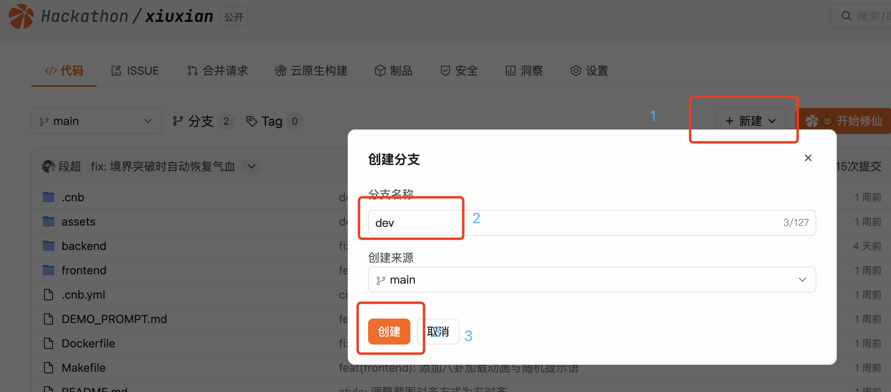

# CNB 仅预览模式 + 自定义启动按钮

> **适用场景**：把 AI 生成的成果分享给别人、提交 Hackathon 作品、做"Fork 即玩"的 Demo / 教学项目。
>
> 访客**不需要进 IDE、点一个按钮就能直接看到效果**。

效果示意：


实现靠**三份配置**：

1. `Dockerfile`：把项目打成镜像（业务怎么跑由它决定）。
2. `.cnb/settings.yml`：在仓库右上角生成醒目的**自定义启动按钮**。
3. `.cnb.yml`：用 `push` 流水线**构建并推送镜像** + 用**仅预览模式**（`onlyPreview: true`）+ `launch` 命令拉起容器。点击按钮后不进 IDE，直接展示预览页。

---

## 1. 准备业务镜像（`Dockerfile`）

先在仓库里写好 `Dockerfile`，确保本地 `docker build && docker run` 能跑起来。例：

```dockerfile
FROM python:3.12-slim
WORKDIR /app
COPY . .
RUN pip install -r requirements.txt
ENV PORT=8686
EXPOSE 8686
# ⚠️ 注意监听 0.0.0.0，否则预览访问不到
CMD ["python", "main.py"]
```

> 端口、监听地址要点见文末"必踩的坑"。

---

## 2. 用 CNB 流水线自动构建镜像（`.cnb.yml` 的 push 段）

在 `.cnb.yml` 里加一段 `main.push` 流水线，每次 push 到主分支时自动构建并推送镜像到 **CNB 内置制品库**：

```yaml
main:
  push:
    - stages:
        - name: build-and-push
          script: |
            docker build -t ${CNB_DOCKER_REGISTRY}/${CNB_REPO_SLUG_LOWERCASE}:latest .
            docker push   ${CNB_DOCKER_REGISTRY}/${CNB_REPO_SLUG_LOWERCASE}:latest
      services:
        - docker
```

- `CNB_DOCKER_REGISTRY`、`CNB_REPO_SLUG_LOWERCASE` 是 **CNB 内置环境变量**，不需要自己填。
- 推送成功后产物镜像形如 `docker.cnb.cool/<你的org>/<你的repo>:latest`，下一步会直接用它。
- 在仓库的 **「构建」/「流水线」** 页面可看到本次构建结果，绿勾代表镜像已就绪。

---

## 3. 自定义启动按钮（`.cnb/settings.yml`）

```yaml
workspace:
  launch:
    button:
      name: 🎃 开始修仙
      description: 百岁觉醒天灵根，三十轮抉择决定仙途命运
      hoverImage: .cnb/launch-hover.gif    # 鼠标悬停时展示的动图（可选）
```

配置完推送，仓库页面右上角就会出现这个按钮。

---

## 4. 仅预览模式 + 启动命令（`.cnb.yml` 的 `$` 段）

> ⚠️ **`launch` 里的镜像地址必须写成常量，不能用变量！** 使用 `${CNB_DOCKER_REGISTRY}/${CNB_REPO_SLUG_LOWERCASE}` 变量会导致评委 Fork 后解析到评委自己的仓库路径，而评委仓库里没有构建过镜像，启动必定失败。

把 `launch` 里的镜像名替换为你仓库的**完整常量地址**（例如 `docker.cnb.cool/your-org/your-repo:latest`），同时确保制品库设为**公有**：

```yaml
$:
  vscode:
    - runner:
        cpus: 16
      services:
        - docker
        - name: vscode
          options:
            onlyPreview: true                 # 仅预览：不进 IDE，直接出预览页
            launch: docker run -d --network host -e PORT=8686 \
                    -e CNB_API_ENDPOINT -e CNB_REPO_SLUG -e CNB_TOKEN \
                    docker.cnb.cool/your-org/your-repo:latest
            keepAliveTimeout: 3600000         # 保活时间（毫秒，1h 无心跳则回收）
            daemon: true
```

关键字段：

| 字段 | 作用 |
| --- | --- |
| `onlyPreview: true` | 跳过 IDE，直接展示业务端口预览页 |
| `launch` | 点击按钮后执行的启动命令（一般是 `docker run` 拉镜像） |
| `keepAliveTimeout` | 无心跳后多久回收资源（毫秒） |
| `daemon: true` | 后台守护方式运行 |

---

## 5. 点击按钮后发生了什么

```
开发者：git push 到 main
   → push 流水线：docker build && docker push 到 CNB 制品库
   → 镜像就绪 ✅

访客：点击仓库右上角的启动按钮
   → CNB 拉起云原生环境（按 runner 配置）
   → 执行 launch：docker run 拉取上面构建好的镜像并启动
   → 自动注入 CNB_API_ENDPOINT / CNB_REPO_SLUG / CNB_TOKEN 等环境变量
   → onlyPreview 直接给出业务端口的预览页
   → 访客看到效果
```

---

## 6. 必踩的坑（重要）

1. **服务必须监听 `0.0.0.0`**——监听 `localhost` / `127.0.0.1` 的服务无法被预览访问。
2. **端口要对齐**：Dockerfile `EXPOSE`、容器 `PORT` 环境变量、launch 命令、应用监听端口要保持一致。
3. **凭证透传**：如果业务里要调 CNB LLM 接口，记得在 `launch` 里用 `-e CNB_TOKEN -e CNB_API_ENDPOINT -e CNB_REPO_SLUG` 把平台注入的环境变量透传给容器。
4. **先有镜像再点按钮**：确认 push 流水线已成功跑过一次（绿勾 ✅），制品库里有镜像后，启动按钮才能拉到东西。
5. **配好仅预览模式后进不去开发环境**：很多同学都会踩到——`onlyPreview: true` 会让默认分支只出预览页，再也点不进 IDE 了。

   解决办法：**新建一个 dev 分支专门用来开发**，步骤如下：

   1. **新建一个 dev 分支**。

      

   2. 在页面上**切换到新建的 dev 分支**。
   3. 在 dev 分支用**最开始那份不带 `onlyPreview` 的 `.cnb.yml`**（见下方），修改后提交。
   4. 在 dev 分支页面点「云原生开发」按钮，即可进入开发环境。
   5. 进入开发环境后，可以 `git checkout main` 切回主分支继续开发，或用任何你习惯的方式开发；主分支继续保留仅预览配置对外展示，两者互不影响。

   原始（开发用）`.cnb.yml` 长这样：

   ```yaml
   $:
     vscode:
       - runner:
           cpus: 16
           # tags: cnb:arch:amd64:gpu:L40
         docker:
           image: docker.cnb.cool/hackathon/vibegame-dev-env:latest
         env:
           VIRTUAL_ENV_DISABLE_PROMPT: "1"
         services:
           - vscode
           - docker
   ```