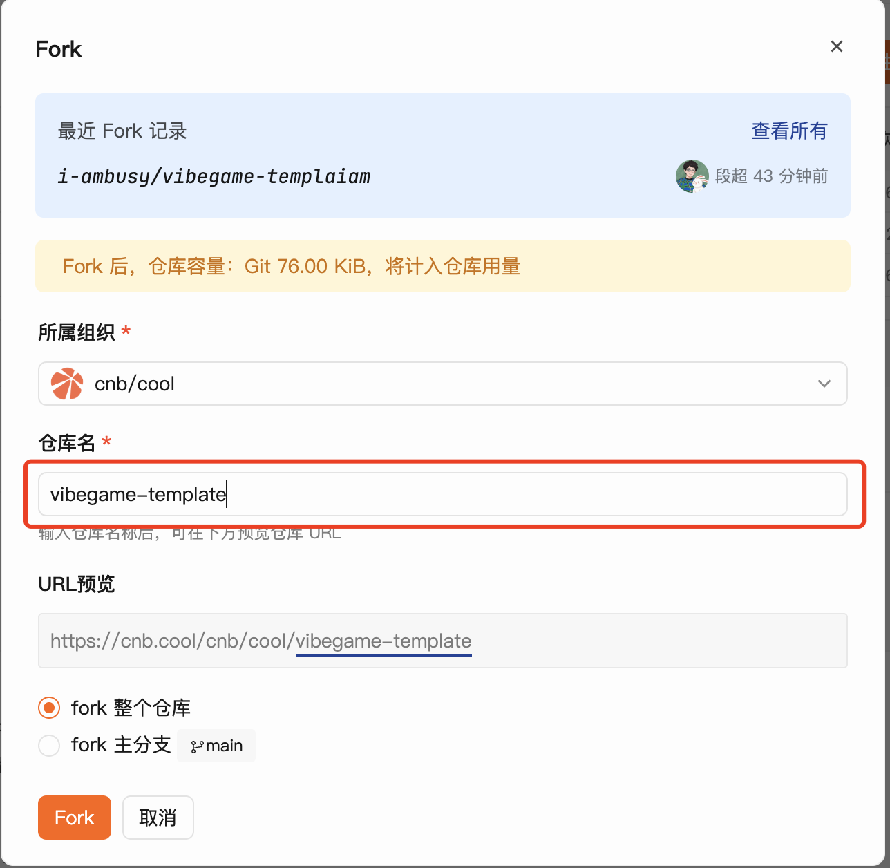
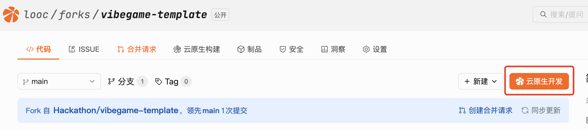
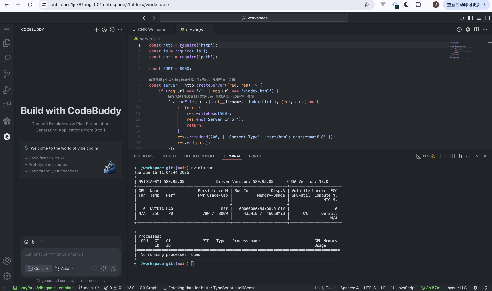
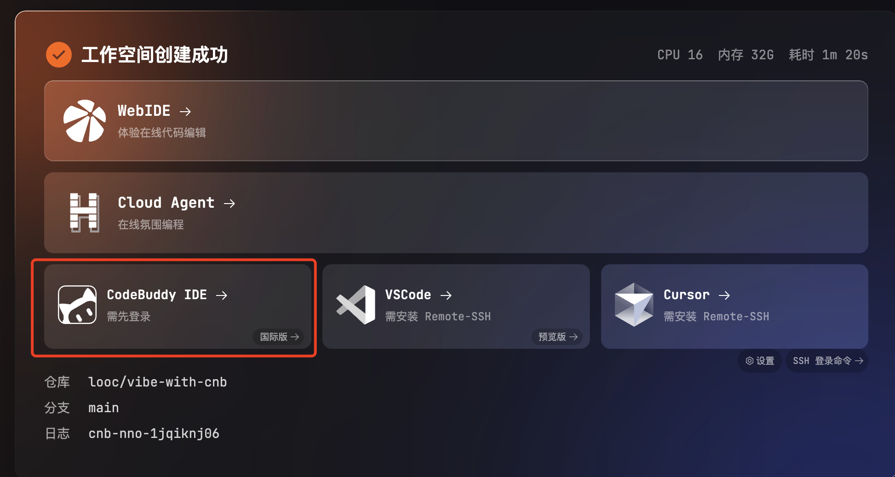
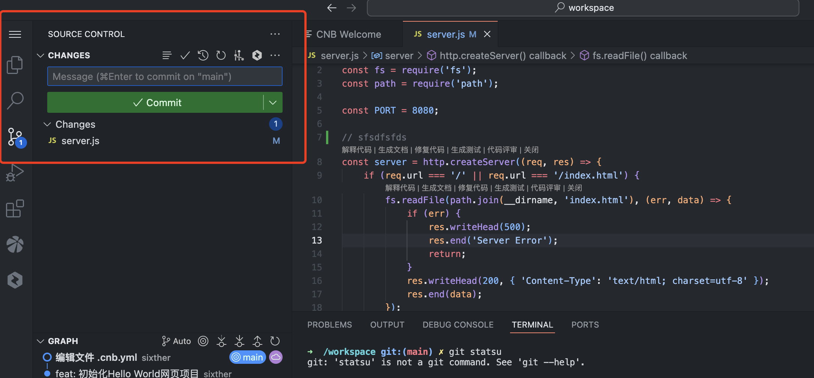
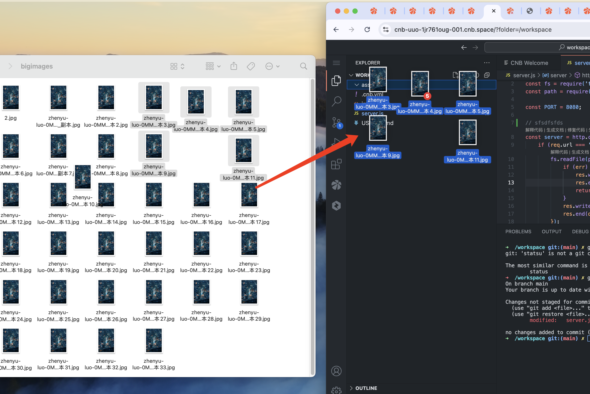
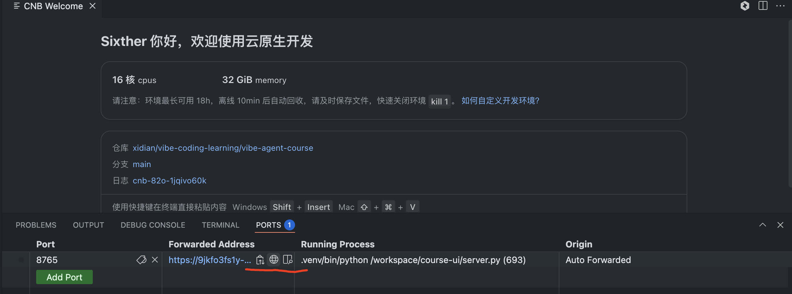

# CodeBuddy + CNB：从 Vibe Coding 到云端部署实战教程

> 一份手把手的教学仓库：用 **CodeBuddy** 进行 AI 编程（Vibe Coding），用 **CNB（云原生构建平台）** 托管代码、运行并部署你的项目。

本教程面向有一定编程基础、希望用 AI 提升交付效率的同学。读完后你将掌握一条完整链路：

```
Fork 模板 → 云原生开发环境写代码 → 提交回 CNB → 端口预览 / 一键启动
```

# 快速上手

**只需两步**：

1. Fork 模板仓库（开箱即用的开发环境）
2. 点「云原生开发」一键拉起云端工作空间，开始写代码

> 推荐优先使用 **CNB 云原生开发环境**，免装本地依赖。喜欢本地 IDE 体验，可走下文 [进阶 A](#进阶-a用本地-codebuddy-ide-远程连接可选)。

## 1. Fork 模板仓库

模板仓库已预置 `.cnb.yml`、开发镜像和示例代码，**fork 一下就能直接用**。

### 1.1 注册 CNB 账号

打开 <https://cnb.cool>，用微信等方式注册并登录。

> ⚠️ **需要实名认证**：CNB 作为内容托管平台，按法规要求需先完成实名认证才能创建仓库 / 推送代码。按页面引导完成即可，几分钟搞定。

### 1.2 Fork 模板仓库

访问 **<https://cnb.cool/Hackathon/vibegame-template>**，点击右上角 **「Fork」**，复制到你自己的命名空间下。



> 首次 fork 时 CNB 会引导你创建一个组织 / Group（建议用你的名字），作为你所有仓库的归属。

> 💡 **建议把 fork 后的仓库名改成你自己项目的名字**：`vibegame-template` 只是模板名，不具有可读性。Fork 时（或 fork 后在仓库设置里）改成能体现项目内容的名字（例如 `my-xiuxian-game`），更便于后续管理和分享。

模板已包含：

- ✅ `.cnb.yml`：声明云原生开发环境，开箱即用
- ✅ 开发镜像：内置 **Godot、Golang、Node.js、Python、Git、Docker**
- ✅ **GPU 算力**：可申请带 GPU 的 runner（如 L40），适合图形渲染、AI 推理、模型训练
- ✅ 示例项目结构

> 🎮 **特别适合游戏开发**：内置 Godot + GPU，fork 完直接在云端编辑、调试、导出，配合 CodeBuddy 做小游戏 / Hackathon 项目尤其顺手。

## 2. 一键开始 Vibe Coding

### 2.1 拉起云原生开发环境

进入 fork 后的仓库，点击右上角橙色 **「云原生开发」** 按钮，CNB 会基于 `.cnb.yml` 秒级拉起一个云端工作空间。



### 2.2 选择 WebIDE

工作空间就绪后，列表里会有多种接入方式，**优先选 WebIDE**：在浏览器里直接写代码，免安装，开箱即用。

点开就能写代码——文件、终端、运行环境全在云端，本地零依赖。环境到这里就准备好了 🎉



### 进阶 A：用本地 CodeBuddy IDE 远程连接（可选）

更喜欢**本地 IDE 手感**？装上 CodeBuddy IDE，通过 Remote-SSH 连到云端工作空间——算力在云端，体验在本地。

1. **下载安装**：访问 CodeBuddy 官网下载 **CodeBuddy IDE**（Windows / macOS），登录账号。
2. **一键连接**：回到 CNB 工作空间页面，点击 **「CodeBuddy IDE」** 卡片，浏览器会唤起本地 IDE 并自动通过 Remote-SSH 连上云端。



连接成功后，左下角会显示远程主机；文件树、终端、运行环境都在云端，本地零依赖；CodeBuddy 可继续在远程环境里 Vibe Coding。

> 小贴士：如需 SSH 信息，可点工作空间右下角的 **「SSH 登录命令」**，也可手动配到 VSCode / Cursor。

## 3. 提交代码到 CNB

写完一段代码，记得把改动提交回仓库——这样云端工作空间销毁后代码不会丢，团队成员也能看到。

> ℹ️ 在云原生开发环境里，CNB 已经帮你配好了仓库地址和身份凭证，**无需手动配置 SSH Key 或 token**，可以直接 push。

### 方式一：在 WebIDE / CodeBuddy IDE 里操作（推荐）

左侧 **源代码管理 / Source Control** 面板（图标是分叉的小树枝）即可完成全部操作：

1. 在 **Changes** 列表查看改动文件，点击文件名可看 diff。
2. 在上方输入框里写一句简短的 **commit message**（例如 `feat: 增加玩家跳跃动作`）；也可以点输入框右侧的 **⚡闪电图标** 由 AI 根据改动内容自动生成。
3. 点 **✓ Commit**，再点 **Sync / Push** 把提交推送到 CNB。



刷新 CNB 网页上的仓库页面，就能看到新提交了。

### 方式二：在终端用 git 命令

打开 WebIDE 自带的终端（菜单 `Terminal → New Terminal`），执行：

```bash
git status                      # 查看改动
git add .                       # 暂存全部改动
git commit -m "feat: xxx"       # 提交
git push                        # 推送到 CNB
```

### 把本地素材上传到 CNB

如果你之前在本地已经准备好了一些素材（图片、音频、模型、字体等），需要把它们带进 CNB 仓库，**最方便的方式是直接拖拽**：

1. 在本地文件管理器里选中文件 / 文件夹。
2. **直接拖到 WebIDE / CodeBuddy IDE 的左侧文件树**对应目录下，松手即可上传到云端工作空间。
3. 上传完成后，按上面 [方式一](#方式一在-webide--codebuddy-ide-里操作推荐) 在源代码管理面板里 **Commit + Push**，把素材一并提交回 CNB。



> 💡 文件夹也可以整个拖；大文件（如几百 MB 的音频 / 视频）建议先评估是否需要走 [Git LFS](https://docs.cnb.cool)，避免仓库膨胀。

## 4. 启动业务并预览

代码写完想立刻"跑起来看看"？云端服务可以通过**端口预览**直接在浏览器里访问，实现"即写即看"。

### 4.1 在终端启动你的服务

打开 WebIDE 自带的终端（菜单 `Terminal → New Terminal`），按项目类型启动，例如：

```bash
# Web 项目
npm run dev          # 或 yarn dev / python -m http.server 8080 / go run .

# Godot 游戏导出后的 HTML5 产物
cd build/web && python3 -m http.server 8080
```

> ⚠️ **服务必须监听 `0.0.0.0`**（而不是 `localhost` / `127.0.0.1`），否则端口预览无法访问。多数框架可通过参数指定，例如 `npm run dev -- --host 0.0.0.0`。

### 4.2 在 PORTS 面板添加端口映射

在 WebIDE 底部找到 **PORTS** 面板（与 Terminal 同级的标签页），CNB 通常会**自动识别**已监听的端口；如果没有，手动点 **「Add Port」** 填入端口号（例如 `8080`）。

CNB 会为该端口生成一个外网可访问的 URL，点击地址栏旁的小地球 / 浏览器图标即可在新标签页打开。



> 💡 用本地 CodeBuddy IDE 远程连接的同学：直接用客户端的 **Port Forward** 功能把端口转发到本地，用 `http://localhost:<port>` 访问，体验和本地开发完全一致。

### 进阶：让别人"点开就能玩"

如果想把成果分享给别人，让他们**不进 IDE、点一下就能直接看到效果**（特别适合提交 Hackathon 作品 / Demo 分享），可以配置**仅预览模式 + 自定义启动按钮**——详见 [CNB 仅预览模式配置 →](./docs/CNB仅预览模式配置.md)。

---

## 小结

- **最快路径**：fork `Hackathon/vibegame-template` → 点「云原生开发」→ WebIDE 写代码。
- 喜欢本地 IDE，再装 CodeBuddy IDE 通过 Remote-SSH 连过来。
- 写完记得 **commit + push** 把代码提交回 CNB，云端环境销毁后代码不丢。
- **跑起来看效果**：终端启动服务（监听 `0.0.0.0`）→ PORTS 面板拿到预览链接。
- CodeBuddy 负责 **Vibe 代码**，CNB 负责 **托管 + 运行 + 部署**。

## 进一步阅读

| 辅助文档 | 适用场景 |
| --- | --- |
| [CNB 仅预览模式配置](./CNB仅预览模式配置.md) | 给项目加个"Fork 即玩"的一键启动按钮 |
| [CNB LLM 接口](./CNB-LLM接口.md) | 在云端零密钥调用大模型（OpenAI 兼容协议） |