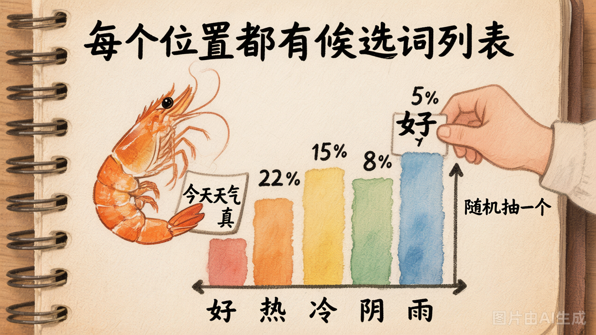
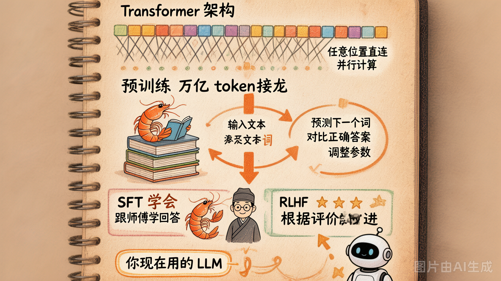
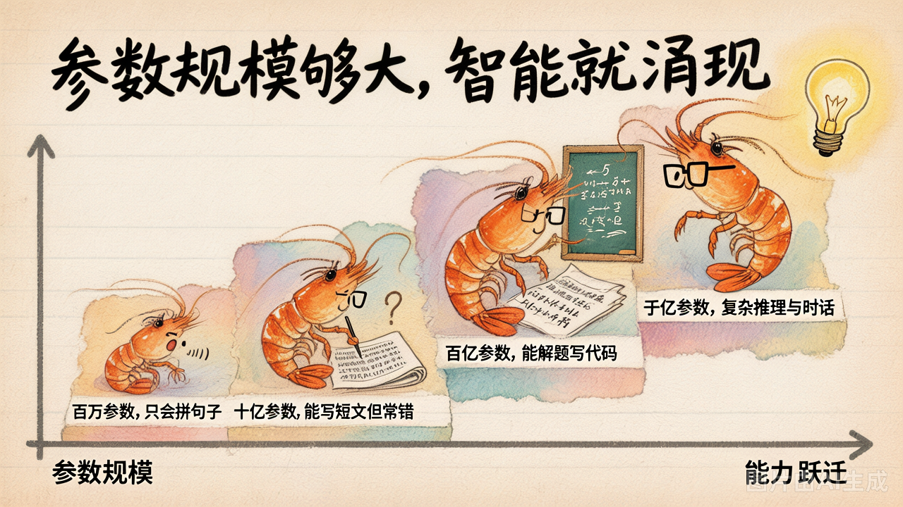

# 第 1 节 · LLM 为什么具备智能

## 一句话回答

> **LLM 的本质就一件事：给定前面一串 token，预测下一个 token 最可能是什么。**

它不是数据库，不会"查找"答案；它在做**概率采样**。

## Next-Token Prediction



先看一个直觉例子。假如输入是 `"今天天气真"`，模型内部会算出一张"下一个 token 的概率分布"：

```
"好"     → 35%
"热"     → 22%
"冷"     → 15%
"不错"   → 8%
"糟糕"   → 5%
......
```

然后从这个分布里**采样一个 token** 输出（比如选了"好"）。接着，把 `"今天天气真好"` 当成新的输入，再算下一个 token 的分布，再采样——如此循环，直到生成完毕。

### Temperature：控制"随机程度"的旋钮

采样时有一个关键参数叫 **temperature**（温度）。它决定了模型从概率分布里"怎么选"：

| temperature | 行为 | 适合场景 |
|-------------|------|---------|
| 0 | 永远选概率最高的那个（贪心） | 代码生成、事实问答 |
| 0.3 ~ 0.7 | 大概率选高分词，偶尔冒险 | 日常对话、写作 |
| 1.0+ | 更均匀地随机采样，输出更发散 | 头脑风暴、创意写作 |

> [!NOTE]
>
> `temperature` 是 `[0, 2]` 范围内的连续浮点数，上表只是三个**有代表性的档位**。`0.2`、`0.55`、`1.3` 等任意值都合法——比如 `0.2` 行为接近 0、但允许极小扰动，常用于代码生成场景。

直觉理解：temperature 越高，概率分布越"平坦"，低概率的词也有机会被选中；越低，分布越"尖锐"，高概率的词几乎必选。

这就是为什么：
- 同一个问题，每次回答可能不同——因为 `temperature > 0` 时它在**随机采样**
- `temperature = 0` 时每次输出一样——因为它总是贪心选概率最高的那个

你可以用 [`demo_01_next_token.py`](../lab/demo_01_next_token.py) 亲眼看到这个过程。


## 模型怎么学会"预测得准"



### 1. 架构：Transformer

LLM 的底层架构叫 **Transformer**。你不需要看懂数学，只需要知道它的核心能力：

> **Attention（注意力）机制**——在预测下一个 token 时，模型能"回头看"前面所有 token，并决定**重点关注哪些**。

比如预测"他把钥匙放在了___"的下一个词时，模型会重点关注"钥匙"和"放"，而不是句首的"他"。正是这个能力让 LLM 能处理几千甚至几十万 token 的长文本。

另一个关键优势：Transformer 在训练时能**并行处理**整段文本中所有位置的预测，而不需要从头到尾一个字一个字地算。这意味着可以用成千上万块 GPU 同时训练——这就是为什么模型能在合理时间内"读完"万亿 token 的数据。

### 2. 预训练（Pre-training）

训练分两步。第一步叫**预训练**，本质就是不断做"完形填空"：

```
┌─────────────────────────────────────────────────────────┐
│  训练语料: "今天天气真好，我去公园散步"                     │
│                        ↓ 遮住一个位置                     │
│  问题: "今天天气真___"                                    │
└───────────────────────────┬─────────────────────────────┘
                            ↓
┌───────────────────────────┴─────────────────────────────┐
│  模型回答: "不错" (12%)    正确答案: "好"                  │
│                                                          │
│           ❌ 猜错了！                                     │
└───────────────────────────┬─────────────────────────────┘
                            ↓
┌───────────────────────────┴─────────────────────────────┐
│  调整参数（拧旋钮）:                                       │
│     "好"   的概率:  12% ──→ 35%  ⬆️                      │
│     "不错" 的概率:  12% ──→  6%  ⬇️                      │
└───────────────────────────┬─────────────────────────────┘
                            ↓
                    下次答得更准！
                            ↓
              ┌─────────────────────────┐
              │  重复万亿次 → 模型学成   │
              └─────────────────────────┘
```

一句话总结：**出题 → 答题 → 对答案 → 调参数 → 下次答得更准**。

把这个过程在**万亿道题**上重复（题目来自整个互联网的文本、代码、书籍……），模型就"见多识广"了：

- 语法规律——知道中文句子该怎么接
- 世界知识——知道"地球围绕太阳转"
- 代码模式——看到 `def fibonacci(n):` 知道后面该写递归

但此时模型只是个"文本接龙机"——你问它问题，它可能继续编问题，而不是回答你。

### 3. 对齐：SFT + RLHF

第二步让模型**学会当助手**：

| 阶段 | 做什么 | 效果 |
|------|--------|------|
| **SFT**（监督微调） | 用"人类提问 → 优质回答"的示范数据继续训练 | 模型学会以对话格式回答 |
| **RLHF**（基于人类反馈的强化学习） | 人类对多个回答排序打分，模型学习"人类更喜欢哪种回答" | 回答更有帮助、更安全、更符合人类偏好 |

简单类比：预训练 = 读遍所有书，SFT = 实习跟着师傅学怎么回答，RLHF = 根据用户评价持续改进。

### 小结

```
Transformer 架构（能处理长上下文）
        ↓
预训练（万亿 token 上学"接龙"）
        ↓
SFT + RLHF（学会当助手）
        ↓
= 你现在用的 LLM
```

**本质上，"学知识"对模型来说就是"把概率分布调对"。**

## 涌现：规模够大时，智能"长出来"



一个令人惊讶的事实：小模型做不到的事，大模型突然能做了。

| 模型规模 | 典型行为 |
|---------|---------|
| 几百万参数 | 只能生成语法基本对的句子 |
| 几亿参数 | 能写短文，但事实经常错 |
| 几十亿参数 | 能解简单数学题、写正确的代码片段 |
| 几千亿参数 | 能做复杂推理、跟人深入对话、写长文档 |

这种"量变引发质变"的现象叫 **emergence（涌现）**。

为什么会涌现？说实话，至今没有完美解释——这是 AI 领域最活跃的研究问题之一。但工程上我们只需要知道一个公式：

> **next-token prediction + 海量数据 + 巨大规模 → 智能**

## 一个重要的类比

LLM 的学习过程，其实很像**一个小孩学说话**。

小孩子从没上过语文课，但通过听大人对话、看动画片、刷手机视频，慢慢就学会了说话。最开始是简单的词——"妈妈""要""不要"；然后是短句——"我要喝水"；再然后，突然有一天蹦出让你惊掉下巴的话：

> "无聊看电视，不无聊不看电视"
>
> "吃饭，吃零食，都得拉屎"

没人教过他这些句子——他是从海量的"语言输入"中，自己总结出了规律，然后**组合**出了从未听过的新句子。

LLM 也是一样：

| 小孩 | LLM |
|------|-----|
| 听大人说话、看动画片 | 读万亿 token 的文本 |
| 从没上过语文课 | 没人逐句教它"这样说才对" |
| 先学会简单词，再学会复杂句 | 参数越多，能力越强（涌现） |
| 偶尔说出惊人的新句子 | 能组合出训练数据里没有的回答 |
| 有时会胡说八道 | 有时会"幻觉"——编造不存在的事实 |
| 没出过家门，不知道外面的世界实时在发生什么 | 不知道训练截止日期之后的信息 |

这个类比解释了后面几节要讲的东西：
- 第 4 节"幻觉"：小孩胡说八道的部分
- 第 5 节"需要工具"：怎么让它获取"家门外"的实时信息

## 动手试试

运行 `demo_01_next_token.py`，你会看到：

- 同一个输入在"对话模式"和"续写模式"下，模型选择的 token 完全不同
- 简单常识题（"地球围绕"）→ 模型非常确信，几乎 100% 选同一个答案
- 不确定的题（"2026 年世界杯冠军是"）→ 模型犹豫，每次可能给出不同答案

## 小结

| 概念 | 一句话理解 |
|------|-----------|
| Next-token prediction | LLM 的全部秘密：预测下一个词 |
| 概率分布 | 每个位置都有一张候选词表，按概率排列 |
| 训练 | 在万亿 token 上反复"纠正概率分布" |
| 涌现 | 规模够大时，能力突然出现 |
| Temperature | 控制采样随机性：0=确定，高=随机 |

---

下一节：知道了 LLM 是个"概率预测机"，**怎么跟它对话**？→ 三种角色：system / user / assistant。
