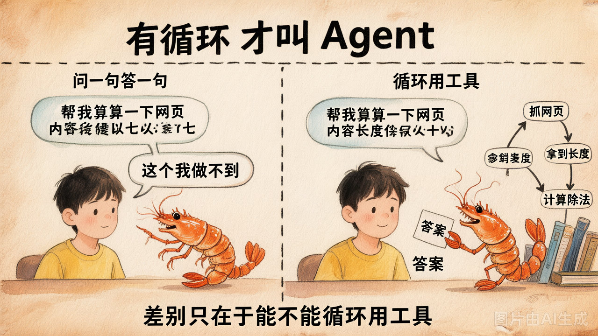
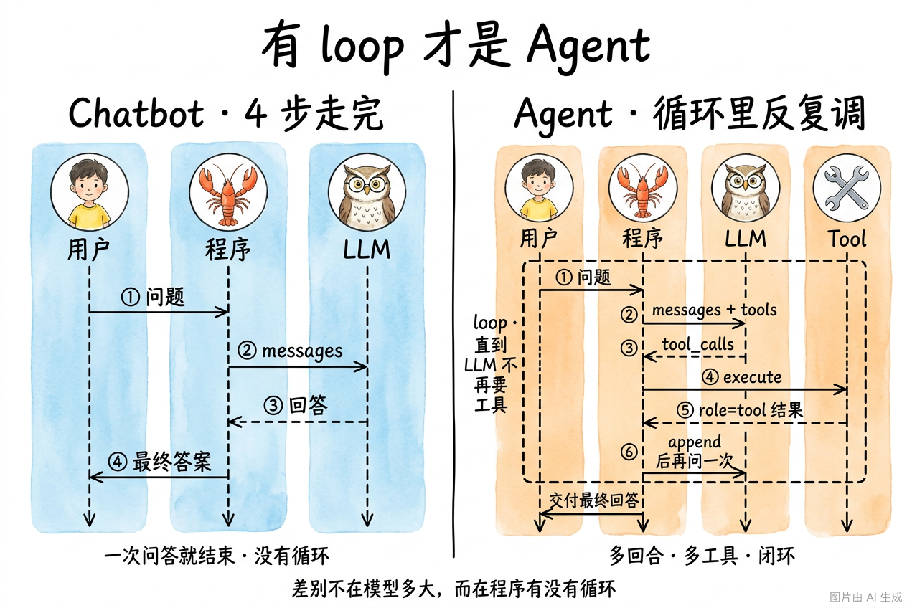

# 第 6 节 · Agent vs Chatbot：为什么需要循环

## 一句话回答

> **Chatbot 是"问一句答一句"的函数；Agent 是"在循环里反复调用 LLM + 工具，直到把活干完"的程序。**

差别不在"用了多大的模型"，而在**有没有循环**。



## 时序对比：信息流走过几个回合

上面那张概念图给你直觉。下面这张**时序图**把"几条消息、谁在等谁"一刀切开——
**Chatbot 永远只走 4 步，Agent 在中间多了一个 `loop`**。



注意两处关键差异：
- **Chatbot 的箭头永远只有 1 个来回**（步骤 ②③），不管模型多强、prompt 多复杂；
- **Agent 在 `loop` 框里同一个 LLM 可能被调 N 次**，每次 `messages` 都比上一次更长（因为追加了 `tool_calls` 和 `role=tool` 的工具结果）。

## 同一个问题，两种命运

> "请帮我抓取 https://example.com 的内容，告诉我它有多少字节，并把这个字节数除以 7。"

### Chatbot 视角

```python
resp = client.chat.completions.create(
    model=MODEL,
    messages=[{"role": "user", "content": question}],
)
print(resp.choices[0].message.content)
```

模型只能用它训练时见过的知识 + 自己脑补。结果两种典型反应：

1. 老实承认："我无法访问网络，请你贴上网页内容。"
2. 自信编造："`example.com` 大概有 1256 字节，1256 / 7 ≈ 179.43。"（数字是编的）

### Agent 视角

```python
while True:
    msg = llm.chat(messages, tools=tools)        # ① 调 LLM
    if not msg.tool_calls:                       # ② 不再要工具？
        return msg.content                       # ③ 结束
    for call in msg.tool_calls:                  # ④ 执行每个工具
        result = run_tool(call.name, call.args)
        messages.append(tool_result(call.id, result))
    # ⑤ 继续循环
```

跑出来是这样：

```
第 1 轮：LLM 说：调 fetch_url("https://example.com")
        工具返回：1256 字节
第 2 轮：LLM 说：调 calculator("1256 / 7")
        工具返回：179.43
第 3 轮：LLM 说：example.com 共 1256 字节，除以 7 ≈ 179.43
        ↑ 没有 tool_calls 了，结束
```

**同一个 LLM、同一道题，加了一个 `while` 循环 + 两个工具，命运完全不同。**

## Chatbot vs Agent 的工程差别

| 维度 | Chatbot | Agent |
|---|---|---|
| 主循环 | 没有 | 有 `while`，多轮反复调 LLM |
| 输入 | `messages: list` | `messages: list` + `tools: list[Schema]` |
| LLM 输出处理 | 直接 `.content` 显示 | 检查 `tool_calls` 字段，分两种走 |
| 外部世界 | 够不到 | 通过工具够得到 |
| 状态 | 上一轮回答 | 持续累积的 `messages`，含 `tool` 角色消息 |
| 可控性 | 完全靠 prompt | 靠 prompt + 工具集 + 循环边界 |

## 一个关键认知：Agent 不是"更聪明的模型"

最常见的误解：以为用了更强的模型，它就能更聪明地帮你干活了。

不是。模型再强，没有外层程序给它**循环 + 工具**，它也只是一个"问一句答一句"的 Chatbot。**Agent 是程序在驱动 LLM**，不是 LLM 自己在驱动程序。

业界近来用一个更形象的词来描述这层程序：**Harness**（马具）。大模型是马，Harness 是马具，马再神骏，没有缰绳和鞍具你也骑不稳。不管叫 Agent 框架还是 Harness，本质都在做同一件事：**控制大模型的输出**——决定什么时候让它思考、什么时候让它调工具、什么时候停下来交付结果。

```
Chatbot:    用户 -> [LLM] -> 用户
Agent:      用户 -> [程序{ LLM, 工具, 循环 }] -> 用户
                       ↑
                      这一层，我们要亲手写
```

后续会讲 Agent 的不同**思考范式**（ReAct / Plan-and-Solve / Reflection），都是在这个 `while` 循环里玩花样——**但循环本身不会变**。

## 历史插曲：为什么 2023 年这件事突然爆发

`while + LLM + 工具` 的想法早在 2022 年的 **ReAct 论文**（Yao et al.）就提出来了，但当时大家只能让模型**用 prompt 约定输出 "Action: xxx" 字符串**，再用正则去解析——非常脆弱（第3章会复盘这种写法）。

2023 年 6 月，OpenAI 推出 **Function Calling**，把"调工具"从 prompt 里搬到了**结构化字段** `tool_calls`，再也不用正则解析。从那天起：
- 写 Agent 的门槛骤降
- 工业级 Agent（Cursor / Claude Code / Devin）井喷

下一节我们就来看看这个 **Function Calling 协议**到底长什么样。

## 动手试试

运行 `demo_06_chatbot_vs_agent.py`，会看到同一道题的两种命运：

```bash
cd 03-tools-and-agent-loop/lab/demos
python demo_06_chatbot_vs_agent.py
```

注意观察"实验 ② Agent"输出里的轮次日志——这就是今天的核心：**循环**。

## 小结

| 概念 | 一句话理解 |
|------|-----------|
| Chatbot | 一次 LLM 调用 = 一次回答 |
| Agent | 多次 LLM 调用 + 工具调度 + 循环边界 |
| 关键拐点 | 2023 年 OpenAI Function Calling，把"调工具"做成协议 |
| 升级路径 | Chatbot + 工具调用 + while 循环 = Agent |

## 随堂练习

> 看完讲义和 demo，趁热把循环骨架自己敲一遍。本章三道练习连起来就是一个最小 Agent，本节先看入口：
>
> 🧪 [第 3 章练习题目录](https://cnb.cool/xidian/vibe-coding-learning/vibe-agent-course/-/tree/main/exercises/03-tools-and-agent-loop)

---

下一节：**Function Calling 协议**到底是什么样？4 种角色 / Tool Schema / 完整消息流，每一处都拆开看。
