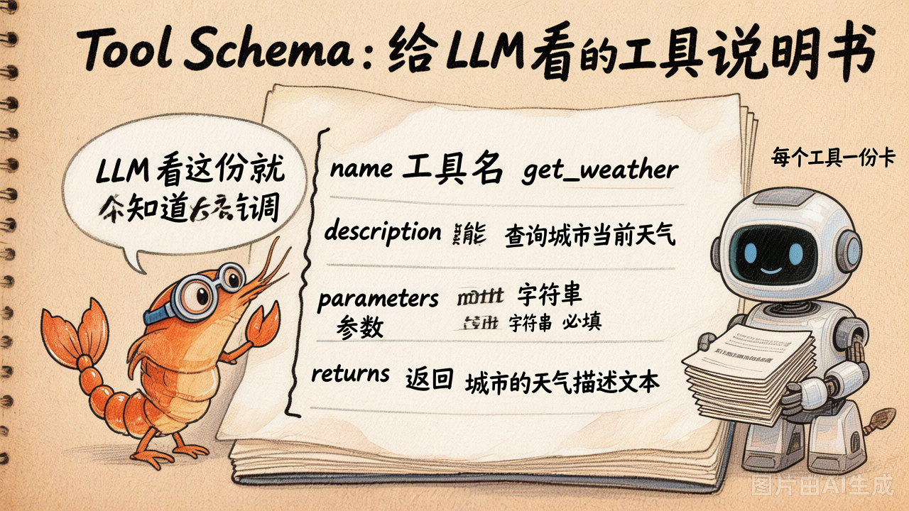
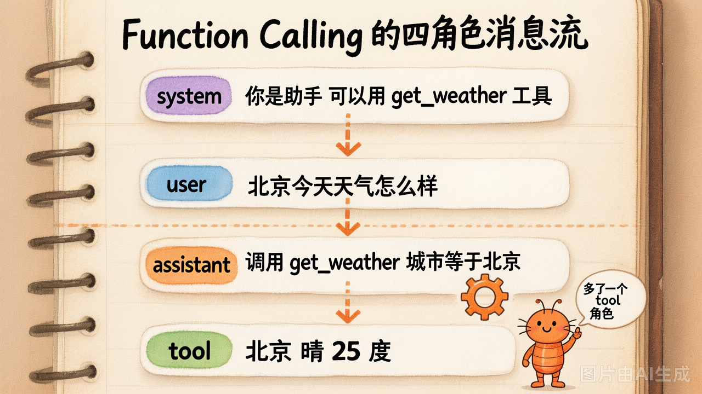

# 第 7 节 · Function Calling 协议：Tool Schema 与消息流

## 一句话回答

> **Function Calling 协议把"让 LLM 调工具"从"prompt 字符串约定"升级到了"OpenAI 官方结构化字段"——从此调工具不再靠正则。**

整个协议就两件东西要看懂：
1. **Tool Schema**：你怎么告诉 LLM "你有什么工具能用"
2. **4 种角色的消息流**：一次完整调用怎么在 `messages` 里来回交互

## Tool Schema：给 LLM 的工具说明书



每个工具要"上线"，必须先写一份**机器可读的说明书**。OpenAI 的标准格式长这样：

```python
{
    "type": "function",
    "function": {
        "name": "get_weather",                       # 工具名
        "description": "查询指定城市的当前天气",        # 干什么用的
        "parameters": {
            "type": "object",
            "properties": {
                "city": {
                    "type": "string",
                    "description": "城市名，例如 '北京'",
                }
            },
            "required": ["city"],
        },
    },
}
```

LLM 拿到这份 schema 之后就**学会了三件事**：
- 这个工具叫 `get_weather`
- 它能"查询城市当前天气"——所以遇到天气问题就该想到它
- 调它必须传一个字符串 `city`

> **重点**：LLM **看不到你函数体里的代码**。它只看 schema。所以
> **`description` 字段写得好不好直接决定模型用得对不对**。
> 一个常见错误：description 写得很简略 → 模型不会用 / 用错。

## Tool Schema 长在哪里？

调 LLM 时多传一个 `tools` 参数：

```python
resp = client.chat.completions.create(
    model=MODEL,
    messages=messages,
    tools=[ ... 上面那个 schema ... ],   # ← 这里
    tool_choice="auto",                  # 让模型自己决定要不要调
)
```

`tool_choice` 有 4 种取值：

| 取值 | 含义 |
|---|---|
| `"auto"`（默认） | 模型自己决定调不调 |
| `"none"` | 这次绝对不要调工具 |
| `"required"` | 这次至少调一个工具 |
| `{"type": "function", "function": {"name": "xx"}}` | 这次必须调 `xx` |

99% 场景用 `auto` 就够。

## 四种角色的消息流



第1章我们见过 3 种角色：`system` / `user` / `assistant`。
Function Calling 多了第 4 种：`tool`。

一次完整调用，`messages` 里至少有 **4 条**消息：

```
[1] system    "你是助手，可以用 get_weather 工具"
[2] user      "北京今天天气怎么样？"
[3] assistant content=None
              tool_calls=[ {id:"call_001", name:"get_weather", args:{"city":"北京"}} ]
[4] tool      tool_call_id="call_001"
              content="北京 晴 25°C"
```

然后再调一次 LLM，模型基于这 4 条消息生成最终回答：

```
[5] assistant "北京今天晴朗 25°C，建议短袖加薄外套。"
```

### 三个最容易踩的坑

**坑 1：assistant 的 content 可以是 None**

模型决定调工具时，`content` 经常是 `None` 或空字符串——真正的"指令"藏在 `tool_calls` 字段里。新手经常打印 `msg.content` 看到 `None` 就以为模型死了。

**坑 2：assistant 消息必须原样追加回 messages**

很多人调完 `tool_call` 后只把工具结果作为 `tool` 消息追加，忘了把 **assistant 那条带 `tool_calls` 的消息**也追加。结果第二次调用时模型看不到自己刚才"决定要调什么"，会重头来过。

**坑 3：tool 消息必须配 `tool_call_id`**

```python
{"role": "tool", "tool_call_id": "call_001", "content": "北京 晴 25°C"}
```

这个 `tool_call_id` 必须和上一条 assistant 里 `tool_calls[*].id` 严格对应，否则模型不知道哪个结果对应哪个调用——尤其当一次 assistant 消息里**同时有多个 tool_call**（并行工具调用）时尤其关键。

## 为什么是 `tool_calls` 列表，不是单数？

模型可以**一次返回多个 tool_call**，让你**并行执行**。例如：

```python
user: "帮我同时查北京、上海、深圳的天气"

assistant.tool_calls = [
    {id: "c1", name: "get_weather", args: {"city": "北京"}},
    {id: "c2", name: "get_weather", args: {"city": "上海"}},
    {id: "c3", name: "get_weather", args: {"city": "深圳"}},
]
```

你可以用 `asyncio.gather` 同时跑三个 HTTP 请求，每个结果用对应的 `tool_call_id` 追加成一条 `tool` 消息。

> 一开始你不需要用并行，但**写 Agent Loop 时就把 tool_calls 当成列表来处理**——后面想加并行只要换成 `asyncio.gather` 即可，不用大改结构。

## ReAct 老写法 vs Function Calling 新写法

时间线先讲清楚：**2022 年 ReAct 论文**（Yao et al.）就提出了"模型边想边调工具"的范式，但当时**没有** `tool_calls` 这种结构化字段——所有调用都得**塞进 prompt、再从 `res.content` 里抠出来**。

也就是说，那时候的"调工具"完全靠两件东西：
1. **Prompt 约定**：在 system 里强行规定模型必须按 `Thought: ... / Action: ... / Observation: ...` 这种格式输出。
2. **正则解析**：模型回完之后，你再用 `re.search()` 把 `Action: get_weather(city="北京")` 这一行抠出来。

来看一段当年典型的 `res.content` 长什么样：

```
Thought: 用户想知道北京天气，我应该调用 get_weather 工具，参数是 city="北京"。
Action: get_weather(city="北京")
```

对应的解析代码就是这种调调：

```python
import re

raw = resp.choices[0].message.content   # ← 注意：是 content，不是 tool_calls
m = re.search(r'Action:\s*(\w+)\((.*?)\)', raw)
if m:
    name, arg_str = m.group(1), m.group(2)
    # arg_str 形如：city="北京"
    args = dict(re.findall(r'(\w+)\s*=\s*"([^"]*)"', arg_str))
    result = run_tool(name, args)
    # 把 Observation 拼回 prompt，再调一次 LLM …
```

看着没问题？真跑起来你会发现**这条路 4 类崩法天天遇到**：

| 失败模式 | 模型可能输出的样子 | 为什么炸 |
|---|---|---|
| ① 模型多说一句 | `Action: get_weather(city="北京")\n这是因为...` | 正则贪婪/非贪婪写错就把后面那段也吞进 `args` |
| ② 参数里带引号/逗号 | `Action: search(query="hello, "world"")` | 嵌套引号、逗号让 `re.findall` 切错；想正确解析得上 AST |
| ③ 模型把 Action 换行 | `Action:\n  get_weather(\n    city="北京"\n  )` | 单行正则 miss；改成 `re.DOTALL` 又容易匹配过头 |
| ④ 流式截断在中间 | `Action: get_weather(city="北` | 流式输出还没收完就拿去解析，参数残缺 |

工程版 ReAct 一般要写**几百行 fallback** 才能勉强稳住——还要应付模型偶尔把 `Action:` 写成 `action:`、`Tool:`、`Use:` 各种中文化变体。"模型不规矩就崩"是 ReAct 时代的常态。

---

**2023 年 6 月 OpenAI 推出 Function Calling**，把这件事直接**搬出 prompt**：模型不再把"我要调谁"写在自然语言里，而是返回一个独立的、严格 JSON 化的 `tool_calls` 字段。

```python
# 旧（ReAct 风格，2022~2023 主流）
prompt = """
...请按以下格式输出:
Thought: ...
Action: tool_name(arg=value)
Observation: ...
"""
# 然后用正则解析模型输出，脆得一批 —— 见上表的 4 类炸法

# 新（Function Calling，2023 年 6 月起）
resp = client.chat.completions.create(
    messages=...,
    tools=[schema_a, schema_b, ...],
)
for tc in resp.choices[0].message.tool_calls:    # ← 结构化字段，没正则
    result = run_tool(tc.function.name, json.loads(tc.function.arguments))
```

**结构化字段 vs 自然语言+正则**——这就是行业拐点。从此调工具的脆弱性问题被 OpenAI 这一层协议从根上消除了，写 Agent 的门槛骤降，工业级 Coding Agent（Cursor / Claude Code / Devin）也是从这一刻才井喷的。

> 第 4 章我们讲 Agent 范式时还会再正面跑一次 ReAct 老写法的 demo，让你**亲手感受一次"模型不规矩就崩"**——你会很庆幸现在有 `tool_calls`。

## 动手试试

运行 `demo_07_function_calling_protocol.py`，它会**手工拼出**一次完整的 4 角色消息流，把每条消息打印出来给你看：

```bash
python demo_07_function_calling_protocol.py
```

观察重点：
- `assistant.content` 在调工具时是不是 `None`
- `tool_call_id` 怎么把 assistant 的 `tool_calls[*].id` 串到 tool 消息上
- 最终 messages 列表完整长什么样

## 小结

| 概念 | 一句话理解 |
|------|-----------|
| Tool Schema | 给 LLM 的"工具说明书"，name + description + parameters |
| `tools` 参数 | 调 LLM 时把 schema 列表传进去 |
| `tool_choice` | 控制本次要不要调工具，默认 `auto` |
| 4 种角色 | system / user / assistant / **tool**（新增） |
| `tool_calls` 字段 | 模型决定调工具时藏在 assistant 里的结构化字段 |
| `tool_call_id` | tool 消息怎么对应到上一条 assistant 的某个调用 |

## 随堂练习

> 协议看懂了，**只有自己拼一遍 messages 才算真懂**。这道题让你手搓一次 user → assistant(tool_calls) → tool(result) → assistant(final) 的完整 4 步消息流：
>
> 🧪 [练习 2.1 · 手搓 Function Calling 消息流](https://cnb.cool/xidian/vibe-coding-learning/vibe-agent-course/-/blob/main/exercises/03-tools-and-agent-loop/ex_2_1.py)

---

下一节：协议看懂了，但每加一个工具都要写 30 行 schema JSON 太烦——**`ToolRegistry`** 一行装饰器搞定。
