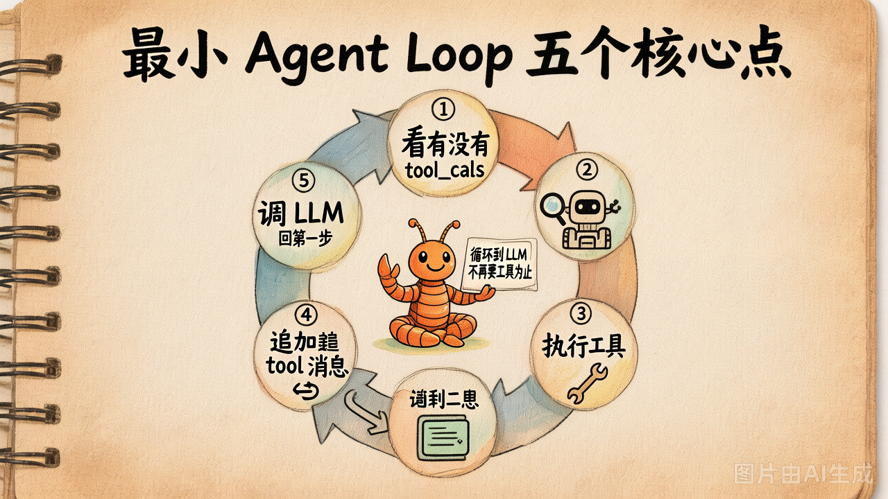

# 第 8 节 · 最小 Agent Loop 的 5 个核心点

## 一句话回答

> **Agent Loop 主体不超过 50 行，5 个步骤反复转：调 LLM → 看 tool_calls → 跑工具 → 拼回 messages → 回到第一步。**

今天最后一节，把第 7 / 8 节的零件拼成一个"能干真活"的最小 Agent。

## 核心循环长这样



```python
def run_agent(question: str, max_iters: int = 6) -> str:
    messages = [
        {"role": "system", "content": "你是助手。需要时调用工具。"},
        {"role": "user", "content": question},
    ]

    for turn in range(max_iters):
        # ① 调 LLM
        msg = client.chat.completions.create(
            model=MODEL,
            messages=messages,
            tools=registry.to_schemas(),
            tool_choice="auto",
        ).choices[0].message

        # ② 检查 tool_calls
        if not msg.tool_calls:
            return msg.content                  # ③ 没有 → 结束

        # ④ 执行每个工具，结果以 role=tool 追加
        messages.append(serialize_assistant(msg))
        for tc in msg.tool_calls:
            args = json.loads(tc.function.arguments)
            result = registry.invoke(tc.function.name, args)
            messages.append({
                "role": "tool",
                "tool_call_id": tc.id,
                "content": result,
            })
        # ⑤ 进入下一轮

    return "⚠️ 达到最大轮次"
```

就这 30 行。这就是 Cursor / Claude Code / Devin 每次干活时跑的同一个循环——**复杂的不是循环本身，是循环里要协调的工具集、上下文、UI**。

## 5 个核心点逐个拆

### 核心点 1：每轮都"全量"传 messages

```python
client.chat.completions.create(
    messages=messages,    # ← 注意是完整列表
    ...,
)
```

LLM 是无状态的（第1章第 2 节讲过）。每一轮你都要把**之前所有消息**都传回去：

```
第 1 轮 messages: [system, user]
第 2 轮 messages: [system, user, assistant(tool_calls), tool]
第 3 轮 messages: [system, user, assistant(tool_calls), tool, assistant(tool_calls), tool]
...
```

这就是为什么 **第4章必须做上下文管理**——不然 messages 列表会无限膨胀。

### 核心点 2：用 `tool_calls` 当循环的"红绿灯"

这是循环退出的**唯一**判据：

```python
if not msg.tool_calls:
    return msg.content
```

不要看 `content` 里有没有"完成"两个字，**只看 `tool_calls` 是不是空**。这是协议保证的：模型决定不再调工具时，`tool_calls` 一定是空。

### 核心点 3：assistant 消息必须原样追加

```python
messages.append({
    "role": "assistant",
    "content": msg.content,                # 通常是 None
    "tool_calls": [
        {
            "id": tc.id,
            "type": "function",
            "function": {
                "name": tc.function.name,
                "arguments": tc.function.arguments,
            },
        }
        for tc in msg.tool_calls
    ],
})
```

漏了这条，下一轮模型就看不到自己刚刚"决定调什么"——会原地踏步重新决策。**99% 的"Agent 跑飞了"都是因为忘了这条**。

### 核心点 4：tool 消息必须配 `tool_call_id`

```python
{"role": "tool", "tool_call_id": tc.id, "content": result}
```

`tool_call_id` 必须和 assistant.tool_calls[*].id 严格一对一，让模型知道**这个结果是哪个调用的**。一次有多个工具时尤其关键。

### 核心点 5：永远要有"刹车"


```python
for turn in range(max_iters):     # ← 上限是必须的
    ...
return "⚠️ 达到最大轮次"
```

为什么？三种典型死循环：

1. **模型卡 bug**：返回 tool_call → 工具失败 → 模型再调一遍 → 再失败 → ……
2. **工具报错没兜底**：工具崩了把 exception 抛出来，循环挂了
3. **模型反复调 tool**：自己也意识不到信息已经够了

**最低限度的三道刹车：**

| 刹车 | 长什么样 |
|---|---|
| 最大轮次 | `for turn in range(max_iters):` |
| 工具异常兜底 | `try/except` 把错误转成字符串塞回 messages |
| 同一工具同样参数连续调用 N 次就停 | 进阶：基于历史去重 |

第 1 / 2 个本章必须有，第 3 个第3章 / 第6章再加。

## 跟 demo_05 的"hand-rolled 版"对比

第1章末尾的那种"让模型输出 JSON 再 parse"的写法（demo_05 也演示了），跟本章的 `tool_calls` 写法对比：

| 维度 | hand-rolled JSON | OpenAI tool_calls |
|---|---|---|
| 模型输出格式约定 | 写在 system prompt 里 | 协议保证 |
| 解析失败 | 经常（模型多说一句就崩） | 几乎不会 |
| 多工具并行 | 自己手写解析 | 协议原生支持 |
| 工业标准 | 没有 | OpenAI / Anthropic / Google 都兼容 |

> 但 hand-rolled 那种写法**不是没用**——第3章 ReAct 范式还是得这么写，演示给你看为什么"输出格式靠 prompt 约定"是 Function Calling 出来之前的老 paradigm。

## 还有什么不在循环里？

今天我们刻意**不**做的事：

| 不做的事 | 何时做 |
|---|---|
| 上下文压缩（messages 太长怎么办） | 第4章 |
| Memory（跨会话持久化） | 第4章 |
| 多 Agent 协作 / 思考范式 | 第3章 |
| Coding 专用工具集（read/write/edit/grep） | 第5章 |
| REPL / 流式输出 / 漂亮的终端 UI | 第6章 |
| Skills 系统 | 第7章 |

**今天只做循环。**这是 Agent 的骨架，先有骨架，剩下 6 天再往上长肉。

> 顺带一提：循环本身已经定型，但「工具从哪来、怎么打包、怎么喂私有知识」这三件事是 Tool Calling 协议本身管不了的——下一节我们做一次 **MCP / Skill / RAG** 鸟瞰，让你知道这条主干还能往外接哪三条延长线。

## 动手试试

运行 `demo_08_mini_agent.py`：

```bash
python demo_08_mini_agent.py
```

它会跑 4 个测试任务：
1. **现在几点？** —— 单工具一轮就完
2. **17 × 23 = ?** —— 单工具
3. **抓 example.com 长度除以 7** —— 串联两个工具，两轮
4. **2099 年世界杯冠军是谁？** —— 没合适工具，模型应该承认不知道

观察 4 号任务里 Agent 的反应：理想情况是承认不知道；常见错误是"硬调"某个工具。这个失败 case 是今天 Checkpoint 必须交的内容之一。

## 小结

| 概念 | 一句话理解 |
|------|-----------|
| Agent Loop 5 步 | 调 LLM → 看 tool_calls → 跑工具 → 拼回 messages → 回到第一步 |
| 退出条件 | 唯一判据：`tool_calls` 是否为空 |
| 必须追加的两条 | assistant(含 tool_calls) + tool(配 tool_call_id) |
| 必须的刹车 | 最大轮次 + 工具异常兜底 |
| 今天不做 | 上下文管理 / 记忆 / 范式 / Coding 工具集 / UI |

## 随堂练习

> Agent Loop 的 5 步全靠一个 `while` 串起来。这道题让你把循环骨架敲出来：有 `tool_calls` 就跑工具、回传结果；没有就退出。**循环终止条件别写错**：
>
> 🧪 [练习 2.3 · 最小 Agent Loop](https://cnb.cool/xidian/vibe-coding-learning/vibe-agent-course/-/blob/main/exercises/02-tools-and-agent-loop/ex_2_3.py)

---

理论部分还差一节鸟瞰图：[第 9 节《Tool Calling 扩展面》](./09-tool-calling-extensions.md) 把 MCP / Skill / RAG 在循环里的位置交代清楚。看完之后再**进 lab**：part1 自己实现一个 ToolRegistry，part2 把循环搭起来 + 接 3 个工具。
