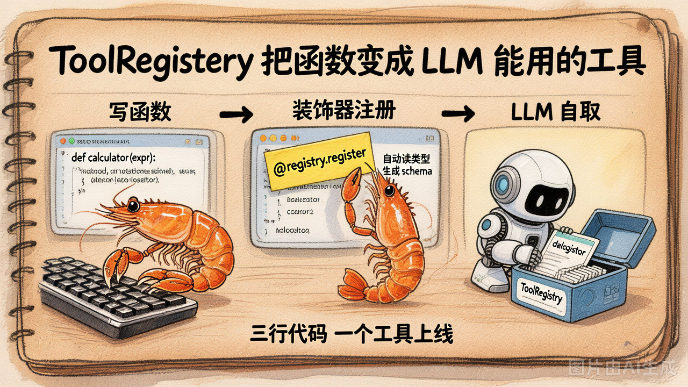

# 第 8 节 · ToolRegistry：让加工具像加函数一样简单

## 一句话回答

> **`ToolRegistry` 是一个"装饰器 + 反射"的小工具，让你写一个普通 Python 函数 → 自动成为 LLM 能调用的工具。**

它不是魔法，是把第 7 节那 30 行 schema JSON **从手写挪到了自动生成**。

## 没有 ToolRegistry 时的痛

回到第 7 节：每加一个工具，你都要写两份东西。

```python
# 1. 函数本体
def get_weather(city: str) -> str:
    return f"{city} 晴 25°C"

# 2. 一份 30 行的 schema（重复信息）
{
    "type": "function",
    "function": {
        "name": "get_weather",                   # ← 函数名重复一次
        "description": "查询指定城市的当前天气",
        "parameters": {
            "type": "object",
            "properties": {
                "city": {                         # ← 参数名重复一次
                    "type": "string",             # ← 参数类型重复一次
                    "description": "城市名",
                }
            },
            "required": ["city"],                # ← required 重复一次
        },
    },
}
```

工具一多，**重复代码爆炸**：参数名、参数类型、required 列表，每加一个工具都要在两个地方写一遍。一旦改了函数签名忘了改 schema，模型就调错。

## ToolRegistry 长什么样



```python
registry = ToolRegistry()

@registry.tool("查询指定城市的当前天气")
def get_weather(city: str) -> str:
    return f"{city} 晴 25°C"
```

**就这两行**。`name` / `parameters` / `required` 全部从函数签名自动读出来。

调 LLM 时：

```python
resp = client.chat.completions.create(
    model=MODEL,
    messages=messages,
    tools=registry.to_schemas(),    # ← 自动生成所有 schema
)

for tc in resp.choices[0].message.tool_calls:
    args = json.loads(tc.function.arguments)
    result = registry.invoke(tc.function.name, args)   # ← 自动调度
```

## 它是怎么"自动"的：`inspect`

ToolRegistry 用 `inspect.signature()` 读函数签名，把它翻译成 OpenAI schema：

```python
import inspect

def get_weather(city: str) -> str:
    ...

sig = inspect.signature(get_weather)
for pname, param in sig.parameters.items():
    print(pname, param.annotation, param.default)

# city <class 'str'> <Parameter.empty>
```

把这些信息翻译成 schema 就行：

| 函数签名 | OpenAI schema |
|---|---|
| `city: str` | `properties.city.type = "string"` |
| `count: int` | `properties.count.type = "integer"` |
| `score: float = 0.5` | `properties.score.type = "number"`，**不在 required 里**（有默认值） |
| `flag: bool` | `properties.flag.type = "boolean"` |

## 极简实现：80 行以内

```python
import inspect
from typing import Any, Callable

class ToolRegistry:
    _TYPE_MAP = {
        str: "string", int: "integer", float: "number",
        bool: "boolean", list: "array", dict: "object",
    }

    def __init__(self) -> None:
        self._funcs: dict[str, Callable] = {}
        self._descs: dict[str, str] = {}

    # ① 装饰器：注册函数
    def tool(self, description: str):
        def deco(func):
            self._funcs[func.__name__] = func
            self._descs[func.__name__] = description
            return func
        return deco

    # ② 自动生成 schema 列表
    def to_schemas(self) -> list[dict]:
        out = []
        for name, func in self._funcs.items():
            sig = inspect.signature(func)
            properties, required = {}, []
            for pname, p in sig.parameters.items():
                properties[pname] = {
                    "type": self._TYPE_MAP.get(p.annotation, "string"),
                    "description": f"参数 {pname}",
                }
                if p.default is inspect.Parameter.empty:
                    required.append(pname)
            out.append({
                "type": "function",
                "function": {
                    "name": name,
                    "description": self._descs[name],
                    "parameters": {
                        "type": "object",
                        "properties": properties,
                        "required": required,
                    },
                },
            })
        return out

    # ③ 按工具名调度
    def invoke(self, name: str, args: dict[str, Any]) -> str:
        if name not in self._funcs:
            return f"未知工具: {name}"
        try:
            return str(self._funcs[name](**args))
        except Exception as e:
            return f"工具 {name} 执行出错: {e}"
```

够你本章用了。第5章我们会把它再扩展（异步执行 / 参数校验 / 工具集分组），但现在**不需要**。

## 设计上的几个取舍

### 取舍 1：description 必填，不读 docstring

很多框架会去解析 docstring 自动当 description。我们今天**故意**让 description 写在装饰器里：

```python
@registry.tool("查询指定城市的当前天气")    # ← 显式写
def get_weather(city: str) -> str:
    """获取天气。"""                       # ← 不读这个
```

为什么？因为 docstring 经常写得"对人类讲"，而 LLM 看的 description 经常需要更**面向调用决策**（"什么时候该用我"）。强制显式写一份给 LLM 看，避免歧义。

### 取舍 2：所有工具返回 `str`

```python
def calculator(expr: str) -> str:
    return str(eval(expr))    # ← 强转字符串
```

为什么？因为 `tool` 消息的 `content` 字段就是字符串。返回 `dict` / `int` 你最后还得 `json.dumps`。统一约定为 `str`，调用方少踩一个坑。

### 取舍 3：异常被捕获、转成字符串返回

```python
def invoke(self, name, args):
    try:
        return str(self._funcs[name](**args))
    except Exception as e:
        return f"工具 {name} 执行出错: {e}"
```

为什么？因为**工具失败不应该让整个 Agent 崩**。把错误转成字符串塞回 messages，**让模型自己看到错误，自己决定下一步**（重试 / 换参数 / 放弃）。

> 这是 Coding Agent 健壮性的关键 design——你会在第5章工具集和第6章整合里反复看到。

## 一些可能的扩展（今天不做）

- 参数 enum：`city: Literal["北京", "上海"]` → schema 自动生成 enum
- 异步工具：`async def` 函数 → `await registry.ainvoke(...)`
- 工具命名空间：`@registry.tool("...", group="git")`
- pydantic 模型作为参数类型，自动生成嵌套 schema

这些**不是本章必须**的。第5章 / 第6章在真做 Coding Agent 时再加。

## 动手试试

运行 `demo_08_tool_registry.py`：

```bash
python demo_08_tool_registry.py
```

它会：
1. 注册 3 个工具
2. **打印自动生成的 schemas**——你能看到 inspect 推出来的类型对不对
3. 跟 LLM 跑一次完整 function calling，让模型同时调三个工具

## 小结

| 概念 | 一句话理解 |
|------|-----------|
| ToolRegistry | "装饰器 + 反射"做出来的工具注册表 |
| `@registry.tool(desc)` | 一行注册一个工具 |
| `to_schemas()` | 自动从函数签名生成 OpenAI schema |
| `invoke(name, args)` | 按名分发执行，异常自动捕获返回字符串 |
| 关键设计 | description 必填 / 工具返回 str / 异常不上抛 |

---

下一节：注册表有了，怎么把它放进**循环**里跑起来——**最小 Agent Loop 的 5 个核心点**。
