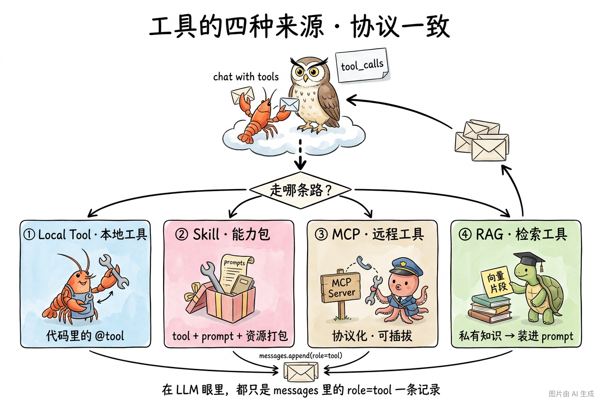

# 第 10 节 · Tool Calling 的三个扩展面：MCP / Skill / RAG

## 一句话回答

> **Tool Calling 协议本身只解决了"模型怎么决定调谁"，没解决"工具从哪来、怎么打包、怎么喂数据"——这三个问题分别催生了 MCP、Skill、RAG。**

第 7-9 节我们看完了"调工具"这一刀的内部解剖。但工业级 Agent 真正要解决的，是这一刀**外部**的三条延长线：

1. **工具从哪来？**——不可能每个 Agent 都自己写一遍 git/db/搜索，于是有了 **MCP**（工具协议化、可插拔）。
2. **工具怎么和能力打包成一个"技能"？**——工具单独存在还不够，复杂任务往往是 `工具 + prompt + 资源文件` 的组合，于是有了 **Skill**。
3. **工具喂给模型的是什么数据？**——除了实时调外部 API，还有"把私有知识查出来塞进 prompt"的需求，于是有了 **RAG**。

它们都不是替代 Tool Calling，而是**站在 Tool Calling 的肩膀上**，解决"协议本身没管的事"。本节做一次预告式的鸟瞰，让你在后面 5 章看到这些概念时不陌生。

## 三个方向并列看

### 方向 1：MCP — 工具协议化

**Model Context Protocol**，Anthropic 2024 年底放出来的开放协议。一句话：**把"工具"从 Agent 进程里拆出来，变成一个可远程连接的标准化服务**。

```
传统：Agent 进程内手写 N 个 @tool 函数
        ↓
MCP ：Agent 进程  ←→  MCP Server（独立进程/远程服务，暴露工具列表）
                  ←→  MCP Server （另一个，暴露另一组工具）
```

为什么这件事重要？回想第 8 节我们手写的 `ToolRegistry`——所有工具都得**写死**在你 Agent 仓库里。如果想接 GitHub、Slack、Notion 三个外部系统，你要：

- 自己读三家 API 文档；
- 自己写三套 schema；
- 三家 API 升级你都要跟着改。

MCP 把这件事**反过来**：GitHub / Slack / Notion 各自跑一个 MCP Server，**它们自己**声明"我有哪些工具、参数是什么"。Agent 这边只需一个 MCP 客户端，连过去就能用。`tool_calls` 协议本身一字不变，**只是工具的实现方从"我自己写"变成了"远程拉取"**。

> 课程里你不会自己实现 MCP Server，但第 8 章接 NPC 时会看到这种"工具从外部加载"的思路。

### 方向 2：Skill — 工具 + 提示词 + 资源的打包

Anthropic 2025 年提出 **Agent Skill** 概念。它解决的问题是：**只有 `tool_calls` 远远不够**——一个真实的"会做某件事"的能力，往往需要：

1. **几个工具**（比如读 PDF、写 docx）；
2. **一段 prompt**（教模型在什么场景下调这些工具、什么顺序、参数怎么填）；
3. **一些资源文件**（模板、样例、字典）。

Skill 就是把这三样东西**打包到一个目录**：

```
skills/
└── pdf-fill/
    ├── SKILL.md          # 触发条件 + 调用约定（喂给 system prompt）
    ├── tools/            # 该 Skill 专属工具
    └── assets/           # 模板、样例
```

模型在 system prompt 里看到 `SKILL.md` 的描述，决定"这个任务用 pdf-fill Skill"——之后 Skill 内部的工具与资源就被激活。**Skill 是 Tool Calling 的"批发包装"**：单个工具是零售，Skill 是把工具+知识打包成一个"专家模块"。

> 第 8 章会专门讲怎么写 `SKILL.md` 并挂上你的 Coding Agent。

### 方向 3：RAG — 把"知识查询"伪装成一个工具

**Retrieval-Augmented Generation**：先用向量检索从私有知识库捞 top-k 段落，再把这些段落塞进 prompt，让模型基于这些内容回答。

注意一个事实：**RAG 在 Agent 里通常以"一个工具"的形态存在**。

```python
@registry.tool("从公司内部知识库检索相关段落")
def search_kb(query: str, top_k: int = 5) -> str:
    vectors = embed(query)
    docs = vector_db.query(vectors, top_k=top_k)
    return "\n\n".join(d.content for d in docs)
```

模型决定"我不知道 → 调 `search_kb`"，跟它决定"我不知道时间 → 调 `now()`"是**完全一样的协议**。区别只是 `search_kb` 内部多了一层向量数据库。

所以**学完 Tool Calling 你已经掌握了 RAG 的"接入面"**——剩下的就是把"向量检索"这个零件做出来。这正是第 5 章 Memory 节要做的事。

> 第 5 章 Memory 会让你**亲手实现一个最简向量记忆**，本质上就是一个 RAG 工具。

## 工具的四种来源 · 协议一致

回到第 9 节的最小循环，再把今天的三条延长线（再加上你已经学过的"本地 @tool"）贴上去——**LLM 视角里它们长得一模一样**：



读这张图记住三点：

- **四种来源、一份协议**——Local @tool / Skill / MCP / RAG，最终都变成 `messages` 里一条 `role=tool` 的记录回喂给 LLM。LLM 不知道、也不关心工具实际来自哪儿。
- **Skill 站位略特殊**——它本身不是单个工具，而是"工具 + prompt + 资源"的打包容器：在 system prompt 阶段被注入说明，激活后内部的工具同样走标准 `tool_calls` 流程。所以图里把它和另外三种并排画，意思是"它也是工具的一种**来源**"，而不是"它本身就是一个工具"。
- **核心循环 5 步没动一根毛**——第 9 节的 30 行循环骨架，足够托起 MCP / Skill / RAG 这三条延长线。这就是为什么"Tool Calling 协议是行业拐点"。

## 接下来去哪

| 这条延长线 | 在哪一章亲手做 |
|---|---|
| Skill 打包与挂载 | 第 8 章《Skills 扩展 + NPC》33-skills.md |
| RAG / 向量记忆 | 第 5 章《上下文与记忆》20-memory-types.md |
| MCP（仅概念，不亲手实现 Server） | 第 8 章 NPC 部署时再提及 |
| 真实 Coding Agent 的工具集 | 第 6 章《Coding Agent 工具集》—— 5 个核心工具 read/write/edit/list_dir/bash |

## 小结

| 问题 | 协议本身管不了，靠谁补？ |
|---|---|
| 工具从哪来 | **MCP** —— 工具协议化、远程加载 |
| 工具怎么打包成"专家能力" | **Skill** —— 工具+prompt+资源一起发版 |
| 工具如何喂私有知识 | **RAG** —— 检索结果当作工具返回值 |
| 模型怎么决定调谁、怎么收回结果 | **Tool Calling**（已学完） |

**Tool Calling 是地基；MCP / Skill / RAG 是地基上盖的三栋楼。**地基稳了，盖楼就是工程问题。

## 随堂练习

> 第 3 章理论到此结束。回头把三道练习从头串一遍——**协议 → 注册表 → 循环**——你就拥有一个能跑起来的最小 Agent：
>
> 🧪 [第 3 章练习题目录](https://cnb.cool/xidian/vibe-coding-learning/vibe-agent-course/-/tree/main/exercises/03-tools-and-agent-loop)
> - 练习 2.1 · 手搓 Function Calling 消息流
> - 练习 2.2 · ToolRegistry 注册与调用
> - 练习 2.3 · 最小 Agent Loop

---

第 3 章理论部分到此真正结束。下一章我们换个视角：模型决定调工具时**怎么"想"**——ReAct、Plan-and-Solve、Reflection 三种 Agent 范式。
