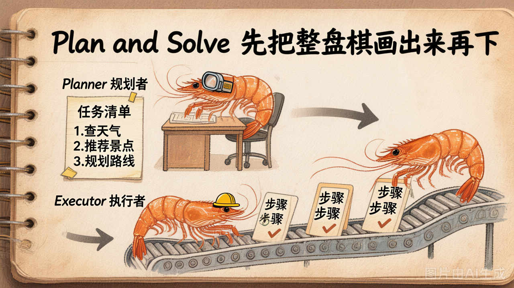
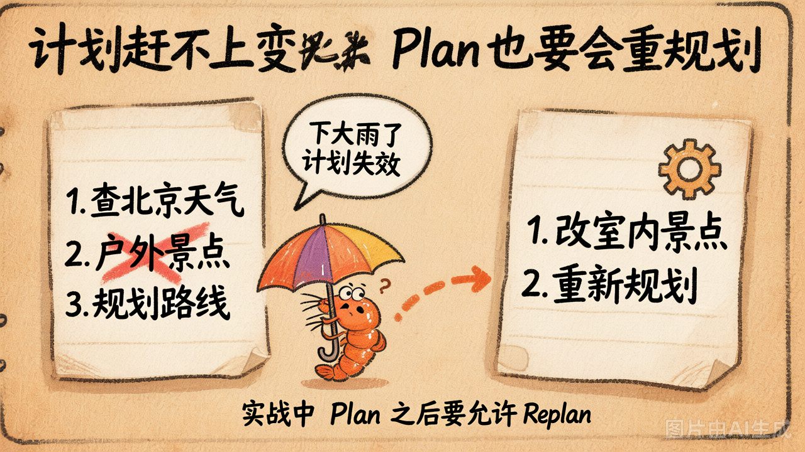

# 第 11 节 · Plan-and-Solve：先规划再执行

## 一句话回答

> **Plan-and-Solve 把"思考"和"行动"切成两个阶段：先让 LLM 把任务拆成一个有序步骤列表，再逐步执行。**

跟 ReAct 反过来——ReAct 是走一步看一步，Plan-and-Solve 是**先在脑里把整盘棋画出来，再开始下**。

## 三段架构



```
用户问题
   │
   ▼
┌──────────┐    步骤列表
│ Planner  │ ───────────► [
└──────────┘              "查北京天气",
   │                      "推荐景点",
   │                      "汇总输出",
   │                    ]
   ▼
┌──────────┐
│ Executor │  ── 步骤 1 ──► 调工具 ──► 结果 1
│          │  ── 步骤 2 ──► 调工具 ──► 结果 2
│          │  ── 步骤 3 ──► 调工具 ──► 结果 3
└──────────┘
   │
   ▼
┌──────────┐
│Aggregator│ ──► 最终答案
└──────────┘
```

3 个角色：
- **Planner**：一次 LLM 调用，输出一个步骤数组（通常要求 JSON 格式）
- **Executor**：每个步骤一次小循环（可以复用第2章的最小 Agent Loop）
- **Aggregator**：一次 LLM 调用，把所有步骤结果汇总成最终答案

## 跟 ReAct 的核心区别

| 维度 | ReAct | Plan-and-Solve |
|---|---|---|
| 决策时机 | 每一步看了 Observation 再决定 | 一开始就把所有步骤定了 |
| 灵活度 | 高（随机应变） | 低（按计划走） |
| token 消耗 | 步多 = token 多 | 一次规划 + 多次小执行 |
| 适用任务 | 信息收集型（不知道下一步要查什么） | 流程明确型（知道大致要做哪几步） |
| 失败时 | 自然在循环里换路 | 计划错了就废了 |

## Planner 的关键：让 LLM 输出**结构化**步骤

最容易翻车的点：**Planner 输出的不是结构化数据**。

```python
# 错误的 Planner prompt
"请帮用户拆解这个问题，告诉我要做几步"

# 模型可能输出
"我觉得这个问题可以分三步：第一步查天气，然后..."
# ↑ 你怎么 parse？
```

正确做法：**强约束 JSON 数组**：

```python
PLANNER_PROMPT = """...
严格输出 JSON 数组，每项一个字符串描述子任务。
不要任何其他文字。

输出："""
```

但即使这样，模型还是可能：
- 用 ` ```json ... ``` ` 包裹（要剥掉）
- 在数组前后多写一段（要找到 `[` 和 `]`）
- 输出对象而不是数组（要做容错）

工程版本通常用 `pydantic + structured output` 或 OpenAI 的 `response_format={"type": "json_object"}`，今天的 demo 用最朴素的"找 `[` 找 `]` 然后 json.loads"。

## 计划赶不上变化：Replan



Planner 在最开始就拍板了所有步骤——但执行中发现实际情况跟规划不符怎么办？

**例子**：
- 计划：1. 查北京天气 → 2. 推荐户外景点 → 3. 输出
- 实际：第 1 步查到"今天大雨" → 第 2 步还按"户外景点"执行就没意义了

**两种应对：**

1. **静态 Plan-and-Solve**（今天 demo 的做法）：每个步骤的 Executor 拿到上一步结果作为 context。Executor 自己有一定的"应变能力"——比如 Executor 看到"大雨"会自动改推荐室内景点。
2. **动态 Replan**（更工业的做法）：执行中发现失败 / 关键假设变了 → **回到 Planner 重新规划**。Devin 这样的产品就在大量用这个范式。

今天为简化只做静态版。

## Plan-and-Solve 适合什么任务？

**适合：**
- 步骤多但流程明确（如"分别查 A/B/C 三家公司的财报，汇总对比"）
- 步骤之间**弱依赖**——后一步不太依赖前一步的具体结果
- token 预算有限——比 ReAct 省

**不适合：**
- 信息收集型（"查一下这个 bug 是怎么造成的"——你根本不知道要拆几步）
- 步骤之间**强依赖**——前一步结果决定后一步该不该做

## 一种常见的混合架构

工业里**经常**这样组合：

```
Planner 拆任务
   │
   ▼
对每个子任务：
   - 如果能用工具直接搞定 → 用 Function Calling 一发即中
   - 如果是"探索性"的 → 在子任务内部跑一个 ReAct 小循环
```

这就是 Devin 之类产品的"双层架构"——Plan-and-Solve 在外层做 macro 规划，ReAct 在内层做 micro 探索。

## 动手试试

```bash
python demo_11_plan_and_solve.py
```

跑 5 个测试任务，观察：

1. **每个任务 Planner 拆出了几步？** 任务 1（"查天气推荐景点"）和任务 2（"算三个商品总价"）拆出来的形态会很不同
2. **Executor 第 i 步用到 i-1 步的结果了吗？** 看 system prompt 是怎么把前序结果传给当前步的
3. **任务 5（"2099 年世界杯"）** 的 Planner 会拆出哪些步骤？这种问题它本来就拆不出"能干的活"

## 小结

| 概念 | 一句话理解 |
|------|-----------|
| Plan-and-Solve | Planner → Executor → Aggregator 三段流水线 |
| 跟 ReAct 比 | 先规划再执行 vs 走一步看一步 |
| Planner 的关键 | 让模型输出**结构化** JSON 数组 |
| 痛点 | 计划错了就废了，工业版要做 Replan |
| 适合 | 步骤多但流程明确 / token 预算紧的任务 |

## 随堂练习

> Planner 写得好不好，看它能不能**稳定输出 JSON 数组**。这道题让你把"复杂问题 → 有序步骤列表"这一环节落到代码上：
>
> 🧪 [练习 3.2 · Plan-and-Solve 的 Planner](https://cnb.cool/xidian/vibe-coding-learning/vibe-agent-course/-/blob/main/exercises/03-agent-patterns/ex_3_2.py)

---

下一节：ReAct 和 Plan-and-Solve 都是"一次性"给答案。如果让模型**自己回头检查一遍**，会不会更准？→ Reflection。
