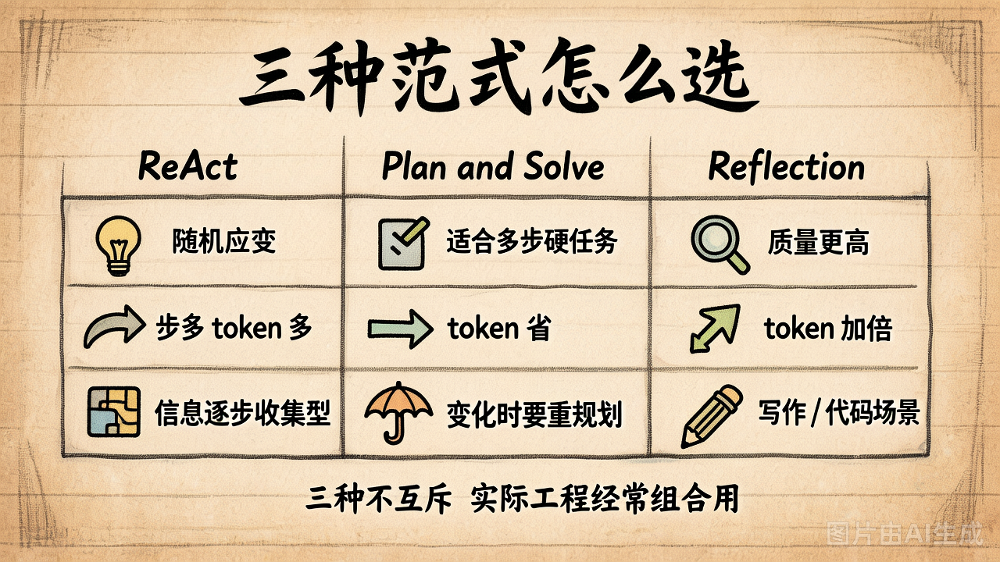

# 第 14 节 · Reflection：让 Agent 自我反思与修正

## 一句话回答

> **Reflection 不是新的 Agent，是一个"包装层"——在底层 Agent 给出答案后，让同一个模型扮演评审员挑刺，再让原 Agent 拿着批注重写。**

它的核心命题：**起草 → 审阅 → 修订**——跟你写论文写代码的过程一样。

## 三段流程


```
                ┌──────────────┐
   用户问题 ──► │ 底层 Agent   │ ──► 草稿答案
                └──────────────┘            │
                                            ▼
                                   ┌──────────────┐
                                   │ 评审员 LLM   │
                                   │（同一个模型 │
                                   │  换个 prompt）│
                                   └──────┬───────┘
                                          │
                          ┌───────────────┴───────────────┐
                          ▼                               ▼
                       PASS ──► 提交答案         NEEDS_REVISION
                                                          │
                                                          ▼
                                               ┌──────────────┐
                                               │ 原 Agent     │
                                               │ + 评审意见   │ ──► 修订版
                                               └──────────────┘
                                                          │
                                                          ▼
                                                    回到评审员
```

## "包装层"是什么意思

Reflection 的代码主体只有 30 行，因为它**不改底层**：

```python
def run_with_reflection(question, max_rounds=2):
    answer = run_base_agent(question)        # ① 底层 Agent 起草
    for _ in range(max_rounds):
        passed, feedback = review(question, answer)   # ② 评审
        if passed:
            return answer
        answer = refine(question, answer, feedback)   # ③ 修订
    return answer
```

**底层 Agent 可以是：**
- Day2 的最小 Agent Loop
- demo_12 的 ReAct
- demo_13 的 Plan-and-Solve
- 甚至一个纯 chatbot（不调工具）

> 这就是为什么把 Reflection 单独作为一节讲——它是**正交**于"怎么干活"的。
> 你已经有的任何 Agent，套个 Reflection 包装就能升级一下质量。

## 评审员的 prompt 怎么写

关键是**让评审员有一个明确的检查清单**，不能光说"你好好检查一下"：

```python
REVIEW_PROMPT = """你现在是一个严格的评审员。请检查下面这个答案。

用户问题：{question}
待评审答案：{answer}

# 检查清单
1. 答案是否直接回答了用户的核心诉求？
2. 数字、计算结果是否准确？
3. 是否漏掉了用户问题里的某个子问题？
4. 是否编造了未经证实的信息？

# 输出格式
VERDICT: PASS 或 NEEDS_REVISION
ISSUES:
- 如果 PASS，写"无"
- 如果 NEEDS_REVISION，列出每个问题，每行一条
"""
```

两个关键点：
- **检查清单要具体**：模糊的"看看有没有问题"几乎一定输出 PASS
- **输出格式要结构化**：VERDICT / ISSUES 两个字段方便程序判断

## 一个 trick：让评审员"假装挑刺"

模型有一个倾向：**对自己刚刚写的东西更宽容**。所以即使你写好检查清单，第一次评审经常说 PASS。

工程上常用 trick：

```python
# 在评审 prompt 里加一句
"假设你是一个挑剔的高级工程师，你必须找出至少 3 个可以改进的地方。"
```

这样模型会**强行**找出问题，第二轮 refine 通常质量明显提升。

更工业的方案：用**一个更强的模型**当评审员。比如底层用 GPT-4o-mini 干活，评审员用 GPT-4o；或者用规则 / 测试 / 静态分析这种**程序化的 reviewer**（写代码场景特别有效）。

## 三种范式怎么选



| | ReAct | Plan-and-Solve | Reflection |
|---|---|---|---|
| **决策方式** | 走一步看一步 | 先规划再执行 | 起草 → 审阅 → 修订 |
| **token 消耗** | 步多 token 多 | 比 ReAct 省 | 比 ReAct **多** ~2x |
| **健壮性** | 低（正则解析脆） | 中（计划错了就废） | 高（多一次自检） |
| **适用任务** | 信息收集 / 探索性 | 流程明确 / 多步硬任务 | 写作 / 代码 / 推理 |
| **可解释性** | Thought 写出来的 | Plan 写出来的 | Review 写出来的 |
| **关键风险** | 模型不规矩就崩 | 计划与现实不符 | 评审员盲区 |

**三种不互斥，工业里经常组合：**

```python
# Devin / Claude Code 的常见架构
def solve(task):
    plan = planner(task)              # ① Plan
    for step in plan:
        result = react_loop(step)     # ② 每步内 ReAct
    answer = aggregate(plan, results)
    answer = reflection(answer)       # ③ 最后一道 Reflection
    return answer
```

## Day2 vs Day3 的关系

Day2 教的"最小 Agent Loop（带 tool_calls）"是**底盘**——一个能调工具、能循环的执行引擎。

Day3 三种范式是**装在底盘上的三种"驾驶模式"**：
- ReAct = 走一步看一步的"巡航模式"
- Plan-and-Solve = 先 GPS 规划好的"导航模式"
- Reflection = 终点前再绕一圈检查的"复核模式"

底盘还是 Day2 那个底盘——`tools` + `messages` + `tool_calls` + 循环。不同范式的差别**只在 prompt 怎么写、循环怎么组织**。

## 动手试试

```bash
python demo_14_reflection.py
```

注意几个观察点：
1. 第一次 review 通常给 NEEDS_REVISION 还是 PASS？
2. Refine 后的答案跟初稿比，主要改了什么？
3. **token 消耗**：跟 demo_12 / demo_13 比，跑同一道题贵了多少？

## 小结

| 概念 | 一句话理解 |
|------|-----------|
| Reflection | 起草 → 评审 → 修订 的包装层 |
| 跟 ReAct/PS 的关系 | 正交。底层用任何 Agent 都行 |
| 评审员 prompt | 必须有具体检查清单 + 结构化输出 |
| 常见 trick | "假装挑剔" 强行找问题 |
| 适用 | 写代码、写报告、做推理这类"质量优先"任务 |
| 代价 | token 大约翻倍 |

---

理论部分到此结束。下面 lab：
- Part 1（50min）：把 demo_12 的 ReAct 从参考实现填空补完
- Part 2（50min）：把 demo_13 的 Plan-and-Solve 填空补完
- Part 3（30min）：套上 Reflection 跑横向对比 + 写 comparison.md
