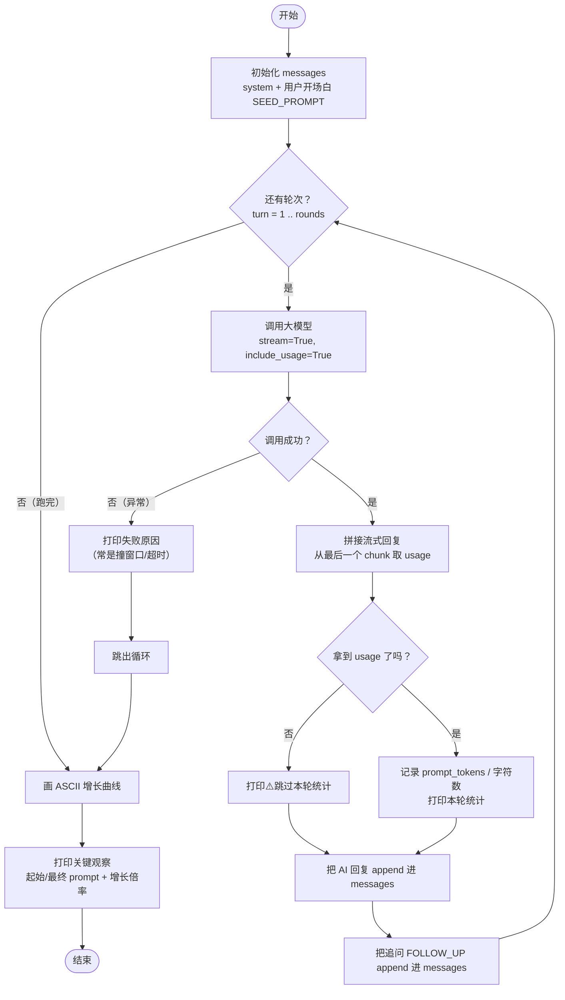

# demo_13_context_explosion.py 代码导读

这份文档帮你**从零看懂这段[代码](../demo_13_context_explosion.py)**：先讲它要干什么，再梳理整体结构，配一张流程图，最后结合真实运行结果解读现象。

> [!NOTE]
>
> 配套讲稿：[第 13 节《上下文工程：为什么必须管，不管会怎样》](../../lecture/13-why-context-matters.md)

---


## 一句话理解

让一个 Agent **不做任何上下文管理**，反复执行同一个任务，每轮都把完整历史塞回去，亲眼看着 `prompt_tokens` 一路飙升——**这就是"上下文爆炸"**。


## 先认识 4 个关键概念

只要抓住这 4 个词，整段代码就通了：

| 概念 | 含义 | 在代码里的体现 |
|---|---|---|
| **messages** | 发给大模型的对话历史列表 | `messages = [...]`，每轮都往里 `append` |
| **全量塞回** | 每轮把"AI 的回复 + 新追问"原样追加，从不删减 | `messages.append(...)` 两次 |
| **prompt_tokens** | 本轮**输入**消耗的 token 数（要花钱的部分） | `usage.prompt_tokens` |
| **stream（流式）** | 模型逐字返回，最后一个数据块才带 `usage` 统计 | `stream=True` + `include_usage=True` |

> [!NOTE]
>
> 核心矛盾：messages 只增不减 → 每轮输入越来越长 → `prompt_tokens` 越来越大。


## 代码整体结构

整个文件分三块：

```text
① 准备阶段   定义两个 prompt（开场白 + 重复追问），初始化 messages
② 循环阶段   跑 N 轮：调模型 → 取 usage → 打印统计 → 把回复塞回历史
③ 收尾阶段   画 ASCII 增长曲线 + 打印关键观察
```

> [!TIP]
>
> ⚠️ 小细节：`main` 函数默认 `rounds=30`，但文件底部实际调用的是 `main(rounds=20)`，所以你看到的输出是 **20 轮**。


## 执行流程图




## 五、分步拆解（对照源码）

### 步骤 1 · 定义两个固定提示词

```python
SEED_PROMPT = "我准备策划一场北京 7 日深度游，请给我一个建议。"   # 只在第 1 轮用
FOLLOW_UP = "总结一下我们之前讨论过的所有要点，然后**再补充 3 个新建议**……"  # 每轮重复追问
```

`FOLLOW_UP` 是制造膨胀的"发动机"——它逼着模型每轮都重新总结全部历史。


### 步骤 2 · 初始化对话历史

```python
messages = [
    {"role": "system", "content": "你是一个旅行规划助手，回答尽量详细。"},
    {"role": "user", "content": SEED_PROMPT},
]
```


### 步骤 3 · 循环调用 + 取 usage

因为接口只支持流式，所以要逐块（chunk）拼接回复，而 `usage` 只在**最后一个 chunk** 上：

```python
for chunk in stream:
    if chunk.choices:                       # 普通内容块
        ... reply_parts.append(delta.content)
    if getattr(chunk, "usage", None):       # 最后一个块才有 usage
        usage = chunk.usage
```


### 步骤 4 · 关键的"全量塞回"

```python
messages.append({"role": "assistant", "content": reply})    # AI 这轮的回复
messages.append({"role": "user", "content": FOLLOW_UP})     # 下一轮的追问
```

**这两行就是"不做上下文管理"的全部含义**：历史只进不出，下一轮输入自然更长。


### 步骤 5 · 收尾画图

用 `█` 字符按比例画一张横向柱状图，把 token 增长趋势可视化。


## 六、真实运行结果解读

截取 [输出](../output/demo_13_context_explosion.txt) 数据：

| 轮次 | prompt_tokens | messages 字符数 |
|---|---|---|
| 第 1 轮 | 32 | 43 |
| 第 2 轮 | 467 | 751 |
| 第 10 轮 | 3946 | 6347 |
| 第 20 轮 | **8296** | 13421 |

```text
第  1 轮 [   32 tk]
第 10 轮 [ 3946 tk] ███████████████████
第 20 轮 [ 8296 tk] ████████████████████████████████████████
```

**关键观察：起始 32 → 最终 8296 tokens，增长 259.2 倍。**


### 一个容易误解的点

仔细看会发现：**每轮 prompt 增量基本恒定（约 +435 tokens）**——因为每轮只追加"一条受 `max_tokens=400` 限制的回复 + 一句固定追问"。所以单轮 `prompt_tokens` 是**近似线性**增长。

真正"爆炸"的是**累计开销**：第 N 轮要发送约 `435 × N` 个 token，这才是钱包的杀手。


## 这段代码暴露了什么问题

正是第 5 章后续要解决的三件事：

1. **撞窗口**：上下文窗口虽有 128K，但不能任由它涨
2. **烧钱**：token 按用量计费，全量塞回 = 重复内容反复付费
3. **变笨**：Lost in the Middle——长上下文里中间的信息会被模型忽略

> [!TIP]
>
> 下一个 demo（`demo_14_context_strategies.py`）就会给出**截断 / 摘要 / 分层 / GSSC** 四种解法，把这条飙升曲线压下去。
