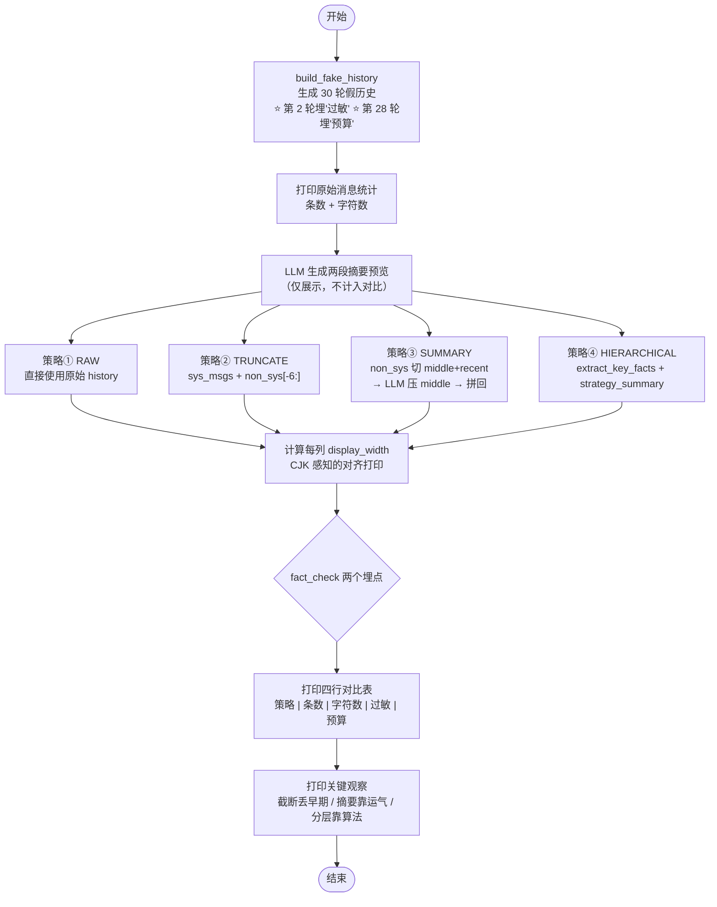

# demo_19_context_strategies.py 代码导读

这份文档帮你**从零看懂这段[代码](../demo_19_context_strategies.py)**：为什么需要上下文管理、四种策略分别怎么做、各自优缺点是什么，最后结合真实运行结果横向对比。

> [!NOTE]
>
> 配套讲稿：[第 19 节《上下文管理策略：截断 / 摘要 / 分层 / GSSC》](../../lecture/19-context-strategies.md)
>
> 前置 demo：[demo_18_context_explosion.py](../demo_18_context_explosion.py) — 先跑一遍"不做上下文管理"会爆炸，再来看解法，体验更深。


## 一句话理解

承接 demo_18 暴露的"上下文爆炸"问题，这里给出四种**上下文压缩策略**：对同一段 30 轮对话历史分别用四种策略处理后，从**消息规模**和**信息保留度**两个维度横向对比——看看谁能用最少 token 保住最多的关键事实。


## 先认识 5 个关键概念

只要抓住这 5 个词，整段代码就通了：

| 概念 | 含义 | 在代码里的体现 |
|---|---|---|
| **messages** | 发给大模型的对话历史列表 | `msgs = [{...}, {...}, ...]`，每元素含 `role` + `content` |
| **埋点事实** | 故意放在历史不同位置的两个约束，用来测试各策略对信息的保留能力 | 第 2 轮埋"花粉过敏"⭐，第 28 轮埋"每天预算 500 元"⭐ |
| **截断** | 只留 system + 最近 N 轮，中间一刀切掉 | `strategy_truncate` — 零 LLM 调用，最简单 |
| **摘要** | 把中间段交给 LLM 压缩成一段话，替代原始内容 | `strategy_summary` — 多一次 LLM 调用，信息保留靠运气 |
| **分层** | 截断 + 摘要 + 关键词抽取：关键事实单独拎出，永不被压 | `strategy_hierarchical` — 工程级方案，信息保留靠算法 |

> [!NOTE]
>
> 核心矛盾：截断靠位置（早期事实在不在最近 N 轮里），摘要靠 LLM（模型记不记得住），分层靠算法（关键词能不能命中）。**关键事实能不能保住，取决于你的工程方案，而非碰巧。**


## 代码整体结构

整个文件分四块：

```text
① 数据准备     build_fake_history — 构造 30 轮模拟对话，埋两个"重要事实"
② 四种策略     strategy_truncate / strategy_summary / strategy_hierarchical — 三种压缩算法
③ 辅助工具     extract_key_facts / stats / fact_check — 关键事实提取、统计、检测
④ 主测试       main() — 对同一段历史跑四种策略，打印对比表
```

> [!TIP]
>
> 文件还包含两个纯展示性的 LLM 摘要输出（第 3~4 行，来自 `main` 开头打印的摘要预览），不影响对比实验的结果。


## 执行流程图




## 分步拆解（对照源码）

### 步骤 1 · 制造数据：`build_fake_history`

```python
def build_fake_history(n_rounds: int = 30) -> list[dict]:
```

这个函数模拟了一段**30 轮旅行助手对话**，但它是"导演"——故意在不同位置埋了两个重要事实：

**对话的 4 层结构：**

```
[system]             ← "你是个旅行助手。"
[user]               ← "我准备 6 月去北京玩 7 天。"
[assistant]          ← "好的，6 月北京天气合适..."
[user]               ← "重要：我对花粉过敏..."  ⭐ 埋点 1（早期，容易丢）
[assistant]          ← "明白，会注意避开花季。"

... 25 轮填充问答 ...  ← 故宫门票、地铁、烤鸭...（模拟"噪音"信息）

[user]               ← "对了，我的预算是每天 500 元。"  ⭐ 埋点 2（晚期，一般能保住）
[assistant]          ← "我会把每天行程控制在预算内。"
```

**填充问答来自预定义的 25 组模板**，通过 `index % len(_filler_qa)` 取模循环填充：

```python
_filler_qa = [
    ("故宫门票需要提前预约吗？", "建议提前在官网预约..."),
    ("从故宫到颐和园怎么走方便？", "地铁 4 号线直达..."),
    # ... 共 25 组
]
for index in range(n_rounds - 5):
    question, answer = _filler_qa[index % len(_filler_qa)]
```


### 步骤 2 · 策略 ② — 截断：`strategy_truncate`

```python
def strategy_truncate(messages, keep_last=6):
    sys_msgs = [m for m in messages if m["role"] == "system"]
    non_sys = [m for m in messages if m["role"] != "system"]
    recent = non_sys[-keep_last:]
    return sys_msgs + recent
```

**思路：只留头和尾，中间全丢掉。** system 消息永不参与截断，永远原样保留。

| 优点 | 缺点 |
|---|---|
| 逻辑极简，10 行内搞定 | 早期重要信息直接消失 |
| 零 LLM 额外调用 | 用户体感差："AI 怎么突然忘了" |

> [!IMPORTANT]
>
> ⚠️ 新手常踩的坑：`messages[-keep_last:]` 一刀切会把 system prompt 也砍了。代码中从 `non_sys` 切片就是为了避开这个坑。


### 步骤 3 · 策略 ③ — 摘要：`strategy_summary`

```python
def strategy_summary(messages, keep_last=6):
    non_sys = [m for m in messages if m["role"] != "system"]
    if len(non_sys) <= keep_last:
        return messages  # 消息太少，不做压缩

    middle = non_sys[:-keep_last]   # 早期对话 → 待压缩
    recent = non_sys[-keep_last:]   # 最近 N 轮 → 保留原文

    # 把中间段拼成文本，交给 LLM 压缩
    middle_text = "\n".join(f"{m['role']}: {m['content']}" for m in middle)
    summary = llm.summarize(middle_text, max=100字)

    return sys_msgs + [{"role": "system", "content": f"[早期对话摘要]\n{summary}"}] + recent
```

**思路：不直接丢，而是压。** 中间段交给 LLM 压缩成一段摘要，以 system 消息注入。

| 优点 | 缺点 |
|---|---|
| 信息保留度比截断好 | 多一次 LLM 调用（成本 + 延迟） |
| token 节省明显 | 关键事实**可能被压成一句话甚至丢** |

摘要提示词特意加了"保留用户偏好和关键事实"的指令，但 LLM 到底能不能做到——**看运气**。


### 步骤 4 · 关键事实提取：`extract_key_facts`

这是分层策略的前置组件。

```python
KEY_FACT_KEYWORDS = {"过敏", "预算", "重要", "对了", "一定要", "不要"}

def extract_key_facts(messages):
    facts = []
    for m in messages:
        if m["role"] == "user" and any(kw in m["content"] for kw in KEY_FACT_KEYWORDS):
            facts.append(m["content"].strip())
    return facts
```

**机制：纯关键词匹配**——遍历所有 user 消息，如果内容命中了 `KEY_FACT_KEYWORDS` 中的任意一个词，就把整句话提取出来。

> [!TIP]
>
> 💡 生产环境中可升级为 LLM 驱动的语义提取，识别隐式约束（如"我不能吃辣"虽不含关键词但同样是硬约束）。


### 步骤 5 · 策略 ④ — 分层：`strategy_hierarchical`

```python
def strategy_hierarchical(messages, keep_last=6):
    sys_msgs = [m for m in messages if m["role"] == "system"]
    summarized = strategy_summary(messages, keep_last)  # ← 复用摘要
    facts = extract_key_facts(messages)                   # ← 关键词抽取

    # 组装四层结构
    return sys_msgs + [fact_msg] + summarized[len(sys_msgs):]
```

**最终输出结构：**

```
[原始 system            ← 角色定义（永不丢失）
 关键事实槽              ← "用户对花粉过敏""预算是每天 500 元"
 早期对话摘要            ← LLM 压缩的中间 20+ 轮
 最近 6 轮原文           ← 保持原始精度
] + user 当前问题
```

**关键事实单独拎出来，以 system 消息前置注入**——这样即使早期对话被摘要覆盖了，关键约束仍然显式可见。这就是分层和摘要的本质区别。


### 步骤 6 · 评估与检测

```python
def stats(messages):
    # 返回处理后的 {count: 条数, chars: 总字符数}

def fact_check(messages):
    # 把所有 content 拼成一个大字符串，检测"过敏"和"预算"是否还在
    text = " ".join(m["content"] for m in messages)
    return ("过敏" in text, "预算" in text)
```

`fact_check` 是和 `build_fake_history` 配对的：构造时埋的"过敏"和"预算"两个关键词，最终通过子串匹配来检测各策略是否保住了这两个事实。


## 真实运行结果解读

截取自 [输出](../output/demo_19_context_strategies.txt)：

```
历史 messages: 57 条 / 923 字符

Strategy                                              Item  Character  Allergy  Budget
① RAW (not process)                                     57        923     ✅      ✅
② TRUNCATE (Last 6 rounds)                               7        106     ❌      ✅
③ SUMMARY (summary + Last 6 rounds)                      8        207     ✅      ✅
④ HIERARCHICAL (Key Facts + summary + Last 6 rounds)     9        267     ✅      ✅
```


### 横向对比分析

| 维度 | ① RAW | ② TRUNCATE | ③ SUMMARY | ④ HIERARCHICAL |
|---|---|---|---|---|
| **条数** | 57（不压缩） | 7（压缩 87%） | 8（压缩 86%） | 9（压缩 84%） |
| **字符数** | 923（不压缩） | 106（压缩 89%） | 207（压缩 78%） | 267（压缩 71%） |
| **"过敏"** | ✅ 在 | ❌ **丢了** | ✅ 在 | ✅ 在 |
| **"预算"** | ✅ 在 | ✅ 在 | ✅ 在 | ✅ 在 |


### 三个关键观察

**观察 1 — "预算"所有人都能保住**

因为它在倒数第二轮（第 28/30 轮），落在 `keep_last=6` 的"最近 N 轮"范围内。截断、摘要、分层都能保住——**晚期事实靠位置，不靠策略**。


**观察 2 — "过敏"只有截断丢了**

它在第 2 轮，远在"最近 6 轮"之外。截断一刀切掉中间，这个事实直接消失。摘要和分层都能保住，但**保住的机制不同**：

- 摘要：靠 LLM 在压缩时"碰巧"记住了（运气成分大）
- 分层：靠 `extract_key_facts` 主动用关键词"打捞"出来了（算法确定性）


**观察 3 — 分层比摘要多约 60 字符，换来了事实的确定性**

多出来的正是那条 `[关键事实，永远记住]` 的 system 消息。这 60 个字符是"确定性"的价格——你不用赌 LLM 的摘要能不能记住，因为事实已经被单独拎出来了。


## 四种策略的选择指南

| 任务特点 | 推荐策略 | 理由 |
|---|---|---|
| 演示 / 短对话 | ① 截断 | 简单够用，关键信息在最近几轮 |
| 中等长度 / 单一任务 | ② 摘要 | 信息保留比截断好，成本可控 |
| 多轮 + 用户不断补约束 | ③ 分层 | 关键事实跨任意轮次也能保住 |
| 真实工业级 Agent | ④ GSSC | 多信息源、多阶段流水线 |

> [!NOTE]
>
> 💡 实际工程里不会只用一个，而是组合：**主链路用分层保关键事实不丢，摘要层内部用 select → summarize 子流水线选什么压、怎么压。**


## 这段代码体现出什么

正是第 19 节要教你的一件事：**关键事实能不能保住，取决于你的工程方案，而非碰巧。**

| 策略 | 保住关键事实靠什么 | 风险 |
|---|---|---|
| 截断 | 靠位置（事实在不在最近 N 轮） | 早期事实直接丢 |
| 摘要 | 靠 LLM（模型记不记得住） | 运气不稳定 |
| 分层 | 靠算法（关键词命中 / 语义提取） | 关键词覆盖不全有盲区 |

> [!TIP]
>
> 跑完 demo_18（不做管理 → 爆炸）再跑 demo_19（四种策略 → 对比），你会直观感受到：**上下文管理不是魔法，是一层层工程手段的叠加。** 从截断到分层，每多一层，就多一分确定性。
