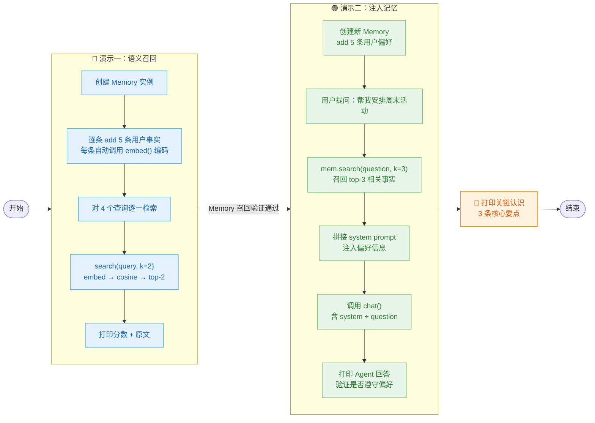
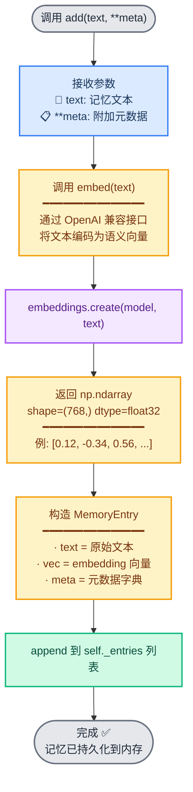
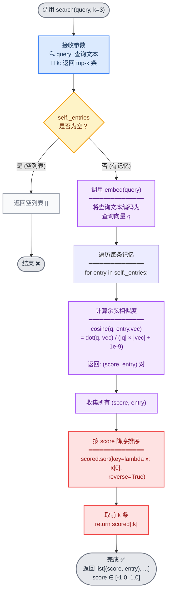

# demo_15_memory.py 代码导读

这份文档帮你**从零看懂这段[代码](../demo_15_memory.py)**：什么是 Memory 系统、为什么它和 ContextManager 不是一回事、embedding 怎么把文本变成向量、余弦相似度怎么算，最后用两个真实演示告诉你——"给模型植入记忆"到底是怎么做到的。

> [!NOTE]
>
> 配套讲稿：[第 15 节《记忆系统：短期 / 长期 / 工作记忆》](../../lecture/15-memory-types.md)
>
> 前置 demo：[demo_14_context_strategies.py](../demo_14_context_strategies.py) — ContextManager 管的是"本次对话的 messages 列表"，Memory 管的是"跨会话的长期事实"，看完前一个再来看这个，分工立刻清晰。


## 一句话理解

用一个最小化的 `Memory` 类，把用户的偏好、约束、习惯等"长期事实"通过 **embedding API 编码为向量**存起来；每轮对话开始前，把当前问题也编成向量，用**余弦相似度**从记忆库里找出最相关的几条事实，塞进 system prompt —— 模型就"有了跨会话的记忆"。


## 先认识 5 个关键概念

只要抓住这 5 个词，整段代码就通了：

| 概念 | 含义 | 在代码里的体现 |
|---|---|---|
| **embedding（嵌入）** | 把一段文本变成一个固定长度的 float 向量，语义相近的文本向量也相近 | `embed("我喜欢喝拿铁")` → 一个 768 维向量 |
| **余弦相似度** | 衡量两个向量"指向多一致"，忽略长度差异，值 0~1 越大越相似 | `cosine(vec_a, vec_b)` → 0.305 表示不太像，0.900 表示很像 |
| **Memory（长期记忆）** | 跨会话持久化的用户事实库，按语义可搜索 | `Memory` 类：`add` 写入、`search` 查询、`save/load` 持久化 |
| **ContextManager（上下文管理）** | 管理"本次对话"的 messages 列表，demo_14 讲的截断/摘要/分层都属于这一层 | demo_14 的 `strategy_truncate` / `strategy_summary` |
| **注入（injection）** | 把 Memory 召回的事实塞进 system prompt，让模型在生成时遵守这些约束 | demo_2：`system_prompt = "用户偏好：" + facts` |

> [!NOTE]
>
> 核心区别：ContextManager 管的是"这句话之前聊了什么"（同一会话内）；Memory 管的是"这个用户喜欢什么、忌讳什么"（跨会话）。**ContextManager 是短期记忆，Memory 是长期记忆。**


## 代码整体结构

整个文件分四块：

```text
① 基础设施     embed() + cosine() — 向量编码器 + 相似度计算器
② Memory 类    MemoryEntry 数据类 + Memory 管理器（add / search / save / load）
③ 演示一       demo_basic_search() — 存 5 条事实 → 用 4 个不同查询验证召回效果
④ 演示二       demo_with_context_injection() — 检索 → 注入 system prompt → 调 LLM 验证
```

> [!TIP]
>
> 本 demo **不引入向量数据库**（pgvector / qdrant / milvus），全部用 `numpy` + 内存 `list` 实现。目的是先把"embedding → 检索 → 注入"这个核心流程跑通，后续章节会换专业库。


## 执行流程图



---

## 分步拆解（对照源码）

### 步骤 1 · 基础设施：`embed` 和 `cosine`

这两个函数是 Memory 系统的"地基"，分别负责**把文本变成向量**和**比较两个向量有多像**。


#### `embed` — 文本 → 向量

```python
EMBEDDING_MODEL = "hunyuan-embedding"  # 模型名以你的 LLM gateway 为准

def embed(text: str) -> np.ndarray:
    resp = _emb_client.embeddings.create(model=EMBEDDING_MODEL, input=text)
    return np.array(resp.data[0].embedding, dtype=np.float32)
```

**核心机制**：调用 embedding API，把任意中文/英文文本编码为一个固定维度的 float32 数组。

| 输入 | 输出 |
|---|---|
| `"我喜欢喝拿铁。"` | `np.array([0.12, -0.34, 0.56, ...], shape=(768,))` |

关键点：
- 向量维度取决于模型（hunyuan-embedding 通常 768 或 1024 维）
- 语义相近的文本，向量在空间中距离更近 → 余弦相似度更高
- 和 chat API 共用同一组凭证，但用独立的 `_emb_client`


#### `cosine` — 计算两个向量有多像

```python
def cosine(a: np.ndarray, b: np.ndarray) -> float:
    return float(np.dot(a, b) / (np.linalg.norm(a) * np.linalg.norm(b) + 1e-9))
```

**公式**：`cos(a, b) = (a · b) / (|a| × |b|)`

| 值 | 含义 |
|---|---|
| 1.0 | 完全一致（语义完全相同） |
| 0.5~0.8 | 比较相关 |
| 0~0.3 | 不太相关 |
| 0 | 无关（正交） |

> [!IMPORTANT]
>
> 💡 分母 `+ 1e-9` 是防止零向量导致的除零错误 —— 工业代码里几乎每个除法都该加这个保护。


### 步骤 2 · Memory 数据模型：`MemoryEntry` 和 `Memory`

####  `MemoryEntry` ： 一条记忆长什么样

```python
@dataclass
class MemoryEntry:
    text: str              # 原始文本，如 "我每天预算 500 元。"
    vec: np.ndarray        # embedding 向量，如 shape=(768,) 的数组
    meta: dict = field(default_factory=dict)  # 可选元数据，如 {"category": "budget"}
```

这就是 Memory 系统的原子单元：**一条记忆 = 原文 + 向量 + 标签**。

> [!TIP]
>
> ⚠️ `vec` 是 `np.ndarray`，无法直接序列化到 JSON。保存时要用 `.tolist()` 转成 list，加载时用 `np.array(list)` 还原。

> [!NOTE]
>
> **为什么不用 Python 内置的 `list` 或 `tuple`？**
>
> `search()` 中需要频繁做两个运算：**向量点积** 和 **向量模**（欧氏范数）：
>
> ```python
> scored = [(cosine(q, e.vec), e) for e in self._entries]
> # cosine 内部：np.dot(a, b) / (np.linalg.norm(a) * np.linalg.norm(b))
> ```
>
> 如果用 Python `list`，你需要**手写双层 for 循环**来算点积和范数：
>
> ```python
> # 用 list 算点积
> dot = sum(a[i] * b[i] for i in range(len(a)))  # Python 逐元素循环，很慢
> ```
>
> 而 `np.ndarray` 用 C 底层实现，`np.dot()` 和 `np.linalg.norm()` 是单条 **向量化指令**，768 维一次性算完。简单说（以 768 维为例）：
>
> | | Python `list` | `np.ndarray` |
> |---|---|---|
> | 点积 | `sum(a[i]*b[i] for i in range(len(a)))` | `np.dot(a, b)` |
> | 范数 | `math.hypot(*a)` 或手写循环 | `np.linalg.norm(a)` |
> | 性能 | 毫秒级，逐元素 Python 循环 | 微秒级，C 底层向量化 |
> | 内存 | 大约 24 KB（每个元素是 PyFloat 对象） | 大约 3 KB（连续存储纯数据） |
>
> 每次 `search()` 都要对**所有记忆各算一次余弦相似度**，如果记忆库有 1000 条，用 list 的 `cosine` 就是 1000 次手写 for 循环 —— **这是 embedding 场景下 `np.ndarray` 不可替代的根本原因。**


#### `Memory` 类 — 四个核心方法

```python
class Memory:
    def add(self, text, **meta):    # 存一条新记忆（自动 embed）
    def search(self, query, k=3):   # 按语义检索 top-k（embed query → cosine → 排序）
    def save(self, path):           # 持久化到 JSON 文件
    def load(self, path):           # 从 JSON 文件中加载
```

**`add` 的流程**：



**`search` 的流程**：



> [!TIP]
>
> 💡 `search` 方法里的这句 `scored.sort(key=lambda x: x[0], reverse=True)` 是整段代码最核心的一行——它决定了**哪些记忆被"想起来"**。


### 步骤 3 · 演示一：基本语义召回 — `demo_basic_search` 函数

```python
def demo_basic_search():
    memory = Memory()
    facts = [
        "我对花粉过敏，户外活动需要避开花期。",
        "我每天预算 500 元。",
        "我喜欢喝拿铁，不喜欢美式。",
        "我下个月要去北京出差。",
        "我家里有一只 3 岁的橘猫，叫胖虎。",
    ]
    for f in facts:
        memory.add(f)

    queries = [
        "用户的饮食喜好是什么",
        "出行有没有什么健康限制",
        "用户最近会去哪里",
        "金钱方面有没有约束",
    ]
    for query in queries:
        for score, e in memory.search(query, k=2):
            print(f"  [{score:.3f}] {e.text}")
```

**验证的核心问题**：查询和记忆的**措辞完全不同**（如"饮食喜好" vs "喜欢喝拿铁"），但 embedding 能捕捉到语义关联，从而正确召回。

运行结果（截取自[输出](../output/demo_15_memory.txt)）：

```
查询: 用户的饮食喜好是什么
  [0.305] 我喜欢喝拿铁，不喜欢美式。        ← ✅ 正确命中！

查询: 出行有没有什么健康限制
  [0.409] 我对花粉过敏...                  ← ✅ 正确命中！

查询: 用户最近会去哪里
  [0.301] 我下个月要去北京出差。            ← ✅ 正确命中！

查询: 金钱方面有没有约束
  [0.177] 我每天预算 500 元。              ← ✅ 正确命中！
```

**四个查询全部命中了正确的记忆**，尽管查询词和记忆原文差异巨大（"饮食喜好" vs "拿铁"、"金钱约束" vs "预算"）——这就是 embedding 的魅力。

> [!TIP]
>
> ⚠️ 注意分数普遍不高（0.17~0.41），这是 `hunyuan-embedding` 模型的正常表现。如果用 `text-embedding-3-small`，分数通常会更高。**分数的高低取决于模型，但排序的正确性才是核心指标。**


### 步骤 4 · 演示二：注入 system prompt — `demo_with_context_injection` 函数

这是"让模型拥有记忆"的完整流程：

```python
def demo_with_context_injection():
    mem = Memory()
    user_facts = [
        "用户每天预算 500 元。",
        "用户对花粉过敏，户外活动需要避开花期。",
        "用户喜欢咖啡，不喜欢甜食。",
        "用户在北京工作，家在朝阳区。",
        "用户上次反馈：博物馆类景点很喜欢。",
    ]
    for f in user_facts:
        mem.add(f)

    question = "帮我安排周末两天的活动。"

    # ① 用问题去 Memory 检索 top-3 相关事实
    relevant = mem.search(question, k=3)

    # ② 把召回的事实拼接成 system prompt
    facts_block = "\n".join(f"- {e.text}" for _, e in relevant)
    system_prompt = "你是用户的助手。下面是用户的长期偏好和约束，请在回答中遵守：\n" + facts_block

    # ③ 调 LLM
    resp = chat(messages=[
        {"role": "system", "content": system_prompt},
        {"role": "user", "content": question},
    ])
```

**运行结果的关键片段：**

```
召回的相关长期事实：
  [0.336] 用户每天预算 500 元。
  [0.335] 用户上次反馈：博物馆类景点很喜欢。
  [0.221] 用户对花粉过敏，户外活动需要避开花期。

=== Agent 回答 ===
根据您的偏好和约束条件（预算每天500元、喜欢博物馆、花粉过敏需避开户外花丛），
我为您策划了一个以"人文历史与室内探索"为主题的周末两天行程。

本行程设定为您所在城市或周边的通用安排...

### 💰 预算概览（两天总计）
*   **总预算：** 1000 元（500元/天）

### 📅 周六：历史沉淀与城市漫步
**上午：核心博物馆深度游**
*   **理由：** 您上次反馈很喜欢博物馆，且完全室内，避开花粉。
```

**三个记忆全部被模型遵守了：**
- ✅ 预算 500 元/天：体现在行程预算规划中
- ✅ 喜欢博物馆：周六上午安排了博物馆深度游
- ✅ 花粉过敏：强调室内活动，标注避开花粉

> [!TIP]
>
> 💡 关键是：用户**没有在这次对话中提到这些偏好**——它们全部来自 Memory 的语义检索 + system prompt 注入。模型"有了记忆"并非魔法，而是把相关事实提前塞进了 prompt。


## 真实运行结果解读

### 演示一：语义召回验证

| 查询 | top-1 结果 | 分数 | 是否正确 |
|---|---|---|---|
| "饮食喜好是什么" | "喜欢喝拿铁，不喜欢美式" | 0.305 | ✅ |
| "健康限制" | "花粉过敏，避开花期" | 0.409 | ✅ |
| "最近会去哪里" | "下个月去北京出差" | 0.301 | ✅ |
| "金钱约束" | "每天预算 500 元" | 0.177 | ✅ |

**结论：embedding + 余弦相似度方案在所有 4 个查询上都正确召回了最相关的事实。** 分数高低反映的是"措辞距离"，不是"准确度"——分数低但排序对，照样能用。


### 演示二：注入效果验证

提问 `"帮我安排周末两天的活动"`，模型回答中：

- ✅ 主动规划了预算结构（每天 500 元）
- ✅ 安排了博物馆类景点（基于"喜欢博物馆"）
- ✅ 避开了户外公园，选择室内场馆（基于"花粉过敏"）

**这三个偏好全部来自 Memory，用户在提问时一个字都没提。**


## Memory 与 ContextManager 的分工

| | ContextManager（demo_14） | Memory（demo_15） |
|---|---|---|
| **管什么** | 本次对话的 messages 列表 | 跨会话的用户事实库 |
| **生命周期** | 单次会话 | 跨会话持久化 |
| **怎么存** | messages = [{...}, {...}] | embedding 向量 + 文本 |
| **怎么查** | 不需要查——当前对话就在眼前 | `search(query)` 按语义检索 |
| **怎么用** | 截断/摘要/分层压缩后发给 LLM | 注入 system prompt 后发给 LLM |

> [!NOTE]
>
> 💡 可以这样理解：ContextManager 是"你刚才说了什么"（短期记忆），Memory 是"你这个人喜欢什么、忌讳什么"（长期记忆）。


## 这段代码体现出什么

正是第 15 节要教你的三件事：

1. **embedding 让"语义搜索"成为可能** —— 不需要精确匹配关键词，"饮食喜好"能命中"喜欢喝拿铁"，"金钱约束"能命中"预算 500"
2. **Memory 和 ContextManager 不是一回事** —— 前者管跨会话的事实库，后者管当前会话的 messages 列表
3. **"有记忆的 AI"的实现原理** —— 每轮对话前搜 Memory → 注入 system prompt → 模型在生成时自动参考

> [!TIP]
>
> 跑完 demo_14（四种上下文管理策略）再跑 demo_15（Memory 系统），你会直观感受到整个架构是怎么搭起来的：
>
> ```mermaid
> flowchart TD
>     User["👤 用户提问"] --> Search
> 
>     Search["🔍 Memory.search(question)<br/>━━━━━━━━━━━━━━━━━<br/>embed → cosine → top-k<br/>召回长期偏好"]
> 
>     Search --> Ctx["📋 ContextManager.build()<br/>━━━━━━━━━━━━━━━━━<br/>组装当前 messages<br/>含截断 / 摘要 / 分层"]
> 
>     Ctx --> Assemble["🧩 拼接上下文<br/>━━━━━━━━━━━━━━━━━<br/>system_prompt<br/>+ 长期偏好（注入）<br/>+ 当前 messages"]
> 
>     Assemble --> LLM["🤖 发给 LLM"]
> 
>     LLM --> Answer["✅ 模型回答<br/>━━━━━━━━━━━━━━━━━<br/>同时遵守：<br/>· 长期偏好<br/>· 当前上下文"]
> 
>     classDef user fill:#dbeafe,stroke:#3b82f6,stroke-width:2px,color:#1e3a5f
>     classDef mem fill:#f3e8ff,stroke:#a855f7,stroke-width:2px,color:#581c87
>     classDef ctx fill:#fef3c7,stroke:#f59e0b,stroke-width:2px,color:#78350f
>     classDef llm fill:#fee2e2,stroke:#ef4444,stroke-width:2px,color:#991b1b
>     classDef answer fill:#d1fae5,stroke:#10b981,stroke-width:2px,color:#064e3b
> 
>     class User user
>     class Search mem
>     class Ctx,Assemble ctx
>     class LLM llm
>     class Answer answer
> ```
>
> 这就是工业级 Agent 的"记忆 + 上下文"双引擎架构。
