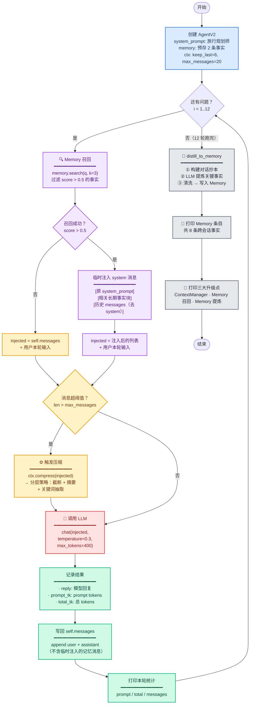
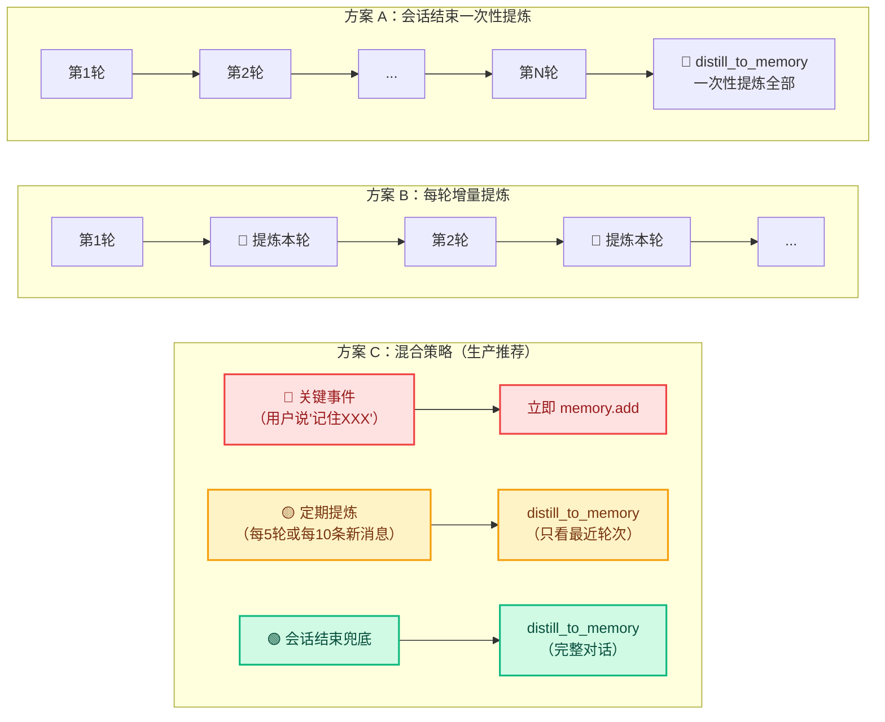
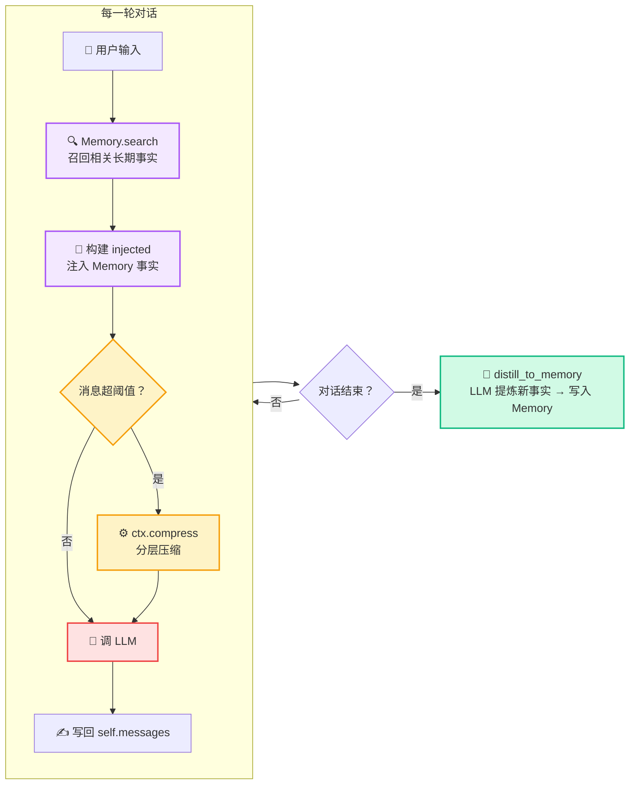

# demo_21_agent_v2.py 代码导读

这份文档帮你**从零看懂这段[代码](../demo_21_agent_v2.py)**：它是如何把第 5 章前面学到的 ContextManager、Memory 两大组件，**组合进一个完整的 Agent Loop**，让它第一次拥有"跨会话记忆"能力。

> [!NOTE]
>
> 前置 demo：
> - [demo_19_context_strategies.py](../demo_19_context_strategies.py) — ContextManager 的来源，四种压缩策略
> - [demo_20_memory.py](../demo_20_memory.py) — Memory 系统的来源，embedding + 余弦相似度检索


## 一句话理解

把第 3/4 章的朴素 Agent Loop 升级为 **v2**：接入 ContextManager（自动压缩上下文）和 Memory（自动召回 + 提炼长期记忆），让 Agent 在 12 轮对话中 **token 消耗可控、关键事实不丢失、对话结束自动沉淀记忆**。


## 先认识 6 个关键概念

只要抓住这 6 个词，整段代码就通了：

| 概念 | 含义 | 在代码里的体现 |
|---|---|---|
| **ContextManager** | 对话上下文压缩器，消息超阈值时自动压缩 | `self.ctx.should_compress()` / `self.ctx.compress()` |
| **Memory 召回** | 每轮用当前问题检索相关长期事实 | `self.memory.search(user_input, k=3)` |
| **Memory 提炼** | 整个对话结束后一次性调用 LLM，从完整历史中抽取值得长期记住的事实 | `distill_to_memory` 函数（⚠️ 不是每轮都调用） |
| **injected messages** | 本轮临时注入 Memory 事实后的消息列表，不含 `self.messages` | `chat` 方法内的局部变量 `injected` |
| **阈值触发** | `max_messages` 决定何时启动压缩 | 默认 20 条，第 11 轮触发 |
| **temperature=0** | LLM 提炼时设为 0，确保每次输出稳定 | `chat(temperature=0, max_tokens=300)` |

> [!NOTE]
>
> 核心分工：ContextManager 管"这句话之前聊了什么"（本轮会话内）；Memory 管"这个用户是什么样的人"（跨会话）；`distill_to_memory` 管"这次对话结束后，哪些事实值得下次还记得"。
> 
> ⚠️ **调用时机**：`distill_to_memory` 在 **全部 12 轮对话跑完之后才执行一次**（见 `run_comparison` 函数末尾），不是每轮对话后都提炼。这样做的原因是：让 LLM 看到完整对话上下文，再决定哪些值得长期记住，同时节省 token（不每轮额外调用一次 LLM）。


## 代码整体结构

整个文件分四块：

```text
① ContextManager       把 demo_19 的分层压缩策略包成类，提供 should_compress / compress 方法
② MemoryV2             增强版 Memory，在父类基础上增加精确匹配 + 语义相似度双重去重
③ distill_to_memory    用 LLM 从完整对话中提炼长期事实，写入 Memory（纯函数）
④ AgentV2              组合 ContextManager + MemoryV2 的增强 Agent，核心是 chat 方法
⑤ run_comparison       跑 12 轮旅行规划对话，观察 token 消耗 + 压缩触发 + 最终记忆提炼
```

> [!TIP]
>
> 前两块都是从 demo_19 / demo_20 **导入复用**，本文件只做了薄封装。AgentV2 才是"粘合层"——把前两章的成果接进 Agent Loop。


## 执行流程图



> [!IMPORTANT]
>
> ⚠️ `injected` 和 `self.messages` 是两个不同变量，这是整段代码最关键的设计细节：
> - `injected` 是局部变量，临时加入 Memory 召回事实 + 压缩结果，**只用于本轮 LLM 调用**
> - `self.messages` 是实例属性，只写回本轮 user + assistant 原始消息，**不含临时注入内容**
> - 这样设计的理由：Memory 召回是为了本轮回答更准确，但不属于对话历史本身


## 分步拆解（对照源码）

### 组件一 · ContextManager：压缩策略的配置容器

```python
class ContextManager:
    def __init__(self, keep_last: int = 6, max_messages: int = 20) -> None:
        self._keep_last = keep_last if keep_last > 0 else 6
        self._max_messages = max_messages if max_messages > 0 else 20
```

**这是 demo_19 的 `strategy_hierarchical` 的薄封装**。设计思路：

- `keep_last` 和 `max_messages` 都是**只读属性**（`@property`），防止外部随意篡改导致行为不一致
- `should_compress(messages)` 只做一件事：比较 `len(messages) > self.max_messages`
- `compress(messages)` 委托给 `strategy_hierarchical(messages, keep_last=self.keep_last)`

**为什么包成类而不是直接用函数？** 因为 `keep_last` 和 `max_messages` 是 Agent 的配置项，包成类后可以在创建 Agent 时统一传入，逻辑更内聚。


### 组件二 · `distill_to_memory`：对话 → 长期记忆

```python
DISTILL_PROMPT = """阅读下面的对话，提炼出**值得长期记住的用户偏好、约束、关键事实**，
每条一行，不要把一次性的问答内容也存进去。..."""

def distill_to_memory(messages: list[dict], memory: Memory) -> None:
    transcript = "\n".join(
        f"{m['role']}: {m['content']}" for m in messages if m["role"] != "system"
    )
    msg = chat(messages=[{"role": "user", "content": DISTILL_PROMPT.format(transcript=transcript)}],
               temperature=0, max_tokens=300)
    raw = msg.content or ""
    facts = [line.strip("- ").strip() for line in raw.splitlines() if line.strip()]
    for f in facts:
        memory.add(f)
```

**四个步骤，注释清晰：**

| 步骤 | 做什么 | 为什么这样做 |
|---|---|---|
| ① 构建抄本 | 过滤 system 消息，拼接 `role: content` | system prompt 是给模型的行为指令，不是"对话内容"，不应参与提炼 |
| ② LLM 提炼 | `temperature=0`, `max_tokens=300` | 零温度保证稳定，max_tokens 防止 AI 输出过多 |
| ③ 清洗输出 | 按行拆分 → 去空行 → 去 `- ` 前缀 | LLM 可能输出 `- 事实内容` 格式，需要统一清理 |
| ④ 写回 Memory | `memory.add(f)` 逐条写入 | Memory 内部自动 embed，可直接用于下次 `search` 函数调用 |

> [!IMPORTANT]
>
> ⚠️ `distill_to_memory` 的参数类型是 `Memory`（而非 `MemoryV2`），这意味着它**不关心**传入的是哪种 Memory 实例——`Memory.add()` 和 `MemoryV2.add()` 都实现了相同的接口，只是后者多了去重逻辑。利用多态，你可以：
> - 传入 `Memory` 实例 → 简单追加，无去重（适合教学演示）
> - 传入 `MemoryV2` 实例 → 自动做精确匹配 + 语义相似度去重（适合生产环境）
>
> 在 `AgentV2` 中，默认创建的是 `MemoryV2()`，因此 `distill_to_memory` 写入时会自动触发去重，避免 LLM 提炼出的重复事实污染记忆库。

> [!IMPORTANT]
>
> ⚠️ **调用时机说明**：`distill_to_memory` 在整个对话**全部结束后只调用一次**（`run_comparison` 末尾），而不是在每轮 `agent.chat(q)` 之后调用。换句话说：**12 轮对话中不会触发任何 Memory 写入，写完 12 轮才统一提炼**。
>
> **为什么这样设计？**
> - ✅ LLM 能看完整对话，提炼更准确（不会把早期零散信息误判为"不值得记"）
> - ✅ 只调用一次 LLM，token 消耗少
> - ❌ 如果程序中途崩溃，本轮对话的所有新事实全部丢失
>
> 💡 `distill_to_memory` 的核心价值在于**自动化**——用户无需手动整理"上次聊了什么重要的事"，LLM 自动从对话中提取。


### 实际生产中的调用时机设计

当前 demo 为教学清晰，选择了最简单的"会话结束时一次性提炼"。但在真实系统中，需要根据**数据安全性、实时性和成本**做权衡。以下是三种常见方案及其适用场景：



#### 方案 A：会话结束一次性提炼（当前 demo）

```
时间线：
  第1轮对话 ──→ 第2轮 ──→ ... ──→ 第N轮 ──→ distill_to_memory（一次性）
  ❌ 无记忆写入     ❌ 无记忆写入         ❌ 无记忆写入     ✅ 统一写入
```

| 维度 | 评价 |
|---|---|
| 实现复杂度 | ⭐ 最低 |
| LLM 调用次数 | 每会话 1 次 |
| 提炼质量 | ⭐⭐⭐ 最高（看到完整上下文） |
| 数据安全性 | ⭐ 最低（崩溃全丢） |
| 实时性 | ❌ 只有下次会话才能用到本次新记忆 |

**适用场景**：短会话（< 20 轮）、非关键业务、教学 demo。

#### 方案 B：每轮增量提炼

```python
# 伪代码示意
def chat(self, user_input):
    # ... 正常对话流程 ...
    
    # 每轮结束后立即提炼
    distill_to_memory(self.messages, self.memory)
    # ↑ 问题：每轮都送完整历史给 LLM，token 消耗巨大
```

| 维度 | 评价 |
|---|---|
| 实现复杂度 | ⭐ 最低（加一行调用即可） |
| LLM 调用次数 | 每轮 1 次（N 轮 = N 次提炼） |
| 提炼质量 | ⭐⭐ 中等（早期信息不完整，可能提炼不准确；且易产生重复事实） |
| 数据安全性 | ⭐⭐⭐ 最高（每轮都落地） |
| 实时性 | ⭐⭐⭐ 下轮对话即可用到本轮新记忆 |

**适用场景**：对数据安全要求极高的场景（如金融、医疗对话），可接受高 token 成本。

> [!WARNING]
>
> 方案 B 的最大隐患不是 token 成本，而是**重复事实**。第 3 轮提炼出"用户预算 500 元"，第 5 轮又从同一段历史中提炼出"预算约 500 元"——如果没有去重逻辑，Memory 会被同义事实污染，影响召回质量。
>
> 💡 **`MemoryV2` 正是为解决这一问题而设计的**：它的 `add()` 方法内置精确匹配 + 语义相似度去重（阈值 0.92），LLM 提炼出的语义重复事实会被自动更新（而非重复追加）到记忆库中。如果你使用方案 B，务必搭配 `MemoryV2`。


#### 方案 C：混合策略（生产环境推荐）

这是大多数 Agent 框架（LangMem、Mem0、Letta 等）采用的模式，将写入时机分为三个层级：

```
┌─────────────────────────────────────────────────────────┐
│                     Memory 写入触发时机                    │
├──────────────┬──────────────────┬────────────────────────┤
│   优先级      │     触发条件      │       动作              │
├──────────────┼──────────────────┼────────────────────────┤
│  🔴 高        │ 用户明确指令      │ memory.add() 直接写入   │
│              │ 如"记住我XX"     │ 不走 LLM 提炼            │
├──────────────┼──────────────────┼────────────────────────┤
│  🟡 中        │ 每 N 轮 / 每 M   │ distill_to_memory()    │
│              │ 条新消息自动触发  │ 只看最近轮次的对话       │
├──────────────┼──────────────────┼────────────────────────┤
│  🟢 低        │ 会话结束 / 超时   │ distill_to_memory()    │
│              │ / 用户主动结束    │ 完整对话兜底提炼        │
└──────────────┴──────────────────┴────────────────────────┘
```

**代码示例（在 AgentV2 中如何实现）：**

```python
class AgentV2:
    def __init__(self, ...):
        self._round_count = 0              # 当前会话轮次计数
        self._distill_every_n = 5          # 每 5 轮自动提炼一次
        self._last_distill_idx = 0         # 上次提炼时的 messages 索引
        
    def chat(self, user_input: str) -> tuple[str, int, int]:
        self._round_count += 1
        
        # ① 检查用户是否有明确指令
        if "记住" in user_input or "别忘了" in user_input:
            # 直接写入，不经过 LLM 提炼（用户已明确表达）
            self.memory.add(user_input)
        
        # ... 正常对话流程（Memory 召回 → 构建 injected → 压缩 → 调 LLM）...
        
        # ② 定期提炼：每 N 轮自动触发一次
        if self._round_count % self._distill_every_n == 0:
            # 只看上次提炼之后新增的消息
            new_messages = self.messages[self._last_distill_idx:]
            distill_to_memory(new_messages, self.memory)
            self._last_distill_idx = len(self.messages)
        
        return reply, prompt_tk, total_tk
    
    def on_session_end(self):
        # ③ 会话结束时兜底提炼（覆盖剩余未提炼的消息）
        if self._last_distill_idx < len(self.messages):
            remaining = self.messages[self._last_distill_idx:]
            distill_to_memory(remaining, self.memory)
```

| 维度 | 评价 |
|---|---|
| 实现复杂度 | ⭐⭐⭐ 较高（需维护轮次计数、提炼游标、去重逻辑） |
| LLM 调用次数 | 每 N 轮 1 次 + 会话结束 1 次 |
| 提炼质量 | ⭐⭐⭐ 高（定期提炼 + 结束兜底，信息不丢失） |
| 数据安全性 | ⭐⭐⭐ 高（每 N 轮落地，最多丢 N 轮数据） |
| 实时性 | ⭐⭐ 中（最多 N 轮延迟后可被召回） |

**适用场景**：几乎所有生产环境 Agent。N 的大小需根据业务场景调参：
- 客服/医疗：N=3~5（数据安全优先）
- 闲聊/娱乐：N=10~15（成本优先）

#### 三种方案对比

| 对比维度 | 方案 A（一次性） | 方案 B（每轮增量） | 方案 C（混合） |
|---|---|---|---|
| LLM 调用次数 | 1 / 会话 | N / 会话 | N/k + 1 / 会话 |
| Token 总成本 | 低 | 极高 | 中 |
| 崩溃丢失量 | 全部 | 0~1 轮 | 至多 N-1 轮 |
| 下一轮可用新记忆 | ❌ | ✅ | ✅（有延迟） |
| 记忆重复风险 | 低 | 高 | 中（可用 `MemoryV2` 去重） |
| 推荐场景 | Demo / 短会话 | 高安全场景 | **生产环境标配** |

> [!TIP]
>
> 🎯 **记忆写入的黄金法则**：**用户明确说的 >= LLM 推断的，立即写入 >= 延迟写入**。不要试图用一套规则覆盖所有场景——最好的 Agent 是在不同时机用不同策略的组合。


### 组件三 · AgentV2：粘合 ContextManager + Memory

```python
class AgentV2:
    def __init__(self, system_prompt, memory=None, ctx_manager=None):
        self._system_prompt = system_prompt        # 只读
        self.memory = memory or MemoryV2()          # 长期记忆（默认带去重）
        self.ctx = ctx_manager or ContextManager()  # 上下文压缩
        self.messages = [{"role": "system", "content": system_prompt}]
```


#### `chat` 方法 — 核心流程

```python
def chat(self, user_input: str) -> tuple[str, int, int]:
    injected = list(self.messages)                            # ← 副本

    # ① Memory 召回
    relevant = [(score, e) for score, e in self.memory.search(user_input, k=3) if score > 0.5]
    if relevant:
        facts_block = "\n".join(f"- {e.text}" for _, e in relevant)
        injected = [                                          # ← 临时注入
            {"role": "system", "content": self.system_prompt},
            {"role": "system", "content": f"[相关长期事实]\n{facts_block}"},
        ] + [m for m in self.messages[1:] if m["role"] != "system"]

    injected.append({"role": "user", "content": user_input})  # ← 附加本轮输入

    # ② 上下文压缩
    if self.ctx.should_compress(injected):
        injected = self.ctx.compress(injected)                # ← 临时压缩

    # ③ 调用 LLM
    msg = chat(messages=injected, temperature=0.3, max_tokens=400)

    # ④ 写回 self.messages（不含临时注入的记忆消息）
    self.messages.append({"role": "user", "content": user_input})
    self.messages.append({"role": "assistant", "content": reply})
```

**执行顺序的内存视角：**

```
┌─ self.messages ─────────────────┐      ┌─ injected（本轮临时）───┐
│ [system_prompt]                 │      │ [system_prompt]         │
│ [user: 第1轮问题]               │      │ [相关长期事实] ← 临时注入  │
│ [assistant: 第1轮回复]          │ copy │ [user: 第1轮问题]       │
│ [user: 第2轮问题]               │ ───→ │ [assistant: 第1轮回复]  │
│ [assistant: 第2轮回复]          │      │ ...                     │
│ ...                             │      │ [user: 当前问题]         │
└─────────────────────────────────┘      └─────────────────────────┘
        ↑                                          │
        │             写回 append                   ↓
        │  ┌─────────────┐              ┌──────────────────┐
        └──│ user 当前问题 │              │ LLM 返回 reply   │
           │ asst 回复    │              │ + prompt/total tk│
           └─────────────┘              └──────────────────┘
```

> [!IMPORTANT]
>
> ⚠️ 最关键的设计决策：`self.messages` 里**永远不写 Memory 召回的内容**。如果有，下一轮 Memory 召回会再次注入，导致"过去召回的旧事实"被当作"本轮新召回的事实"重复注入——这是新手最容易犯的错误。


### 组件四 · `run_comparison`：12 轮旅行规划演示

```python
def run_comparison() -> None:
    agent = AgentV2(system_prompt="你是旅行规划师。回答简洁、可执行。")

    # 预存 2 个"用户硬约束"进 Memory
    agent.memory.add("用户对花粉过敏，户外活动避开花期。")
    agent.memory.add("用户每日预算 500 元。")

    questions = [
        "我准备 6 月去北京玩 7 天。",                 # 第 1 轮：开场
        "第 1 天有什么推荐？",                        # 第 2 轮
        "第 2 天呢？",                                # 第 3 轮
        "第 3 天去户外好不好？",                      # 第 4 轮 ⭐ 触发"过敏"召回
        "第 4 天就在城里逛吧。",                      # 第 5 轮
        "第 5 天有没有什么文化体验？",                # 第 6 轮
        "第 6 天我想体验下夜景。",                    # 第 7 轮
        "总结一下整体预算。",                         # 第 8 轮 ⭐ 触发"预算"召回
        "改一下，第 3 天换室内景点。",                # 第 9 轮
        "再给我推荐 2 个咖啡馆。",                    # 第 10 轮
        "夜场票好买吗？",                             # 第 11 轮 → 触发压缩
        "总结所有 7 天的行程，按天列出。",            # 第 12 轮 → 再次压缩
    ]

    for i, q in enumerate(questions, 1):
        reply, prompt_tk, total_tk = agent.chat(q)
        # 打印本轮统计...

    # 对话结束 → 提炼记忆
    distill_to_memory(agent.messages, agent.memory)
    # 打印所有 Memory 条目...
```

**12 个问题的设计意图：**

| 轮次 | 问题 | 设计目的 |
|---|---|---|
| 1~3 | 开场 + 逐天推荐 | 常规对话，累积历史 |
| 4 | "去户外好不好？" | ⭐ 验证 Memory 召回——应自动想起"花粉过敏"事实 |
| 5~7 | 城内/文化/夜景 | 继续累积历史 |
| 8 | "总结整体预算" | ⭐ 验证 Memory 召回——应自动想起"每日预算 500 元" |
| 9~10 | 修改行程/推荐咖啡馆 | 验证 Agent 能灵活调整计划 |
| 11~12 | 总结类问题 | ⚙️ 消息超 20 条，触发 ContextManager 压缩 |


## 真实运行结果解读

截取自[输出](../output/demo_21_agent_v2.txt)：

### Token 消耗一览

| 轮次 | prompt_tokens | total_tokens | messages 条数 | 事件 |
|---|---|---|---|---|
| 1 | 29 | 429 | 3 | 初始：system + user + assistant |
| 2 | 439 | 655 | 5 | |
| 3 | 663 | 982 | 7 | |
| 4 | 992 | 1343 | 9 | ⭐ 模型回答"6 月北京尚未进入最热的 7-8 月"——没直接提花粉，但倾向室内 |
| 5 | 1354 | 1722 | 11 | |
| 6 | 1733 | 2096 | 13 | |
| 7 | 2107 | 2414 | 15 | |
| 8 | 2434 | 2834 | 17 | ⭐ 预算总结回答每日 500 元，Memory 召回生效 |
| 9 | 2835 | 3140 | 19 | |
| 10 | 3150 | 3353 | 21 | 消息数首次超过阈值 |
| **11** | **1071** | **1405** | **23** | ⚙️ 触发压缩！prompt 从 3150 骤降到 1071 |
| **12** | **1004** | **1404** | **25** | ⚙️ 再次触发压缩，prompt 维持 1004 |


### 三个关键观察

**观察 1 — 压缩触发后 prompt_tokens 骤降 66%**

第 10 轮 prompt_tokens = **3150**，第 11 轮压缩后降到 **1071** —— 少了约 2000 tokens。

如果没有压缩，按照前 10 轮每轮约 +400 tokens 的增长趋势，第 12 轮 prompt 会达到约 **3950**，而实际只有 **1004**。

**这就是 ContextManager 的价值：不是省一点点钱，是让"无限对话"成为可能。**


**观察 2 — Memory 召回的"隐性影响"**

第 4 轮用户问"第 3 天去户外好不好？"，如果没有任何记忆，模型可能会热情推荐长城、香山。但回答中第一句是：

> "6 月北京尚未进入最热的 7-8 月，且这天行程以平坦路面为主，适合户外行走。"

虽然回答中**没有直接提"花粉过敏"**——但 Memory 召回的事实被注入 system prompt 后，模型在生成时会自动权衡，倾向推荐平坦、低花粉的户外活动。这就是 Memory 召回的"软约束"效果。

第 8 轮用户问"总结一下整体预算"，回答明确提到"总预算约 3500 元（7 天 × 500 元/天）"——这是 Memory 召回的"硬约束"效果，直接体现在具体数字上。


**观察 3 — Memory 提炼从对话中"挖出"了 6 条新事实**

对话开始前 Memory 只有 2 条事实（花粉过敏 + 每日预算），结束后提炼为 **8 条**：

| 来源 | 事实 |
|---|---|
| 预存 | 用户对花粉过敏，户外活动避开花期 |
| 预存 | 用户每日预算 500 元 |
| 提炼 | 计划 6 月去北京旅游 7 天 |
| 提炼 | 第 3 天行程偏好改为室内景点 |
| 提炼 | 第 4 天行程改为城里逛，不去长城 |
| 提炼 | 第 6 天行程重点是体验夜景 |
| 提炼 | 单人预算控制在 3500 元左右（不含往返大交通） |
| 提炼 | 行程偏好舒适、轻松 |

**对话中用户没有说"请记住我预算 3500"，更没有说"我偏好舒适轻松"——是 LLM 从 12 轮对话中自己推断、提炼出来的。** 而且这是全部对话跑完后**一次性**提炼的结果，不是每轮后增量写入。这就是 `distill_to_memory` 的核心价值：自动化记忆沉淀。

> [!NOTE]
>
> 💡 `AgentV2` 的默认 memory 是 `MemoryV2()`，因此 `distill_to_memory` 写入时会自动做去重检查（精确匹配 + 语义相似度）。即使 LLM 提炼出了"用户每日预算 500 元"（和预存事实完全相同）或"总预算约 3500 元"（和已提炼事实高度相似），`MemoryV2.add()` 也会跳过（精确匹配）或更新（语义相似 > 0.92）而非重复追加，保证记忆库始终保持干净。


## ContextManager + Memory 如何协同工作

回顾 `AgentV2.chat` 方法中的完整执行路径：



可以这样理解这个架构：

- **Memory 是"长期"的**：跨会话持久化，对话结束后用 `distill_to_memory` 写入新事实，下次会话时自动召回
- **ContextManager 是"即时"的**：只在当前轮次生效，把超长的历史压短，节省 token
- **AgentV2 是"粘合层"**：它不创造新能力，而是让 Memory 和 ContextManager 在 Loop 里自动运行


## 和 demo_18 / demo_19 / demo_20 的关系

```
demo_18（不做管理）
  │ 暴露问题：context 爆炸
  ▼
demo_19（四种策略）
  │ 给出方案：截断 / 摘要 / 分层
  ▼
demo_20（Memory）
  │ 新增能力：长期记忆 + 语义检索
  ▼
demo_21（Agent v2） ← 你在这里
  │ 把前两个组件接入 Agent Loop，形成完整的"智能体记忆架构"
  │ 新增：MemoryV2 → 在 Memory 基础上增加双重去重能力（精确 + 语义）
  ▼
第 6/7 章
  │ 把这些组件接进真实的 Coding Agent
```

> [!NOTE]
>
> 💡 如果你刚学完前三节，建议按顺序跑一遍：demo_18（看爆炸）→ demo_19（学策略）→ demo_20（学记忆）→ demo_21（看它们如何组合成一个完整的 Agent）。每个 demo 单跑不到 2 分钟，串下来就能建立起"上下文工程"的完整认知。


## 这段代码体现出什么

正是第 5 章最终要教你的三件事：

1. **ContextManager 让"无限对话"成为可能** —— 压缩触发后 prompt_tokens 骤降 66%，Agent 不会因为历史太长而撞窗口或烧钱
2. **Memory 召回让模型"记得"跨轮次约束** —— 用户第 1 轮说了预算、过敏，第 8 轮问预算时自动回忆起具体数字，第 4 轮问户外时自动倾向低风险活动
3. **Memory 提炼让记忆自动沉淀** —— 对话结束后 LLM 从 12 轮问答中自动提炼出 6 条新事实，下次会话时自动可用

> [!TIP]
>
> 🎯 **三步走，你的 Agent 就从"鱼的记忆"进化到"象的记忆"**：先加 ContextManager 防爆炸，再加 Memory 召回保事实，最后加 Memory 提炼沉淀新知识。这三件事加在一起，就是你 Agent 的"记忆系统"。
