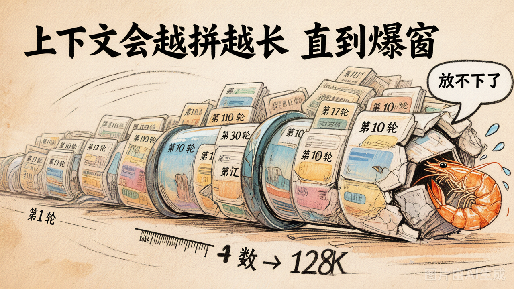

# 第 18 节 · 上下文工程：为什么必须管，不管会怎样

**上下文管理是 Agent 工程的核心命题。** 第2章 demo 里"每轮全量传 messages"看似没什么问题，但在 30 轮以上的真实任务中**必然撞窗口 + 烧光预算**——本章就来解决这件事。


## 对话膨胀实验：30 轮，prompt 暴涨 88 倍



跑一下 [`demo_18_context_explosion.py`](../lab/demo_18_context_explosion.py)，让 Agent 反复执行"总结之前的讨论 + 再补充 3 条建议"。输出如下：

```text
[第  1 轮] prompt=  256 tokens · total=  680 tokens
[第  5 轮] prompt= 2280 tokens · total= 2700 tokens
[第 10 轮] prompt= 5800 tokens · total= 6300 tokens
[第 15 轮] prompt=12400 tokens · total=13000 tokens
[第 20 轮] prompt=22500 tokens · total=23200 tokens
```

**20 轮，prompt 从 256 涨到 22500，翻了 88 倍**。总 token 消耗不断增长。三种后果会同时出现：

1. **撞窗口**：128K 看似很大，但 Coding Agent 一个 `read_file` 就能塞进来 5000 token，30 轮直接顶到天花板
2. **烧钱**：每轮都重新发送整段历史 = **相同内容反复计费**。10 轮后，第 1 条消息已经被算了 10 次价
3. **变笨**：第2章讲过 **Lost in the Middle**——上下文越长，中间部分被模型关注到的概率越低


## 三类消息，三种膨胀速度


| 信息类型 | 来源 | 单条规模 | 累计速度 | 备注 |
|---|---|---|---|---|
| **system** | 你写的角色提示 | 几百 token | 不增长 | 一次性，开篇就固定 |
| **user / assistant** | 对话历史 | 每条 100-500 token | 线性增长 | 轮数越多越膨胀 |
| **tool** | 工具返回结果 | **几百 ~ 几万 token** | 可能爆炸 | Coding Agent 的头号杀手 |

工业上**最贵的是 tool 消息**，看看这些场景：
- `read_file("README.md")` → 整个文件内容原封不动塞回上下文
- `bash("npm test")` → 几千行 STDOUT 全量返回
- `grep("function", "src/")` → 几百个匹配行一条不落

**没有上下文管理的 Coding Agent 可能仅仅跑过几轮就会崩溃。**


## 对症下药：三个痛点，三条解法


| 痛点 | 工程解法 |
|---|---|
| 撞窗口 | 设定 token 阈值，触发后主动压缩消息 |
| 烧钱 | 让重复信息只算一次（缓存命中 / 摘要替代） |
| 变笨 | 重要事实前置 + 无关历史后移 |

具体怎么压、怎么缓存、怎么前置——下一节给你四种典型策略。


## 上下文工程：Agent 时代的核心竞争力

> Andrej Karpathy 在 2024 年说过：**Context engineering is the new prompt engineering**。

换成大白话：在 Agent 时代，**写好 prompt 只是基本功**，真正的难点是**在正确的时机把正确的信息放进 messages**。具体来说，上下文工程覆盖四个维度：

- ContextManager → 管"本轮对话中 messages 怎么压缩"
- Memory → 管"跨会话的事实怎么持久化 + 检索"
- 工具的输出格式 → 管"tool 消息怎么写得短而有用"
- Skills（第7章） → 管"领域规范怎么按需加载"

**本章聚焦前两个：ContextManager + Memory。**


## 算一笔账：价格对比与一个致命误判

| 模型 | 上下文窗口 | 输入价格 ¥/1M token | 30 轮 messages 预估成本 |
|---|---|---|---|
| GPT-4o | 128K | ~¥18 | ¥0.36 |
| Claude 3.5 Sonnet | 200K | ~¥22 | ¥0.55 |
| DeepSeek-V3 | 128K | ~¥1 | ¥0.025 |
| 混元 Turbo S | 256K | 极低 | ≈0 |

简单换算一下：128K token 大概能装下一本中篇小说或几万行代码；200K 则能装半部《三体》。看起来很大——但别忘了，前文的实验中 20 轮对话就已经吃掉了 23k token。**窗口大 ≠ 可以不管**：就算用混元一分钱不花，**Lost in the Middle 依然会让你的 Agent 越聊越笨**。


## 动手试试：亲眼看看 prompt_tokens 怎么飙升

在云原生开发环境中执行：

```bash
cd 05-context-and-memory/lab/demos
python demo_18_context_explosion.py
```

注意观察三件事：

1. prompt_tokens 从第 1 轮到第 20 轮涨了多少倍
2. 每轮新增的 token 是匀速增长，还是在加速膨胀
3. 按这个趋势再跑 10 轮（到 30 轮），总量会不会摸到 128K 的天花板

把这个数字记住——**下一章要亲手把它压回去**。


## 核心回顾

| 要点 | 一句话理解                                 |
|------|---------------------------------------|
| 上下文工程 | 决定"什么信息在什么时机放进 messages"的工程           |
| 三大痛点 | 撞窗口、成本飙升、Lost in the Middle——三个问题同时变糟 |
| 最贵的角色 | tool 消息：一次返回几万 token 不奇怪，是上下文的头号杀手    |
| 不管的代价 | 30 轮之内必然崩溃——窗口再大也架不住无限增长              |

一句话总结本节：**上下文管理不是"优化项"，而是 Agent 能不能跑完任务的前提条件。**


## 随堂练习：写一个上下文压缩决策器

"撞窗口"是三大痛点之首，但 Agent 不能等到爆窗才动手——它需要在合适的时机**主动判断**是否该压缩历史消息。

### 题目

实现一个最小化的决策器：输入当前 messages 的 token 数，输出"继续"还是"该压了"。

### 提示

- 设定一个合理的 token 阈值（参考本节实验数据：20 轮 ≈ 23k token）
- 阈值可以不是死的——考虑留出安全余量，别等窗口满了再反应

🧪 [练习 4.3 · 上下文管理决策器](https://cnb.cool/xidian/vibe-coding-learning/vibe-agent-exercise/-/blob/main/exercises/05-context-and-memory/ex_4_3.py)


---

下一节：四种典型上下文管理策略——**截断 / 摘要 / 分层 / GSSC** —— 各自适合什么场景。
