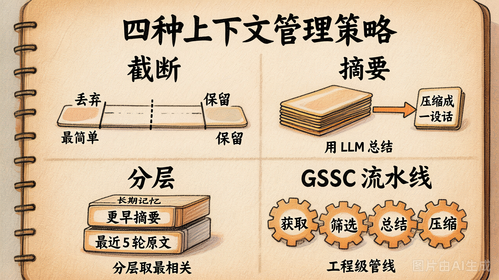
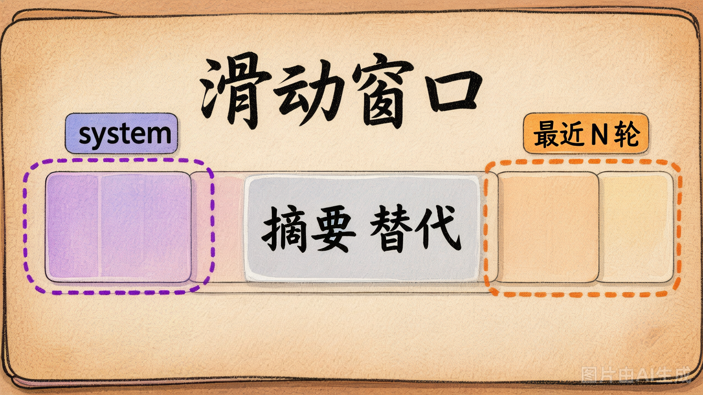

# 第 14 节 · 上下文管理策略：截断 / 摘要 / 分层 / GSSC

**四种策略，复杂度从低到高，token 节省效果越来越强，但丢失关键信息的风险也随之上升。** 没有万能方案，你需要根据任务类型灵活组合。




## 策略 ① 截断（Truncation）

最粗暴也最常用的一招：**只留头和尾，中间全丢掉**。保留 system prompt + 最近 N 轮对话，其余历史消息一刀切，不分析、不总结、不纠结。

```python
def truncate(messages, keep_last=6):
    sys_msgs = [m for m in messages if m["role"] == "system"]
    recent = messages[-keep_last:]
    return sys_msgs + recent
```


| 优点 ✅ | 缺点 ❌ |
|---|---|
| 逻辑极简，10 行内搞定 | 早期重要信息（用户偏好、硬约束）过了 N 轮直接消失 |
| 零 LLM 额外调用，无额外成本 | 用户体感差："AI 怎么突然忘了我说过的话" |
| token 总量有硬上限，绝不会超预算 | 不仅丢事实，中间的多步推理链也一起没了 |
| | N 值难调：太小丢上下文，太大又浪费 token |

截断最适合**短对话场景**——客服问答、一次性脚本生成这类任务，关键上下文本来就在最近几轮里，丢了中间也不影响。演示、原型阶段也常先用截断快速跑通效果。

> [!WARNING]
>
> 新手最常踩的坑：`messages[-keep_last:]` 一刀切到底，把 system prompt 也砍了。没了角色约束，模型直接"放飞自我"，输出完全不可控。**结论：system 消息永远不参与截断，必须原样保留。**


## 策略 ② 摘要（Summary）

比截断聪明一步：**不直接丢，而是压**。让 LLM 把中间的早期对话压缩成一段摘要，再拼上 system + 最近 N 轮原文。相当于用一次 LLM 调用的代价，换回对话历史的"浓缩记忆"。

```python
def summary(messages, keep_last=6):
    sys = [m for m in messages if m["role"] == "system"]
    middle = [m for m in messages if m["role"] != "system"][:-keep_last]
    recent = messages[-keep_last:]
    
    summary_text = llm.summarize(middle)  # ← 多花一次 LLM 调用
    return sys + [{"role": "system", "content": f"[早期摘要]\n{summary_text}"}] + recent
```


| 优点 ✅                                                     | 缺点 ❌                                         |
| ---------------------------------------------------------- | ---------------------------------------------- |
| 信息保留度比截断好得多                                     | 多一次 LLM 调用（成本 + 延迟）                 |
| token 节省效果明显（中间一段几千 token → 一段 200 字摘要） | 摘要质量靠 LLM —— **关键事实可能被压成一句话** |


> [!TIP]
>
> **让摘要更靠谱的两个 trick：**
>
> **Trick 1 — 明确告诉 LLM 保留什么、丢掉什么**
>
> ```python
> SUMMARY_PROMPT = """请压缩成 100 字以内的中文摘要。
> **必须保留：** 用户偏好、硬约束、关键事实、未完成的任务。
> **可以丢弃：** 客套话、重复确认、模型的解释性回复。
> """
> ```
>
> **Trick 2 — 让 LLM 输出结构化摘要，而非一段话**
>
> ```text
> - 用户偏好: 喜欢博物馆，不喜欢拥挤景点
> - 已确认事实: 6月去北京 7 天
> - 未决问题: 第 3 天行程未定
> ```
>
> 结构化摘要对后续模型更友好——后续轮次中 LLM 能更快"找到"它需要的那条信息。


## 策略 ③ 分层（Hierarchical）



截断和摘要的缝合升级版：**中间的历史既不删也不压成一坨，而是分层对待**——每条信息按"距离当前任务的相关度"归入不同层级，各层独立管理。

```
[原始 system]            ← 角色定义 / 工具 / 规则（永不丢失）
[关键长期事实]            ← 用户的硬约束，单独抽出，跨轮持久化
[早期对话摘要]            ← LLM 压缩的中间对话
[最近 N 轮原文]           ← 保持原始精度
+ user 当前问题
```

**关键事实怎么找？** 最朴素的做法是关键词匹配——用户说"对了"、"一定要"、"注意"时，往往是在补硬约束：

```python
KEY_FACT_KEYWORDS = {"过敏", "预算", "重要", "对了", "一定要", "不要", "注意"}

def extract_key_facts(messages):
    facts = []
    for m in messages:
        if m["role"] == "user" and any(kw in m["content"] for kw in KEY_FACT_KEYWORDS):
            facts.append(m["content"])
    return facts
```

更进阶的做法：用小模型做 NER / 关系抽取，或直接让大模型做"事实抽取"，准确率会高不少。


| 优点 ✅ | 缺点 ❌ |
|---|---|
| **关键事实跨任意多轮也能保住**——这是分层最大的价值 | 实现复杂度比截断 / 摘要高一档 |
| 工程上很灵活：每一层独立可调 | 关键事实抽取可能漏（关键词覆盖不全天然有盲区，进阶方案成本又上去了） |

分层最适合**多轮长对话**场景——用户会不断补充新约束（"对了，注意 X"），这种硬限制必须跨越所有工具调用一直保留。典型例子：旅行规划（预算/偏好反复调整）、Coding Agent（边写边改需求）。


## 策略 ④ GSSC 流水线

前三种策略都在"单点优化"（砍、压、分层），GSSC 则把上下文构造提升为一条**可复用的 4 阶段流水线**——每阶段各司其职，可以独立调优、替换、合入 CI。

| 阶段 | 做什么 |
|---|---|
| **G**ather（获取） | 从对话历史、Memory、工具输出、文件系统等所有来源拉取候选信息 |
| **S**elect（筛选） | 按当前任务相关度打分，丢弃低相关的 |
| **S**ummarize（总结） | 长内容压缩（此阶段可直接复用策略②的摘要能力） |
| **C**ompose（组装） | 按预设结构（system / facts / examples / context）拼成最终 messages |

这就是 Anthropic、Cursor、Claude Code 等生产级 Agent 背后的上下文管线。GSSC 更适合**真实生产系统和团队级 Agent**——当上下文来源不止对话历史，还涉及文档、代码库、Skills 等多个信息源时，流水线模型能保证每一阶段的决策都是可控、可观测的。


## 四种策略怎么选

| 任务特点 | 推荐策略 |
|---|---|
| 演示 / 短对话 | ① 截断 |
| 中等长度对话 / 单一任务 | ② 摘要 |
| 多轮 + 用户不断补约束 | ③ 分层（**今天 lab 实现这个**） |
| 真实工业级 Agent | ④ GSSC |

**实际工程里不会只用一个，而是组合：**

- 主链路用分层（③），保证关键事实不丢
- system 和关键事实这两层**永不参与压缩**
- 早期摘要层内部跑 GSSC 风格的 select → summarize 子流水线，按任务相关度决定压什么、怎么压


## 实验对比：四种策略实测

在 [`demo_14_context_strategies.py`](../lab/demo_14_context_strategies.py) 中跑了一段 30 轮对话，故意在第 2 轮埋了"过敏"事实、第 28 轮埋了"预算"事实，看各策略能不能保住：

| 策略 | messages 条数 | 字符数 | "过敏"（早期） | "预算"（近期） |
|---|---|---|---|---|
| 不处理 | 64 条 | ~28,000 | ✅ | ✅ |
| 截断（最近 6 轮） | 7 条 | ~600 | ❌ 被砍了 | ✅ |
| 摘要 | 8 条 | ~1,100 | ⚠️ 看 LLM 表现 | ✅ |
| 分层 | 9 条 | ~1,300 | ✅ 关键事实抽出 | ✅ |

跑一遍就能看清：截断靠位置，摘要靠运气，分层靠算法——**关键事实能不能保住，取决于你的工程方案，而非碰巧。**


## 动手验证：跑一遍 demo，亲眼对比四种策略

在云原生开发环境中执行：

```bash
python demo_14_context_strategies.py
```

运行后重点关注三件事：

1. **"过敏"（第 2 轮埋的早期事实）在每种策略下还在不在**——哪个丢了、哪个靠运气、哪个稳稳保住
2. 四种策略的 messages 条数和总字符数差距有多大
3. 分层策略是怎么把关键事实单独拎出来的，和摘要的"一大段话"有什么区别

看完再回来看上面的实验对比表格，你会对"为什么分层是关键"有切身体感。


## 本节回顾

| 策略 | 一句话 | 代价 |
|---|---|---|
| ① 截断 | 砍中间、留头尾 | 丢了早期的事实 |
| ② 摘要 | 用 LLM 把中间压成一段话 | 多一次 LLM 调用，摘要质量不稳定 |
| ③ 分层 | 关键事实单独抽出，永不被压 | 需要实现事实抽取逻辑 |
| ④ GSSC | 工程级流水线，每阶段独立可调 | 设计和维护成本高，适合团队 |

一句话带走：**从截断到 GSSC，复杂度逐渐升高，关键信息丢失的风险逐渐降低——没有标准答案，只有合适的组合。**


## 随堂练习

> 把"摘要策略"亲手实现一遍——`compress_messages` 接收一段长 messages，用 LLM 把早期对话压缩成一段话再拼回去。**关键事实别丢、客套话别留**：
>
> 🧪 [练习 4.1 · 上下文压缩器](https://cnb.cool/xidian/vibe-coding-learning/vibe-agent-course/-/blob/main/exercises/04-context-and-memory/ex_4_1.py)

---

下一节：上下文管理是"本次对话的事"。但用户的偏好、约束、习惯——**这些应该跨会话存活**。这就是 Memory 系统。
