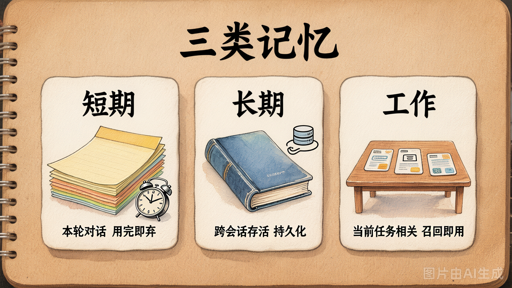
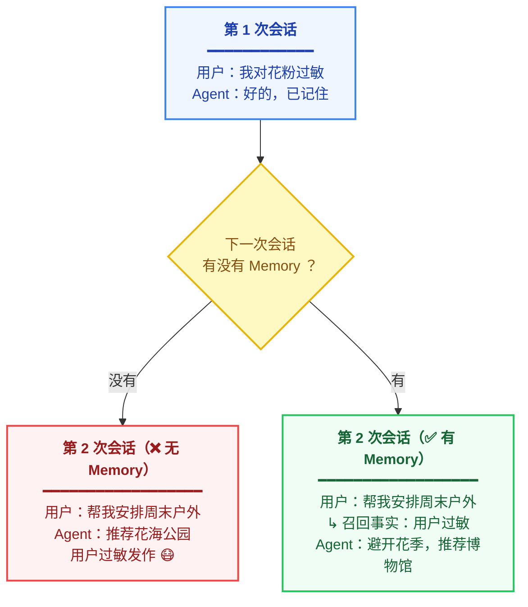
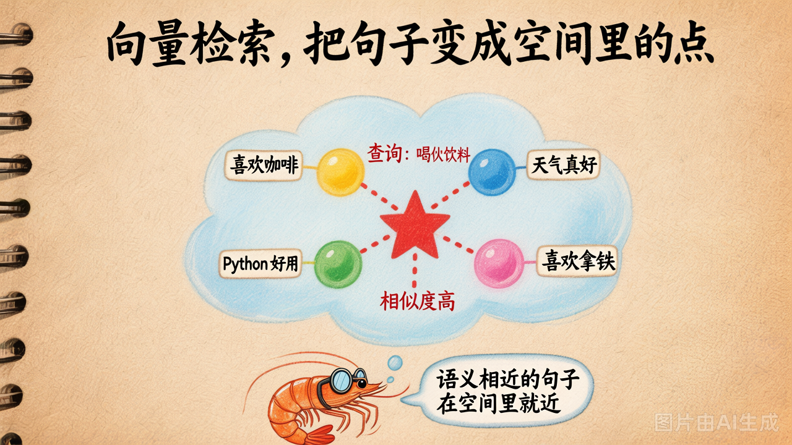
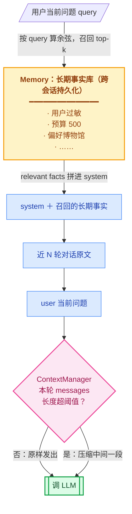

# 第 15 节 · 记忆系统：短期 / 长期 / 工作记忆

**ContextManager 是"本次对话怎么压缩"，Memory 是"跨会话怎么记住事实并按需召回"。** 二者协作让 Agent 像人一样"既不爆窗也不忘事"。


## 三种记忆，分别管什么



| 记忆类型 | 长什么样 | 存活时间 | 谁管 |
|---|---|---|---|
| **短期记忆** | 本次对话的 messages 列表 | 对话结束就丢 | 第2章的循环 |
| **长期记忆** | 持久化的事实库（用户偏好 / 历史决策 / 项目规范） | 跨会话存活 | **Memory（今天主角）** |
| **工作记忆** | 当下任务用到的精挑信息 | 当前任务用完即弃 | ContextManager |

工业 Coding Agent（Cursor / Claude Code）这三种全用：
- 短期：本次会话的 chat history
- 工作：当前任务相关的代码片段、上次工具结果
- 长期：用户的常用风格 / 项目的代码规范 / Skills


## 长期记忆要解决什么问题



**没有长期记忆 = 每次会话都是「第一次见面」。**


## 怎么实现：向量检索

理解了"为什么需要长期记忆"，下面讲"怎么做"。最流行的实现方案是：**向量数据库 + 余弦相似度**。

- **向量数据库**：把每条事实编码成向量存起来，支持快速相似度检索
- **余弦相似度**：衡量"问题"和"事实"语义上有多近

核心思路只有三步，我们先跟关键词检索对比一下，再看具体代码。


### 关键词检索 vs 向量检索：为什么选向量

这两条路都能"按问题查事实"，但判断"相关"的方式完全不同：

| | 关键词检索（BM25 / TF-IDF） | 向量检索（embedding + 余弦相似度） |
|---|---|---|
| 判断依据 | 词面重合度：问题和事实**有几个相同的词** | 语义相近度：问题和事实**在向量空间里有多近** |
| 典型失败案例 | 查"我有什么过敏症状"找不到"我对花粉敏感"（零词面重合） | 几乎不会失败，但向量质量依赖 embedding 模型 |
| 优点 | 无需外部依赖 / 零成本 / 毫秒级 | 同义、改写、跨语言都能处理 |
| 缺点 | 字面不匹配就完全失效 | 需要调用 embedding 接口（有成本） |
| 适合场景 | 术语稳定的领域（API 文档、代码库） | 自然语言对话、用户偏好 |

**为什么 Memory 选向量检索？** 我们的主线是"记住用户偏好和对话事实"，这些都是自然语言，用词完全不可预测——用户说"花粉过敏"，后面可能说"春天能去哪"，关键词检索完全接不住。

> [!TIP]
> 
> **延伸：混合检索（Hybrid Retrieval）**
> 
> 工业 RAG 系统常常**两条路一起走**：关键词检索负责"精确匹配术语"，向量检索负责"语义匹配"，最后把两份结果合并去重。这是 exercises 里的延伸题，感兴趣可以试试。


---




### 三步走

#### 第 1 步：把每条事实"编码"成一个向量

```python
text = "用户对花粉过敏"
vector = embedding_model.embed(text)   # 一个 1536 维的向量
# [0.012, -0.034, 0.567, ..., 0.089]
```

这个向量是一个空间里的点。**语义相近的句子在空间里就近**。

> [!NOTE]
>
> **关于注释里的「1536 维向量」**
>
> "1536 维"不是抽象概念——`vector` 就是一个**长度为 1536 的 `list[float]`**，`len(vector) == 1536`。叫"维"是因为数学上每个数对应一根独立坐标轴：3 个数 → 三维空间里的一个点 (x, y, z)；1536 个数 → 1536 维空间里的一个点。
>
> 这个数字**不是随便选的，由 embedding 模型写死**：OpenAI `text-embedding-ada-002` / `text-embedding-3-small` 是 1536，`text-embedding-3-large` 是 3072，BGE-base / M3E-base 是 768，腾讯混元 `hunyuan-embedding` 是 1024 或 1536（看版本）。所以注释里的 1536 是举例，**实际跑起来 `len(vec)` 是多少，看你用哪个模型**。
>
> 几何含义就是后面整套向量检索的基石：embedding 模型的训练目标是**把语义相近的句子，编码到这个高维空间里靠近的位置**——人脑想象不了 1536 维，但"距离/夹角"的数学运算照样能做，这就是第 3 步用 `cosine` 算相似度的依据。
>
> 维度并非越高越好：维度高表达力强、召回质量好，但每条向量占 `4 × 1536 = 6KB`（float32），10 万条事实就是 600MB，余弦遍历也变慢——这是后面要引入向量数据库（FAISS / Milvus / Qdrant）的根本原因。


#### 第 2 步：所有事实都存成 (text, vector) 对

事实有两个来源：
1. **用户主动说**："我对花粉过敏" → 直接存
2. **对话结束提炼**：用 LLM 从对话记录里提炼值得长期记的事实（第 4 步会讲）

```python
memory = [
    ("用户对花粉过敏", vec_1),
    ("用户每天预算 500 元", vec_2),
    ("用户喜欢博物馆", vec_3),
    ...
]
```

> [!NOTE]
> 
> **生产环境的做法**
> 
> 上面用 Python list 只是演示。生产环境中：
> - **存储**：用向量数据库（FAISS / Qdrant / Milvus / pgvector），支持快速 ANN 检索
> - **去重**：存入前检查相似度，避免“用户对花粉过敏”和“用户花粉过敏”重复存储
> - **元数据**：每条事实附带 `timestamp`、`source`（用户说 / AI 提炼）、`confidence` 等字段
> - **原子性**：每条只存**一个事实**，不要存段落。对比：
>   - ✅ `("用户对花粉过敏", vec)`  
>   - ❌ `("用户过敏，预算500，喜欢博物馆", vec)` ← 混在一起，召回时要么全召回要么全不召回


#### 第 3 步：查询时，用余弦相似度召回相关事实

```python
query = "周末有没有什么健康限制"
q_vec = embedding_model.embed(query)      # ① 查询也编码成向量

# ② 和每条事实算余弦相似度
texts = [text for text, _ in memory]
scores = [cosine(q_vec, v) for _, v in memory]

# ③ 取分数最高的 top-k，完成召回
top_k = sorted(zip(scores, texts), reverse=True)[:3]
# → [(0.78, "用户对花粉过敏"), (0.31, "用户喜欢博物馆"), ...]
```

分数越高，语义越近。这份召回结果后面会塞进 system prompt，模型就能“记住”这些事实了。

> [!NOTE]
>
> **`zip` 函数的作用**
>
> `zip(scores, texts)` 把两个列表"打包"在一起，让每个分数和对应的文本绑定成一对：
>
> ```python
> scores = [0.78, 0.31, 0.95]
> texts  = ["用户对花粉过敏", "用户每天预算 500 元", "用户喜欢博物馆"]
> 
> zip(scores, texts)
> # → [(0.78, "用户对花粉过敏"), (0.31, "用户每天预算 500 元"), (0.95, "用户喜欢博物馆")]
> ```
>
> 打包后，`sorted(..., reverse=True)` 才能按分数从高到低排序，同时保持分数和文本的对应关系不变。类似拉链，`zip` 把两边一一对齐“拉上”。
>
> **那么为什么 `sorted` 按 `score` 排序而不是 `text`？**
>
> `zip(scores, texts)` 产出的是一个个**二元组**（tuple），例如 `(0.78, "用户对花粉过敏")`。Python 对 tuple 排序遵循**字典序（lexicographical order）**：
>
> 1. **先比较第 1 个元素**（这里是 `score`）
> 2. 如果第 1 个元素相同，**再比较第 2 个元素**（这里是 `text`）
>
> 这正是我们需要的行为——想让谁排前面，就把它放在 tuple 的第一位。如果想按 `text` 排序，需要显式指定 `key`：
>
> ```python
> sorted(zip(scores, texts), key=lambda x: x[1], reverse=True)
> # → 按 text 字符串（Unicode 编码）排序，结果会乱
> ```
>
> **总结**：不是 `sorted` 特意针对 `score`，而是 Python tuple 排序**默认从第一个元素开始比**，而 `zip(scores, texts)` 恰好把 `score` 放在前面。


## Embedding 模型与余弦相似度

上面三步走的第 1 步和第 3 步反复用到了两个东西：**Embedding 模型**（文本 → 向量）和**余弦相似度**（两向量有多近）。这一节把它们的细节展开讲清楚。

Embedding 模型是一个**专门把文本变向量的独立模型**，跟 chat 模型不是一回事——它不会对话，只管编码。

```python
from openai import OpenAI

client = OpenAI(base_url=BASE_URL, api_key=API_KEY)

resp = client.embeddings.create(
    model="hunyuan-embedding",   # CNB 上是这个名字
    input="用户对花粉过敏",
)
vec = resp.data[0].embedding     # → [float] 长度 1024 或 1536
```

接口跟 chat completion 同一个 base_url + 同一个 API key，**只是端点是 `/embeddings`**。


### 余弦相似度怎么算

```python
import numpy as np

def cosine(a, b):
    return float(np.dot(a, b) / (np.linalg.norm(a) * np.linalg.norm(b)))
```

返回值 [-1, 1]，**越接近 1 越相似**。一般 > 0.5 算"挺相关"，> 0.7 算"很相关"。

> [!NOTE]
>
> **为什么"越接近 1 越相似"**
>
> `cosine(a, b)` 算出来的就是两向量夹角 θ 的 `cos(θ)`：
>
> - 点积的几何定义 `a · b = |a| · |b| · cos(θ)`，分母 `|a| · |b|` 把长度约掉，**只剩方向**。（即 
> - 三角函数性质：θ ∈ [0°, 180°] 上 `cos(θ)` 单调递减——0° → 1（同向，最相似），90° → 0（垂直，无关），180° → -1（反向，最不相似）。
> - embedding 模型的训练目标就是把**语义相近的句子映射到方向相近的向量**。所以"夹角小 ↔ cos 大 ↔ 语义近"。
>
> 用一张二维示意图直观感受一下（箭头从原点出发）：
>
> ```text
>                  "用户对花粉过敏"
>                          ↗  ← 夹角很小，cos ≈ 0.95（语义近）
>                       ↗
>     query: "周末有  ↗
>     健康限制吗"   ●─────────────→  "用户喜欢逛博物馆"
>                    \              ↑ 夹角约 90°，cos ≈ 0.05（无关）
>                     \
>                      ↘
>                       ↘  ← 夹角接近 180°，cos ≈ -0.9（相反）
>                "用户讨厌一切户外活动"
> ```
>
> 同一个 query，跟三段记忆分别算余弦：方向越贴近，分数越高 → 召回时排第一。
>
> 阈值 0.5 / 0.7 是经验值：高维空间里完全无关的文本余弦也很少为 0（通常 0.0~0.3），同主题约 0.5~0.75，近义改写 0.85+。**换 embedding 模型阈值会平移**，工程上要抽样校准。
>


## 一个最小 Memory 类

把前面三步走串起来，就是一个能用的 Memory 类——只用了 10 行代码：

```python
class Memory:
    """最小可用的向量记忆：存入事实 → 按语义召回。"""

    def __init__(self):
        self.entries: list[tuple[str, list[float]]] = []   # [(text, vector)]

    def add(self, text: str) -> None:
        """存入一条事实：文本编码为向量，和原文一起保存（步骤 1+2）。"""
        self.entries.append((text, embed(text)))

    def search(self, query: str, k: int = 3) -> list[tuple[float, str]]:
        """按语义召回 top-k 条相关事实（步骤 3）。"""
        q = embed(query)                                            # ① 查询也编码成向量
        scored = [(cosine(q, v), t) for t, v in self.entries]      # ② 遍历记忆，逐一算余弦相似度
        scored.sort(reverse=True)                                   # ③ 按分数降序（tuple 默认比第一个元素）
        return scored[:k]                                           # ④ 返回 top-k
```

三行核心逻辑对应前面三步走：

| 代码 | 对应步骤 |
|---|---|
| `self.entries.append((text, embed(text)))` | 步骤 1+2：编码 + 存储 |
| `scored = [(cosine(q, v), t) for ...]` | 步骤 3：逐条算相似度 |
| `scored.sort(reverse=True)` + `[:k]` | 步骤 3：排序 + 取 top-k |

**就这么简单。** `demo_15_memory.py` 完整版在这基础上加了持久化、元数据和阈值过滤，核心还是这十行。


## 将 Memory 集成到 Agent：两个时机

Memory 和 Agent 的协作是一个**"读 → 写"闭环**：

- **对话前（读）**：从 Memory 召回相关事实，注入 system prompt，让模型"想起"历史
- **对话后（写）**：从本轮对话中提炼值得长期记的事实，写回 Memory，留给下次用

下面分别看这两个时机的代码。


### 步骤 1：每轮对话前，召回事实注入 prompt

这是 Memory 的 **"读"** 环节——每轮对话开始前，用当前问题去 Memory 里检索，把相关事实注入 system prompt：

```python
def chat(user_input):
    # ① 用当前问题作为查询，召回 top-3 相关事实
    relevant = memory.search(user_input, k=3)

    # ② 阈值过滤：相似度 < 0.5 的不要，避免无关信息污染 prompt
    facts = [t for score, t in relevant if score > 0.5]

    # ③ 把召回的事实拼进 system prompt
    system = f"{base_system_prompt}\n\n[相关长期事实]\n" + "\n".join(facts)

    # ④ 和正常的 chat history 一起发给 LLM
    return llm.chat([{"role": "system", "content": system}, ...])
```

**关键点**：Memory 做的事情就是把召回结果"塞"进 system prompt。模型本身没有任何变化，它只是看到了更多上下文，就能"想起"跨会话的事实了。


### 步骤 2：对话结束后，提炼事实写回 Memory

这是 Memory 的 **"写"** 环节——对话结束后，用 LLM 从本轮对话中提炼值得长期记的事实，存回 Memory：

```python
# ① 设计提炼 prompt：告诉 LLM 哪些该存、哪些不该存
DISTILL_PROMPT = """从下面对话提炼**值得长期记的事实**，每行一条：
- 用户偏好
- 硬约束
- 重要事实
不要把一次性问答存进去。

对话：{transcript}
"""

# ② 调 LLM 提炼事实（LLM 输出每行一条事实的纯文本）
new_facts = llm.chat(...)

# ③ 逐行写入 Memory（内部自动做 embedding + 存储）
for fact in new_facts.splitlines():
    if fact.strip():                # 跳过空行
        memory.add(fact)
```

**关键点**：不是把所有原始对话都往 Memory 里塞，而是用 LLM **先提炼、再存入**。`DISTILL_PROMPT` 里特别叮嘱"不要把一次性问答存进去"，就是为了避免"你刚才说了什么"这类临时对话污染记忆库。

下次会话步骤 1 召回时，这些事实就会被自动检索到——**"读 → 写"闭环就此完成**。


## 一个常见困惑：Memory 和 ContextManager 怎么协作？



> [!NOTE]
>
> 色块说明：
>
> 1. 黄色：长期记忆 Memory
> 2. 蓝色三段：本轮 messages（短期/工作记忆）
> 3. 粉色：控制节点 ContextManager
> 4. 绿色：最终发给 LLM


**两件事的分工：**

- **Memory** 决定"哪些长期事实塞进来"
- **ContextManager** 决定"塞进来的本次 messages 怎么压"


## 生产环境的进阶方向

当前实现的 `Memory` 是最小可用版，适合学习和原型验证。以下是从 demo 到上线需要补齐的六个方向：

| 进阶项 | 要做什么 | 为什么 |
|---|---|---|
| 向量库 | 换成 FAISS / Qdrant / Milvus / pgvector | `numpy` 逐条算余弦是 O(n)，上万条事实后每一轮召回都卡；向量库用 ANN 索引可以 O(log n) |
| Embedding 缓存 | 同一段文本不重复 embed（按文本 hash 缓存） | embedding 接口有成本和延迟，同一事实反复调用浪费资源 |
| 阈值过滤 | 相似度 < 阈值的结果直接丢弃（步骤 1 代码中已用 `> 0.5`） | 不相关的事实注入 prompt 是噪声，反而干扰模型 |
| 时间衰减 | 老记忆权重随时间递减 | 用户偏好会变化，一年前的"预算 500"可能已涨到 800 |
| 混合检索 | 向量检索 + 关键词检索，两者结果合并去重 | 精确术语（API 名、配置项）关键词匹配更准，自然语言向量匹配更好——结合两者取长补短 |
| 用户分区 | 每条事实绑定 `user_id`，按用户隔离检索 | 多用户场景下不能把张三的花粉过敏召回给李四 |

第 7 章和第 8 章介绍工业级 Agent 时会逐一展开这些内容。


## 动手实践

在云原生开发环境中运行配套演示脚本，直观感受 Memory 的召回效果：

```bash
python demo_15_memory.py
```

脚本依次跑两个演示：

1. **基本召回**：预置 5 条事实，用 4 个不同查询测试——看余弦相似度能否把语义相近的事实排到前面
2. **注入对话**：把步骤 1+2 串起来走一遍完整流程——召回事实 → 注入 system prompt → 完成对话 → 提炼新事实写回


## 要点回顾

本节从"为什么要长期记忆"出发，走完了向量检索的原理、实现和集成。核心概念一句话总结：

| 概念 | 一句话理解 |
|------|-----------|
| 短期记忆 | 本次对话的 messages，对话结束即丢弃（Agent 循环管） |
| 长期记忆 | 跨会话持久化的事实库，基于向量检索按语义召回（Memory 管） |
| 工作记忆 | 当前任务精挑的上下文片段，用完即弃（ContextManager 管） |
| Memory | 长期记忆的实现：`add()` 编码+存储，`search()` 向量检索召回 |
| Embedding | 把文本变成向量的独立模型（不是 chat 模型），向量长度由模型写死 |
| 余弦相似度 | 衡量两向量方向有多近，值 ∈ [-1,1]，越接近 1 语义越近 |
| 集成方式 | 每轮对话前召回事实注入 system prompt（读）→ 对话结束后提炼新事实写回（写），形成闭环 |


---

理论部分到此结束。下面 lab：
- Part 1：写 ContextManager（分层策略）
- Part 2：写 Memory（向量检索）
- Part 3：拼成 Agent v2，对比第3章朴素版的 token 消耗
