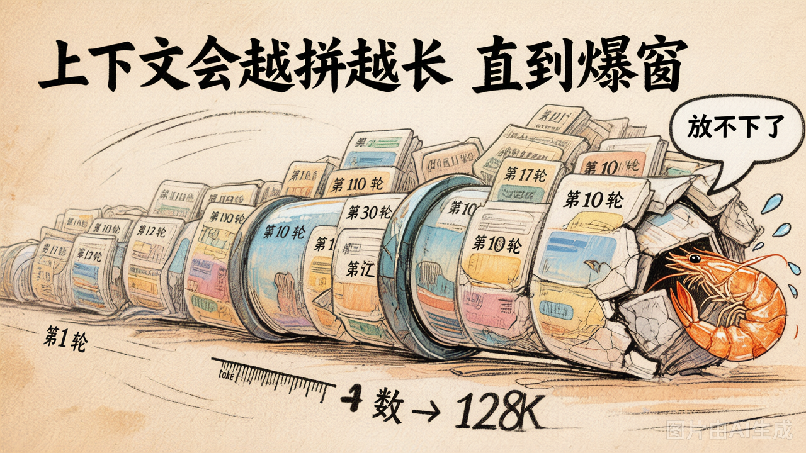
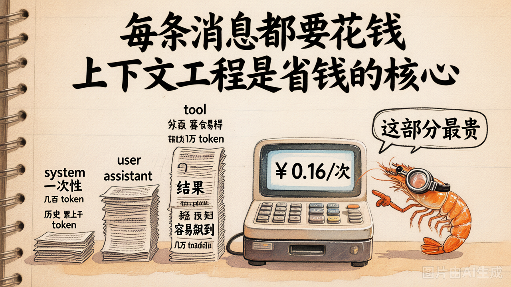

# 第 18 节 · 上下文工程：为什么要管、什么时候爆

## 一句话回答

> **上下文管理 = Agent 工程的核心。** Day2 你看到的"每轮全量传 messages"在 30 轮以上的真实任务里**必然爆窗 + 烧钱**，今天我们就来解决它。

## 一个 30 轮对话能膨胀到什么程度



跑一下 [`demo_18_context_explosion.py`](../lab/demo_18_context_explosion.py)，让 Agent 反复回答"总结之前的讨论 + 再补充 3 条建议"。结果非常具体：

```
[第  1 轮] prompt=  256 tokens · total=  680 tokens
[第  5 轮] prompt= 2280 tokens · total= 2700 tokens
[第 10 轮] prompt= 5800 tokens · total= 6300 tokens
[第 15 轮] prompt=12400 tokens · total=13000 tokens
[第 20 轮] prompt=22500 tokens · total=23200 tokens
```

**20 轮 prompt 涨了 88 倍**，总 token 消耗指数增长。三件事会同时变糟：

1. **撞窗口**：128K 看起来很大，但 Coding Agent 一个 `read_file` 工具调用就能塞进去 5000 token，30 轮直接顶到天花板
2. **烧钱**：每轮重新发整段历史 = **同样的内容反复算钱**。10 轮对话相当于把开头那条消息算了 10 次价
3. **变笨**：Day1 第 3 节讲过 **Lost in the Middle**，长上下文里中间的内容关注度显著下降

## 三类信息的"代价"完全不同



| 信息类型 | 来源 | 单条规模 | 累计速度 | 备注 |
|---|---|---|---|---|
| **system** | 你写的角色提示 | 几百 token | 不增长 | 一次性的 |
| **user / assistant** | 对话历史 | 每条 100-500 token | 线性增长 | 多轮就累积 |
| **tool** | 工具返回结果 | **几百 ~ 几万 token** | 可能爆炸 | Coding Agent 杀手 |

工业上**最贵的是 tool 消息**：
- `read_file("README.md")` → 整个 README 内容塞回 messages
- `bash("npm test")` → 几千行 stdout 回到 messages
- `grep("function", "src/")` → 几百个匹配行回到 messages

**没有上下文管理的 Coding Agent 不可能跑过 5 轮就崩。**

## 上下文管理要解决的三件事

| 痛点 | 工程对策 |
|---|---|
| 撞窗口 | 触发阈值 → 主动压缩 |
| 烧钱 | 让重复信息只算一次（缓存 / 摘要） |
| 变笨 | 把"重要事实"前置 + 把无关历史挪后 |

具体怎么压、怎么缓存、怎么前置——下一节给你 4 种典型策略。

## "上下文工程"为什么是 Agent 工程的核心

> Andrej Karpathy 在 2024 年说过：**Context engineering is the new prompt engineering**。

一句话总结这个观点：在 Agent 时代，**写 prompt 已经不是难点**，难点在于**怎么把对的信息在对的时机塞进 messages**：

- ContextManager → 管"本次对话的 messages 怎么压缩"
- Memory → 管"跨会话的事实怎么持久化 + 检索"
- 工具的输出格式 → 管"tool 消息怎么写得短而有用"
- Skills（Day7） → 管"领域规范怎么按需加载"

**今天我们重点搞前两个：ContextManager + Memory。**

## 一些数字感

| 模型 | 上下文窗口 | 输入价格 ¥/1M | 30 轮 messages 输入成本（估） |
|---|---|---|---|
| GPT-4o | 128K | ~¥18 | ¥0.36 |
| Claude 3.5 Sonnet | 200K | ~¥22 | ¥0.55 |
| DeepSeek-V3 | 128K | ~¥1 | ¥0.025 |
| 混元 Turbo S | 256K | 极低 | ≈0 |

**"窗口大"≠"可以不管"**：哪怕用混元免费，**Lost in the Middle 还是会让你的 Agent 越聊越笨**。

## 动手试试

```bash
cd 04-context-and-memory/lab/demos
python demo_18_context_explosion.py
```

看着 prompt_tokens 一路飙升，记住这个数字，**Day4 后面要把它压回去**。

## 小结

| 概念 | 一句话理解 |
|------|-----------|
| 上下文工程 | 决定"什么信息在什么时机塞进 messages"的工程 |
| 三大痛点 | 撞窗口 / 烧钱 / Lost in the Middle |
| 最贵的角色 | tool 消息（一次返回几万 token 不奇怪） |
| 不管的代价 | 30 轮内必崩 |

---

下一节：四种典型上下文管理策略——**截断 / 摘要 / 分层 / GSSC** —— 各自适合什么场景。
