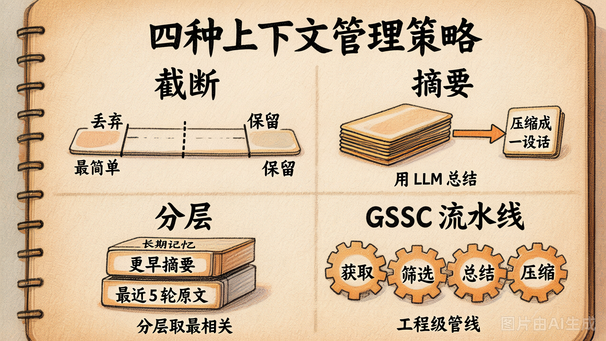
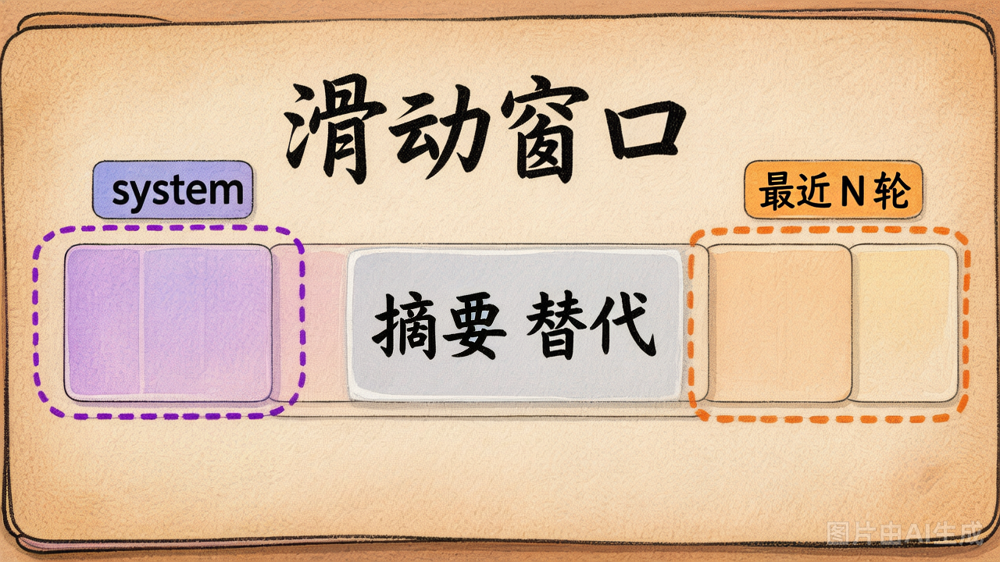

# 第 19 节 · 上下文管理策略：截断 / 摘要 / 分层 / GSSC

## 一句话回答

> **四种策略复杂度递增、token 节省力递增、"丢失重要信息的风险"也递增。** 你要根据任务类型混着用。



## 策略 ① 截断（Truncation）

### 做法

保留 system + 最近 N 轮，**直接砍掉中间**。

```python
def truncate(messages, keep_last=6):
    sys_msgs = [m for m in messages if m["role"] == "system"]
    recent = messages[-keep_last:]
    return sys_msgs + recent
```

### 优缺点

✅ **极简，10 行内搞定**
✅ 没有任何 LLM 额外调用，零成本
❌ 早期的"重要事实"（用户偏好 / 硬约束）一旦过了 N 轮就消失
❌ 用户会感觉"AI 突然忘了我说过的话"

### 适合场景

- 客服类短对话（用户的硬约束都在最近几轮里）
- 演示场景（要简单跑通看效果）

### ⚠️ 一个常见的坑

很多人写截断时**不保留 system**，直接 `messages[-keep_last:]`。这样系统提示也被砍了，模型行为完全跑偏。**system 必须永远保留**。

## 策略 ② 摘要（Summary）

### 做法

system + LLM 摘要的"早期对话" + 最近 N 轮原文。

```python
def summary(messages, keep_last=6):
    sys = [m for m in messages if m["role"] == "system"]
    middle = [m for m in messages if m["role"] != "system"][:-keep_last]
    recent = messages[-keep_last:]
    
    summary_text = llm.summarize(middle)  # ← 多花一次 LLM 调用
    return sys + [{"role": "system", "content": f"[早期摘要]\n{summary_text}"}] + recent
```

### 优缺点

✅ 信息保留度比截断好得多
✅ token 节省效果明显（中间一段几千 token → 一段 200 字摘要）
❌ 多一次 LLM 调用（成本 + 延迟）
❌ 摘要质量靠 LLM —— **关键事实可能被压成一句话**

### 让摘要更靠谱的两个 trick

**trick 1：明确告诉 LLM 摘要要保留什么**

```python
SUMMARY_PROMPT = """请压缩成 100 字以内的中文摘要。
**特别保留：** 用户偏好、硬约束、关键事实、未完成的任务。
**可以丢弃：** 客套话、重复确认、模型的解释性回复。
"""
```

**trick 2：让 LLM 输出结构化摘要**

```yaml
- 用户偏好: 喜欢博物馆，不喜欢拥挤景点
- 已确认事实: 6月去北京 7 天
- 未决问题: 第 3 天行程未定
```

结构化摘要比"一段话"对后续模型更友好。

## 策略 ③ 分层（Hierarchical）



### 做法

**每条信息按"距离当下任务的相关度"分三层：**

```
[原始 system]            ← 角色 / 工具 / 规则
[关键长期事实]            ← 用户的硬约束（独立抽出来）
[早期对话摘要]            ← LLM 压缩
[最近 N 轮原文]           ← 不动
+ user 当前问题
```

**关键事实**怎么找？最朴素的做法是**关键词匹配**：

```python
KEY_FACT_KEYWORDS = ["过敏", "预算", "重要", "对了", "一定要", "不要"]

def extract_key_facts(messages):
    facts = []
    for m in messages:
        if m["role"] == "user" and any(kw in m["content"] for kw in KEY_FACT_KEYWORDS):
            facts.append(m["content"])
    return facts
```

更进阶：用一个小模型做命名实体识别 / 关系抽取，或者直接让大模型做"事实抽取"。

### 优缺点

✅ **关键事实跨越任意多轮也能保住** —— 这是分层最大的价值
✅ 工程上很灵活：每一层独立可调
❌ 实现复杂度比截断/摘要高一档
❌ 关键事实抽取本身可能漏（关键词没覆盖的情况）

### 适合场景

- **多轮长对话** + **用户会不断补充硬约束**（典型：旅行规划、工程咨询）
- Coding Agent（用户提需求时常说"对了，注意 X"，这种约束必须跨越所有工具调用记得住）

## 策略 ④ GSSC 流水线

### 做法

把上下文构造看成一个 4 阶段流水线：

| 阶段 | 做什么 |
|---|---|
| **G**ather（获取） | 从对话历史 / Memory / 工具 / 文件系统拉所有可能相关的信息 |
| **S**elect（筛选） | 按当前任务相关度打分，扔掉不相关的 |
| **S**ummarize（总结） | 长内容压缩 |
| **C**ompose（组装） | 按特定结构（system / facts / examples / context）拼成最终 messages |

这个就是 Anthropic / Cursor / Claude Code 内部用的工程级 pipeline，每一阶段都是一个可单独优化的模块。

### 跟 04-my-agent 对应

仓库里 [`examples/04-my-agent/context/context_builder.py`](../../examples/04-my-agent/context/context_builder.py) 就是一个 GSSC 风格实现。**今天不要求你写 GSSC**，但要求你看懂它。

### 适合场景

- 真实生产系统
- 团队级 Agent（多个上下文源并存：会话 / 文档 / 代码 / Skills）

## 怎么选

| 任务特点 | 推荐策略 |
|---|---|
| 演示 / 短对话 | ① 截断 |
| 中等长度对话 / 单一任务 | ② 摘要 |
| 多轮 + 用户不断补约束 | ③ 分层（**今天 lab 实现这个**） |
| 真实工业级 Agent | ④ GSSC |

**实际工程里经常组合**：
- 主链路用分层
- system / 关键事实 这两层不参与压缩
- 早期摘要这一层跑 GSSC 风格的 select + summarize 子流水线

## 一个真实数据

我们 [`demo_19_context_strategies.py`](../lab/demo_19_context_strategies.py) 里跑了一段 30 轮对话，**第 2 轮埋了"过敏"事实，第 28 轮埋了"预算"事实**：

| 策略 | messages 条数 | 字符数 | "过敏" 保住？ | "预算" 保住？ |
|---|---|---|---|---|
| ① 不处理 | 64 条 | ~28000 字符 | ✅ | ✅ |
| ② 截断（最近 6 轮）| 7 条 | ~600 字符 | ❌ 被砍了 | ✅ |
| ③ 摘要 | 8 条 | ~1100 字符 | ⚠️ 看 LLM 摘得好不好 | ✅ |
| ④ 分层 | 9 条 | ~1300 字符 | ✅ 关键事实抽出来了 | ✅ |

跑一遍你会发现，**关键事实抽取不靠运气，靠算法**。

## 动手试试

```bash
python demo_19_context_strategies.py
```

看 4 种策略的输出对比，**特别注意**"过敏"这个早期事实在每种策略下还在不在。

## 小结

| 策略 | 一句话理解 |
|------|-----------|
| ① 截断 | 砍掉中间，保留头尾 |
| ② 摘要 | 中间用 LLM 压缩成一段话 |
| ③ 分层 | 关键事实独立抽出来，跨越任意压缩 |
| ④ GSSC | 工程级 4 阶段流水线，工业 Agent 通用做法 |

---

下一节：上下文管理是"本次对话的事"。但用户的偏好、约束、习惯——**这些应该跨会话存活**。这就是 Memory 系统。
