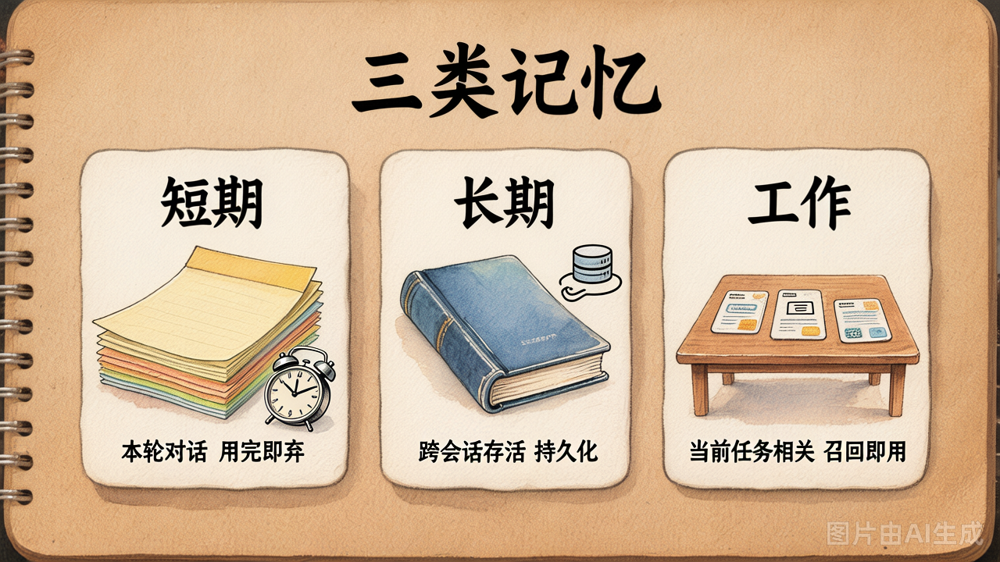
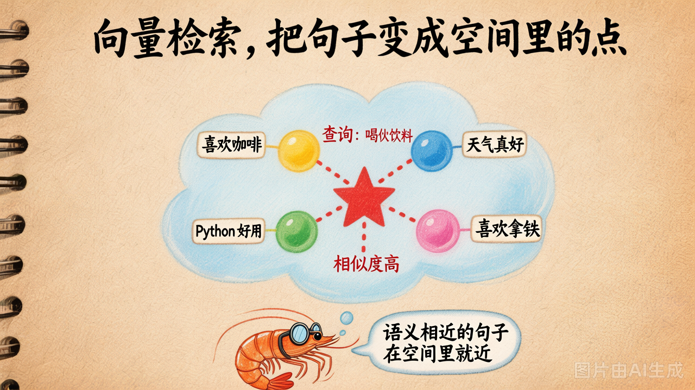

# 第 20 节 · 记忆系统：短期 / 长期 / 工作记忆

## 一句话回答

> **ContextManager 是"本次对话怎么压缩"，Memory 是"跨会话怎么记住事实并按需召回"。** 二者协作让 Agent 像人一样"既不爆窗也不忘事"。

## 三种记忆，分别管什么



| 记忆类型 | 长什么样 | 存活时间 | 谁管 |
|---|---|---|---|
| **短期记忆** | 本次对话的 messages 列表 | 对话结束就丢 | Day2 的循环 |
| **长期记忆** | 持久化的事实库（用户偏好 / 历史决策 / 项目规范） | 跨会话存活 | **Memory（今天主角）** |
| **工作记忆** | 当下任务用到的精挑信息 | 当前任务用完即弃 | ContextManager |

工业 Coding Agent（Cursor / Claude Code）这三种全用：
- 短期：本次会话的 chat history
- 工作：当前任务相关的代码片段、上次工具结果
- 长期：用户的常用风格 / 项目的代码规范 / Skills

## 长期记忆要解决什么问题

```
第 1 次会话：用户说"我对花粉过敏"
↓
第 2 次会话：用户说"帮我安排周末户外"
↓
理想结果：Agent 自动记起"过敏"这个事实，避开花季景点
现实结果（没有 Memory）：Agent 一无所知，推荐花海公园
```

**没有长期记忆 = 每次会话用户都得重复说自己。**

## 怎么实现：向量检索

最流行的长期记忆实现 = **向量数据库 + 余弦相似度**。

### 先简单提一下：关键词检索 vs 向量检索

这两条路都能"按问题查事实"，差别在**怎么判断相关**：

| | 关键词检索（BM25 / TF-IDF） | 向量检索（embedding + 余弦） |
|---|---|---|
| 怎么判断相关 | 看问题和事实**有几个相同的词** | 看问题和事实**语义有多近** |
| 例子 | 查"我有什么过敏症状"找不到"我对花粉敏感"（一个词都不重合） | 这两句嵌入后向量很近，能召回 |
| 优点 | 无需嵌入模型 / 零外部依赖 / 极快 | 处理同义、改写、跨语言都不怕 |
| 缺点 | "字面对不上"就崩 | 要调 embedding 接口，每次要钱 |
| 适合 | 关键词稳定的领域（API 文档、代码命名） | 自然语言对话、用户偏好 |

**今天 Memory 我们走向量检索这条路**——课程主线就是用户偏好/对话事实，向量更合适。关键词法当 baseline 在 exercises 里留了一道延伸题（你也可以两条线混合，叫 hybrid retrieval，工业 RAG 的常见做法）。

---



### 三步走

**第 1 步：把每条事实"编码"成一个向量**

```python
text = "用户对花粉过敏"
vector = embedding_model.embed(text)   # 一个 1536 维的向量
# [0.012, -0.034, 0.567, ..., 0.089]
```

这个向量是一个空间里的点。**语义相近的句子在空间里就近**。

**第 2 步：所有事实都存成 (text, vector) 对**

```python
memory = [
    ("用户对花粉过敏", vec_1),
    ("用户每天预算 500 元", vec_2),
    ("用户喜欢博物馆", vec_3),
    ...
]
```

**第 3 步：查询时**

```python
query = "周末有没有什么健康限制"
q_vec = embedding_model.embed(query)

# 跟所有事实算余弦相似度
scores = [cosine(q_vec, v) for _, v in memory]

# 取分数最高的 top-k
top_k = sorted(zip(scores, memory), reverse=True)[:3]
# → [(0.78, "用户对花粉过敏"), (0.31, "用户喜欢博物馆"), ...]
```

最相关的事实分数最高，**就召回它**。

## Embedding 是什么 / 怎么调

Embedding 模型是一个**专门把文本变向量的小模型**，跟 chat 模型不是一回事。

```python
from openai import OpenAI

client = OpenAI(base_url=BASE_URL, api_key=API_KEY)

resp = client.embeddings.create(
    model="hunyuan-embedding",   # CNB 上是这个名字
    input="用户对花粉过敏",
)
vec = resp.data[0].embedding     # → [float] 长度 1024 或 1536
```

接口跟 chat completion 同一个 base_url + 同一个 API key，**只是端点是 `/embeddings`**。

### 余弦相似度怎么算

```python
import numpy as np

def cosine(a, b):
    return float(np.dot(a, b) / (np.linalg.norm(a) * np.linalg.norm(b)))
```

返回值 [-1, 1]，**越接近 1 越相似**。一般 > 0.5 算"挺相关"，> 0.7 算"很相关"。

## 一个最小 Memory 类

```python
class Memory:
    def __init__(self):
        self.entries = []   # [(text, vector)]

    def add(self, text):
        self.entries.append((text, embed(text)))

    def search(self, query, k=3):
        q = embed(query)
        scored = [(cosine(q, v), t) for t, v in self.entries]
        scored.sort(reverse=True)
        return scored[:k]
```

**就这么简单**。`demo_20_memory.py` 完整版加了几个工程细节（持久化 / 元数据），核心还是这十行。

## 把 Memory 接到 Agent：两步

### 步骤 1：每轮对话开始前，召回相关事实

```python
def chat(user_input):
    relevant = memory.search(user_input, k=3)
    facts = [t for score, t in relevant if score > 0.5]
    
    system = f"{base_system_prompt}\n\n[相关长期事实]\n" + "\n".join(facts)
    return llm.chat([{"role": "system", "content": system}, ...])
```

**召回的事实塞进 system prompt** —— 模型自动"记得"这些事。

### 步骤 2：对话结束时，提炼新事实写回 Memory

```python
DISTILL_PROMPT = """从下面对话提炼**值得长期记的事实**，每行一条：
- 用户偏好
- 硬约束
- 重要事实
不要把一次性问答存进去。

对话：{transcript}
"""

new_facts = llm.chat(...)
for fact in new_facts.splitlines():
    memory.add(fact)
```

下次会话时，这些事实会自动被召回。

## 一个常见困惑：Memory 和 ContextManager 怎么协作？

```
┌──────────────────────────────────────────────┐
│  Memory（长期）                                │
│  ┌──────────────┐                             │
│  │ 用户过敏      │                             │
│  │ 预算 500     │                             │
│  │ 偏好博物馆   │                             │
│  └──────┬───────┘                             │
│         │ 每轮按 query 召回 top-k             │
└─────────┼──────────────────────────────────────┘
          │
          ▼
┌──────────────────────────────────────────────┐
│  本轮 messages                                  │
│   [system + 召回事实] + [近 N 轮原文] +        │
│   [user 当前问题]                              │
└──────────┬─────────────────────────────────────┘
           │ ContextManager 检查长度
           │ 超阈值 → 压缩中间一段
           ▼
        发给 LLM
```

**两件事的分工：**
- **Memory** 决定"哪些长期事实塞进来"
- **ContextManager** 决定"塞进来的本次 messages 怎么压"

## 工业版的进阶（今天不做）

| 进阶项 | 做什么 |
|---|---|
| 向量库 | 换成 pgvector / qdrant / milvus，量大时 numpy 算余弦慢 |
| Embedding 缓存 | 同一段文本不要 embed 两次（按 hash 缓存） |
| 阈值过滤 | 相似度 < 0.5 不召回，避免污染 prompt |
| 时间衰减 | 老记忆权重降低 |
| 混合检索 | 关键词 + 向量混合，关键词命中加权 |
| 用户分区 | 每个用户单独的命名空间，避免串号 |

Day7 / Day8 介绍工业级 Agent 时会再讨论这些。

## 动手试试

```bash
python demo_20_memory.py
```

会跑两个演示：
1. 基本召回：5 条事实，4 个查询，看相似度对不对
2. 注入对话：把 Memory 召回结果塞进 system 跑一次完整对话

## 小结

| 概念 | 一句话理解 |
|------|-----------|
| 短期 / 长期 / 工作记忆 | 三种存活时间不同的"记忆" |
| Memory | 长期记忆的实现，本质是向量数据库 |
| Embedding | 把文本变成向量的小模型 |
| 余弦相似度 | 衡量两个向量"语义有多近" |
| 用法 | 每轮按 query 召回 top-k 事实，塞 system；对话结束提炼新事实写回 |

---

理论部分到此结束。下面 lab：
- Part 1：写 ContextManager（分层策略）
- Part 2：写 Memory（向量检索）
- Part 3：拼成 Agent v2，对比 Day3 朴素版的 token 消耗
