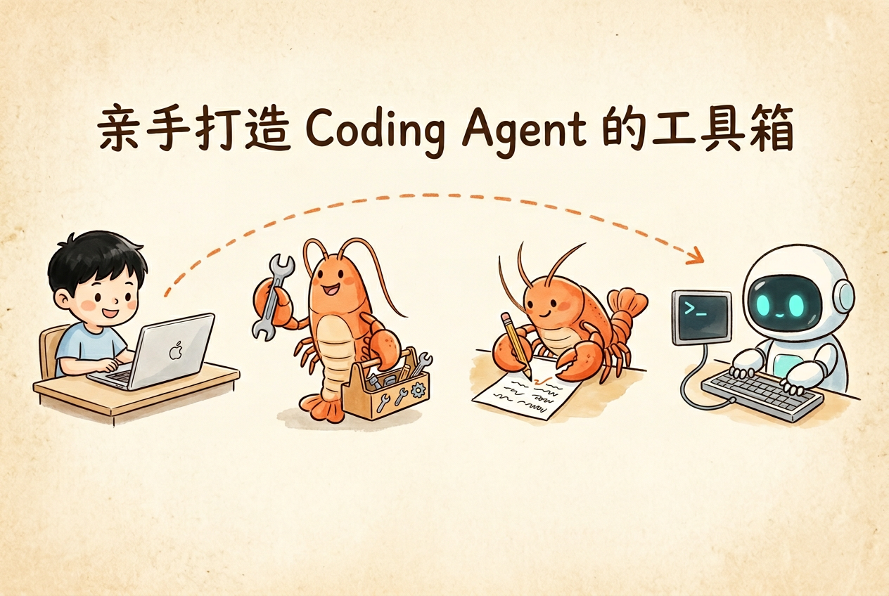

<p align="center">
    
</p>


# 第 5 章 · Coding Agent 工具集与整合

本章目标：先为 Coding Agent 实现 5 个核心工具，再把前面各章的零件整合成一个能跑通真实任务的完整 Coding Agent。
产出：`my-agent/coding_tools/`（read/write/edit/list_dir/bash 五个工具）+ `my-agent/main.py`（整合后的 Agent 入口）。


## 你将学到

- Coding Agent 的核心工作流：理解需求 → 定位代码 → 修改文件 → 验证结果 → 汇报变更，形成 5 阶段闭环
- 工具设计的三条原则：唯一性约束（一个工具只做一件事）、安全闸门（高风险操作需确认）、友好报错（失败时给出可执行的提示）
- `read` / `write` / `edit` / `list_dir` / `bash` 五个工具的实现思路与关键细节
- 整体串联流程：把 LLMClient / ToolRegistry / Agent / ContextManager / Memory + 工具按单向数据流组装成完整 Agent
- Coding Agent 的几个形态：REPL / Solo / WebUI，一个内核多种壳


## 内容结构

| 节 | 内容 | 讲义 | Demo |
|----|------|------|------|
| 17 | Coding Agent 工作流 | [17-coding-agent-workflow.md](./lecture/17-coding-agent-workflow.md) | `demo_17_five_stages.py` |
| 18 | 工具设计哲学 | [18-tool-design.md](./lecture/18-tool-design.md) | `demo_18_design_philosophy.py` |
| 19 | 整合与形态 | [19-integration-and-modes.md](./lecture/19-integration-and-modes.md) | - |


## 运行示例

在云原生开发环境中执行：

```bash
cd 05-coding-agent-tools/lab
python demo_17_five_stages.py
python demo_18_design_philosophy.py
```


## 本章作业

本章作业需要在配套仓库中完成，按以下步骤操作：

> [!TIP]
>
> 📦 **作业仓库**：<https://cnb.cool/opencamp/learning-agent/vibe-agent-exercise>

**操作流程**：

1. **Fork** 作业仓库到自己的账号下
2. 在 `my-agent/` 目录中完成核心代码产出，在 `exercises/` 目录中完成配套填空题
3. **提交 PR**，CI 流水线（`.cnb.yml`）会自动运行测评
4. 全部测试通过（全绿）即视为作业通过检测 ✅，作业完成


## 本章产出

1. 在作业仓库中补全 `my-agent/coding_tools/` 下的 5 个工具文件，让测试通过：

```bash
cd my-agent
python tests/test_coding_tools.py
```

2. 把所有模块接好，在 `my-agent/main.py` 里组装出完整 Agent 并跑通：

```bash
cd my-agent
python main.py
# 输入一个真实任务，如："在当前目录创建一个 hello.py，写一个 hello world，然后运行它"
```
