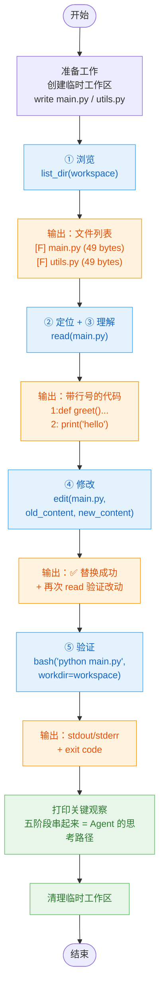

# demo_24_five_stages.py 代码导读

这份文档帮你**从零看懂这段[代码](../demo_24_five_stages.py)**：Coding Agent 写代码的"五阶段工作流"到底长什么样、5 个核心工具分别对应哪个阶段、上一步的输出如何变成下一步的输入，最后结合真实运行结果讲清楚每一步发生了什么。

> [!NOTE]
>
> 配套讲稿：[第 24 节《Coding Agent 的工作模式》](../../lecture/24-coding-agent-workflow.md)
>
> 这是第 6 章的第一个 demo，也是整章的"骨架演示"——不引入 LLM，纯手动调用工具，把 Agent 内部本该自动完成的决策过程，一步步摆在你眼前。


## 一句话理解

写代码可以拆成 **浏览 → 定位 → 理解 → 修改 → 验证** 五个阶段，本 demo 不依赖 LLM，而是**人工扮演 Agent 的角色**，依次调用 `list_dir`、`read`、`edit`、`bash` 四个工具，完成"给 `main.py` 的 `greet` 函数加一句开场白"这个真实任务——让你直观看到每个工具的输出如何变成下一步决策的依据。


## 先认识 5 个关键概念

只要抓住这 5 个词，整段代码就通了：

| 概念 | 含义 | 在代码里的体现 |
|---|---|---|
| **五阶段工作流** | 写代码的过程被拆成浏览、定位、理解、修改、验证五个环节，循环往复 | 代码里用 5 个 `print("=" * 60)` 分段，逐一对应 |
| **list_dir（浏览）** | 列出目录内容，区分文件 / 目录，帮 Agent 建立"这个项目里有什么"的初步认知 | `list_dir(workspace)` → `[F] main.py  (49 bytes)` |
| **read（理解）** | 读文件内容并**带行号**返回，方便后续精确引用某一行 | `read(os.path.join(workspace, "main.py"))` |
| **edit（修改）** | 用 `old_content` 精确匹配一段已有文本，替换为 `new_content`，而不是重写整个文件 | `edit(path, old_content=..., new_content=...)` |
| **bash（验证）** | 在指定工作目录下执行 shell 命令，返回 `stdout/stderr` + 退出码，用于判断修改是否生效 | `bash("python main.py", workdir=workspace)` |

> [!NOTE]
>
> 本 demo 省略了"② 定位"对应的 `glob`/`grep`——因为项目只有两个文件，`list_dir` 的输出已经足够定位到 `main.py`，代码里也用注释明确写了"已在上一步定位，无需 grep"。真实项目文件成百上千时，定位阶段才会真正用上搜索工具。


## 代码整体结构

整个文件分六块：

```text
① 准备工作     创建临时工作区，写入 main.py / utils.py 两个示例文件
② 阶段一 浏览   list_dir(workspace) —— 看看项目里有什么
③ 阶段二+三 定位+理解  read(main.py) —— 读内容，带行号
④ 阶段四 修改   edit(main.py, old_content, new_content) —— 精确替换一段代码
⑤ 阶段五 验证   bash("python main.py", workdir=...) —— 跑起来看结果对不对
⑥ 收尾         打印三条关键观察 + 清理临时工作区
```

> [!TIP]
>
> 五个阶段用到的工具全部从 `coding_tools` 包导入：`from coding_tools import bash, edit, list_dir, read, write`。`write` 只在"准备工作"里用来**创建**两个示例文件——这也印证了第 24 节的一个核心原则：**write 用于新建文件，edit 用于修改已有文件**，两者不能互换。


## 执行流程图




## 分步拆解（对照源码）

### 步骤 0 · 准备：造一个"迷你项目"

```python
workspace = tempfile.mkdtemp(prefix="05_demo_")
write(os.path.join(workspace, "main.py"), "def greet() -> None:\n    print('hello')\n\ngreet()\n")
write(os.path.join(workspace, "utils.py"), "def add(a: int, b: int) -> int:\n    return a + b\n")
```

用 `tempfile.mkdtemp` 造一个临时目录当"项目根目录"，再用 `write` 新建两个最小示例文件——这一步不算五阶段之一，只是为了让后面的 demo 有真实文件可操作。

> [!TIP]
>
> 💡 用临时目录而不是仓库里的固定文件，是为了让这个 demo **可重复运行、不污染仓库**——每次运行都是一个全新的、干净的工作区，运行完还会 `shutil.rmtree` 清理掉。


### 步骤 1 · 阶段① 浏览：`list_dir`

```python
print(list_dir(workspace))
```

**对应人类动作**：在 IDE 里展开项目目录树，第一眼看看有哪些文件。

**输出（截取自[运行结果](../output/demo_24_five_stages.txt)）：**

```
# /var/folders/.../05_demo_lpj47o27
共 0 个目录, 2 个文件
[F] main.py  (49 bytes)
[F] utils.py  (49 bytes)
```

关键点：`[F]` 前缀明确标出这是文件而非目录——这个区分决定了下一步该继续 `list_dir` 深入子目录，还是直接 `read` 这个文件。这里两个都是文件，且 `main.py` 显然是入口，所以下一步选择 `read` 它。


### 步骤 2 · 阶段②+③ 定位 + 理解：`read`

```python
print(read(os.path.join(workspace, "main.py")))
```

**对应人类动作**：Cmd+P 打开文件（这里因为文件已知，"定位"和"打开阅读"合并成一步），然后逐行阅读代码内容。

**输出：**

```
1:def greet() -> None:
2:    print('hello')
3:
4:greet()
```

关键点：**每行都带行号**。这不是为了好看，而是给下一步的 `edit` 做铺垫——虽然 `edit` 本身用 `old_content` 内容匹配、不依赖行号，但带行号的输出能让人（或模型）在报告问题、引用代码位置时更精确（比如"第 2 行需要加一句 print"）。


### 步骤 3 · 阶段④ 修改：`edit`

```python
result = edit(
    os.path.join(workspace, "main.py"),
    old_content="def greet() -> None:\n    print('hello')",
    new_content="def greet() -> None:\n    print('=== Demo ===')\n    print('hello')",
)
```

**对应人类动作**：在 IDE 里选中一段代码，输入新内容替换掉。

**核心机制**：`edit` 内部做的事情是：

```python
count = content.count(old_content)
if count == 0:   # old_content 没找到 → 报错，提示先用 read 核对
if count > 1:    # old_content 匹配了多处 → 报错，提示加更多上下文让它唯一
# 恰好 1 次 → 执行替换，只改这一处
new_full = content.replace(old_content, new_content, 1)
```

`old_content` 必须在文件中**逐字符**唯一匹配（含空格、缩进、换行），这是"按内容定位"而非"按行号定位"——第 24 节讲稿解释过原因：任何一次修改都会导致后续行号整体偏移，行号定位在多步编辑时极易出错，而内容定位永远精确。

**输出：**

```
✅ 已替换 /var/folders/.../main.py 中的内容

修改后的文件：
1:def greet() -> None:
2:    print('=== Demo ===')
3:    print('hello')
4:
5:greet()
```

代码里紧接着又调用了一次 `read`，打印"修改后的文件"——这一步是在**验证修改本身有没有写对**，是"阶段④修改"内部的自我核查，还不是"阶段⑤验证"（后者验证的是程序运行结果，而非文件内容）。

> [!IMPORTANT]
>
> ⚠️ 对比第 24 节讲稿里的反模式：如果这里用 `write` 重写整个 `main.py`，哪怕只改一行 `print`，也要把 `greet()` 的调用那一行原样重新输出一遍——这就是"灯泡坏了却把整栋楼电路全拆了重装"。`edit` 只动目标那一小段，其余代码原封不动。


### 步骤 4 · 阶段⑤ 验证：`bash`

```python
print(bash("python main.py", workdir=workspace))
```

**对应人类动作**：在终端里跑一下脚本，看输出对不对。

**输出（本机实际运行结果）：**

```
[exit code: 127]
[stderr]
/bin/sh: python: command not found
```

**这里恰好暴露了一个真实场景**：本机没有 `python` 命令（可能只有 `python3`），所以退出码是 `127`（"命令未找到"）而非预期的 `0`。

> [!TIP]
>
> 💡 这其实是这个 demo 最有价值的"意外教学点"——`bash` 工具的输出里**含退出码**，正是为了让 Agent（或人）能明确判断"验证到底通过没有"，而不是靠猜。如果这里退出码是 `0`，说明 `print('=== Demo ===')` 和 `print('hello')` 都正常打印了，修改验证成功；如果像这次一样返回 `127`，Agent 下一步该做的是**换成 `python3` 再跑一次**，而不是误以为代码逻辑有问题去改 `edit`。这正体现了讲稿里"bash 的输出要含 exit code，让 LLM 判断而非猜测"的设计原则。


### 步骤 5 · 收尾：三条关键观察 + 清理

```python
print("  ① 五个阶段在脑子里串起来 = Coding Agent 的'思考路径'")
print("  ② 每个阶段的工具输出，**都是下一步决策的输入**")
print("     - list 输出 → 决定 read 哪个文件")
print("     - read 输出 → 决定 edit 改哪一段")
print("     - bash 输出 → 决定要不要再修一轮")
print("  ③ 把上面整段流程喂给 LLM + tool_calls 协议，就成了 第6章 的真 Agent")

shutil.rmtree(workspace)
```

这三句话正是整个 demo 想传达的核心：**demo 本身没有 LLM，是人在"扮演" Agent 的决策过程**——list_dir 的输出决定读哪个文件，read 的输出决定改哪一段，bash 的输出决定要不要再修一轮。把这条手动串起来的链路，换成让 LLM 根据每一步的工具返回值自主选择下一个工具调用，就是完整的 Coding Agent。


## 真实运行结果解读

完整运行日志见 [output/demo_24_five_stages.txt](../output/demo_24_five_stages.txt)：

| 阶段 | 工具调用 | 输出关键信息 | 决定了什么 |
|---|---|---|---|
| ① 浏览 | `list_dir(workspace)` | 2 个文件：`main.py`、`utils.py` | 下一步该 `read` 哪个文件（选了看起来是入口的 `main.py`） |
| ②+③ 定位理解 | `read(main.py)` | `greet()` 函数只有一句 `print('hello')` | 明确了 `edit` 时 `old_content` 该写什么 |
| ④ 修改 | `edit(main.py, ...)` | `✅ 已替换` | 确认修改成功，可以进入验证阶段 |
| ⑤ 验证 | `bash("python main.py", ...)` | `exit code: 127`，`python: command not found` | 揸示运行环境没有 `python` 命令，若是真 Agent，下一步会尝试 `python3` 重跑，而不是去改代码逻辑 |

**这条链路最关键的观察**：五个工具的调用顺序、参数选择，全部由上一步的输出决定——没有任何一步是"凭空决定"的：

```
list_dir 的文件列表 → 决定 read 哪个文件
read 的代码内容      → 决定 edit 的 old_content 怎么写
edit 的替换结果      → 决定要不要进入 bash 验证
bash 的 exit code    → 决定任务是否完成，还是要回到 edit 再修一轮
```


## 这段代码体现出什么

正是第 24 节要教你的核心认识：

1. **五阶段工作流是一切 Coding Agent 的公共骨架**——无论 Cursor、Claude Code 还是 Devin，核心循环都是浏览 → 定位 → 理解 → 修改 → 验证，产品之间的差异只在工具实现得更精致，而不是流程本身不同。
2. **工具是按"工作流阶段"设计的，不是按"文件操作动词"设计的**——这也是为什么本章只做 5 个工具（`list_dir`/`read`/`write`/`edit`/`bash`），而不是一堆看似全面的 `open_file`/`close_file`/`delete_file`。
3. **工具的输出是"给下一步用的输入"，不是随便打印几行字**——`read` 带行号、`list_dir` 区分文件/目录、`bash` 含退出码，每一处设计都是为了让下一步（无论是人还是 LLM）能拿到刚好够用的信息去做决策。

> [!TIP]
>
> 跑完这个 demo 再往下看第 25 节（[demo_25_design_philosophy.py](../demo_25_design_philosophy.py)），你会看到这 5 个工具背后那些"防 LLM 翻车"的设计细节——比如 `edit` 为什么要求 `old_content` 必须唯一匹配、`bash` 为什么要拦截危险命令模式。这些细节正是让"手动走一遍"的流程，能安全地交给 LLM 自主执行的关键。
