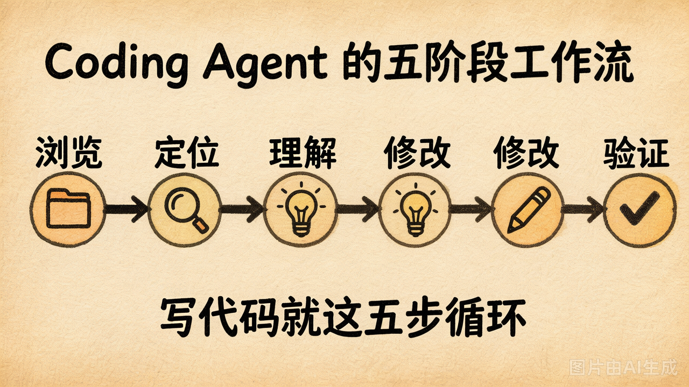
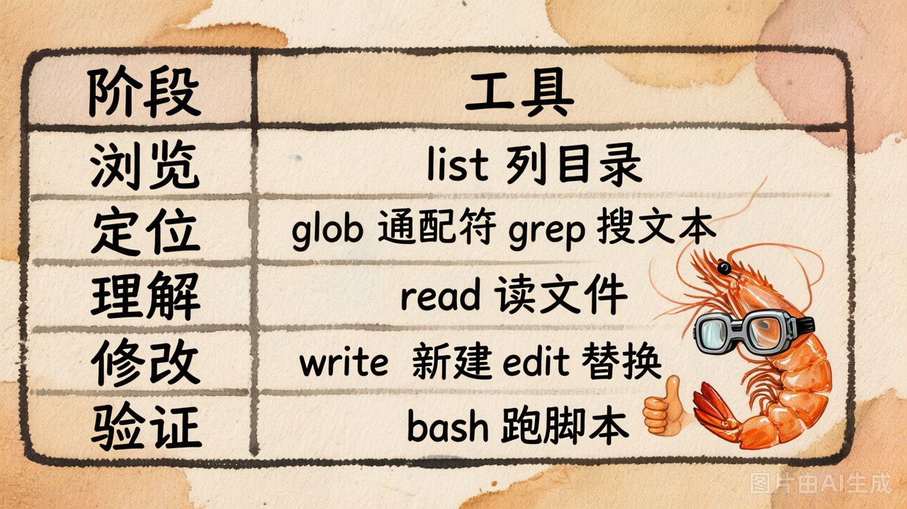
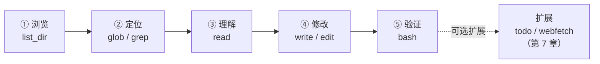
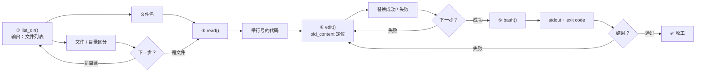

# 第 17 节 · Coding Agent 的工作模式

写代码的过程可以归纳为五个阶段：浏览 → 定位 → 理解 → 修改 → 验证。Coding Agent 的工具集正是围绕这五个阶段来设计的。


## 五阶段工作流



| 阶段 | 你（人类）会做什么 | 对应的工具类 |
|---|---|---|
| **① 浏览** | 在 IDE 里展开项目目录树，了解整体结构 | `list_dir` |
| **② 定位** | 用 Cmd+P 找文件、Cmd+F 搜文本 | `glob`、`grep` |
| **③ 理解** | 打开关键文件、阅读代码 | `read` |
| **④ 修改** | 新建文件 / 修改某一段代码 | `write`、`edit` |
| **⑤ 验证** | 运行测试 / 执行脚本 | `bash` |

**写代码本质上就是这五个阶段的不断循环。**无论是 Cursor、Claude Code 还是 Devin，这些产品的核心循环都遵循同样的五个阶段——只是工具实现得更加精致。


## 工具该按"工作流阶段"分类，而非"文件操作"

很多人第一反应是按文件操作的"动词"来分类：`open` / `close` / `read` / `write`。**但这是错的**。正确的分类逻辑应当是**按"Agent 工作流的阶段"来划分**。举几个例子：

- 为什么不需要 `open_file`？因为 LLM 不像人类那样需要"打开"文件——`read` 一次读取就够了
- 为什么不需要 `delete_file`？因为它是高危操作，也不属于五个阶段中的任何一个
- 为什么不需要 `move_file`？因为模型直接用 `bash` 执行 `mv` 就能完成

**少而精的工具集，远比一堆"看似全面"的工具更好用。**


## 五个阶段与工具的映射



按五个阶段把工具分组：



**今天必做的 5 个工具**：`list_dir` / `read` / `write` / `edit` / `bash`，它们覆盖了五个阶段所需的最低限度能力。


## 实战：完整走一遍五阶段

任务："给 `main.py` 里的 `greet` 函数加一句开场白，再运行验证。"

```
① list_dir(".")          → 看到 main.py / utils.py
② read("main.py")        → 看到 def greet(): print("hello")
③（已在上一步定位，无需 grep）
④ edit("main.py", 
     old_content="def greet():\n    print('hello')",
     new_content="def greet():\n    print('=== 开场 ===')\n    print('hello')")
                          → ✅ 替换成功
⑤ bash("python main.py") → 看到 "=== 开场 === \\n hello"
```

运行 [`demo_17_five_stages.py`](../lab/demo_17_five_stages.py)，**手动**完整走一遍这 5 步，你就能直观感受到工具输出之间的依赖关系。


## 工具之间的数据流：上一步的输出，决定下一步的输入

五个工具不是各干各的，而是**一条数据流上的五个节点**：



**这条链能跑通的前提是：每个工具的输出格式，要刚好能喂给下一个工具当输入。**

这就是为什么工具的输出不是随便打印几行字——

| 工具 | 输出设计 | 为谁服务 |
|------|---------|---------|
| `read` | **带行号** | 让 `edit` 能精确引用第几行，也让报错定位更准 |
| `list_dir` | **区分文件 / 目录** | 让下一步知道该 `read` 还是递归 `list_dir` |
| `bash` | **含 exit code** | 让 LLM 判断"测试过了没"，而不是猜 |

一句话总结：**工具的输出，是给 LLM 看的 UI。** 设计输出格式的时候，想的不是"打印什么好看"，而是"下一个工具从这段输出里能拿到什么"。


## 为什么不该让 LLM 一次性"写整个文件"

新手常常这样用：

```python
# ❌ 让 LLM 一次写完整个 main.py
write("main.py", "...500 行内容...")
```

这是一个**典型的反模式**，背后有三个深层问题：

1. **Token 浪费**：每改一行都要重写全篇——哪怕只改了一个变量名，整个文件也要重新输出一遍，而 LLM 是按 token 计费的
2. **输出不可控**：长输出时 LLM 容易"写丢"某一段（模型本身有输出长度上限），你永远不知道哪个函数会莫名其妙消失
3. **缺乏可追溯性**：重写整个文件，你根本无法知道到底改了什么——就像用 `git commit -a` 但不写 commit message

> [!NOTE]
>
> **反模式**：看起来合理、但实际会带来问题的做法 ❌


**打个比方**：灯泡坏了，师傅却把整栋楼的电路全拆了重装。不仅浪费，还引入了新的风险。

**正确做法**：用 `edit` 做精确的"局部修改"，`write` 只用于**新建文件**。区分标准很简单：

| 场景 | 用什么 | 原理 |
|------|--------|------|
| 修改已有文件的某一段 | `edit` | 只替换目标代码块，不改动其他部分 |
| 创建新文件 | `write` | 文件还不存在，只能从头写 |

**一个思维习惯**：每次想用 `write` 改已有文件时，先问自己一句——"我真的需要重写整个文件吗？还是只改几行就够了？"


## 动手试试：完整五阶段实操

在云原生开发环境中运行：

```bash
cd 05-coding-agent-tools/lab/demos
python demo_17_five_stages.py
```

脚本会**创建一个临时工作区**，按 ①→②→③→④→⑤ 的顺序依次调用五个工具，并把每一步的输出打印出来。运行时注意观察：

- `list_dir` 的输出里**文件和目录是否明确区分**（决定下一步该 `read` 还是继续 `list_dir`）
- `read` 返回的代码**是否带了行号**（为 `edit` 的精确引用做准备）
- `edit` 的 `old_content` 参数**如何精确定位目标代码块**（替换后只改目标区域，其他代码不动）
- `bash` 的输出里**有没有退出码**（让 LLM 能判断测试是通过还是失败，而不是靠猜）


## 核心回顾

| 要点 | 一句话理解 |
|------|-----------|
| 五阶段工作流 | 浏览 → 定位 → 理解 → 修改 → 验证，Agent 的工作模式就是这五个阶段的循环 |
| 工具分类 | 按**工作流阶段**分类，而非文件操作动词 |
| 数据流 | 工具间不是孤立的——上一步的输出，就是下一步的输入 |
| 输出设计 | 工具的输出是给 LLM 看的 UI：`read` 带行号、`list_dir` 区分类型、`bash` 含退出码 |
| 必做 5 个 | `list_dir` / `read` / `write` / `edit` / `bash` |

一句话总结本节：**Coding Agent 的本质，就是把"写代码"拆成五个阶段，用一把精心设计的工具串成一条可循环的数据流。**


---

下一节：每个工具背后藏着大量的"防 LLM 翻车"设计。**第 18 节会拆 4 个最关键的设计选择。**
