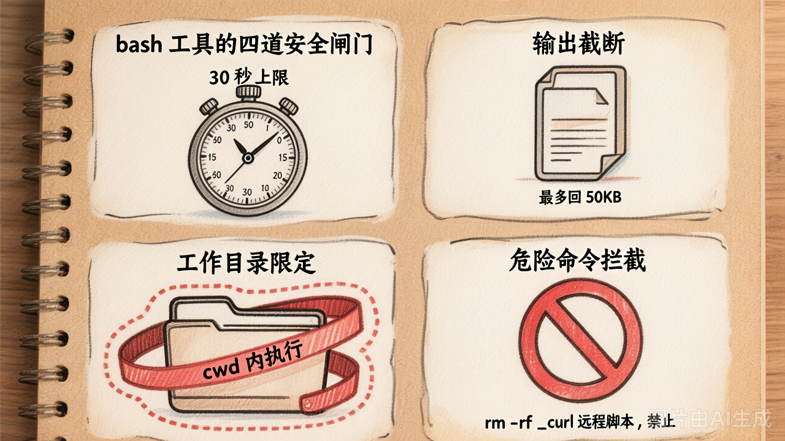
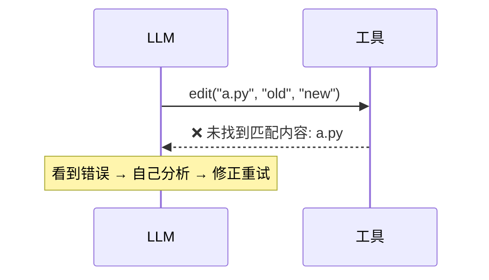

# 第 18 节 · 工具的设计哲学：4 个关键选择

**工具设计不是"实现功能就完事了"，而是"帮 LLM 不犯错"。** 本节聚焦 4 个最关键的设计选择——每一个都来自真实开发中 LLM 反复翻车的场景。


## 1️⃣ 按内容定位，不按行号


### 翻车场景：行号偏移

设想 edit 工具接收 `line_number` 参数进行操作：

```python
# 第 1 步：在第 5 行前插入 3 行新代码
edit_at_line("main.py", line=5, mode="insert_before", content="...")
# → 文件多了 3 行，原第 9 行被推到了第 12 行

# 第 2 步：想修改"原本的第 12 行"
edit_at_line("main.py", line=12, mode="replace", content="...")
# → 但第 12 行现在是原第 9 行的内容——LLM 不知道行号变了，改错了位置
```


### 解法：用内容做锚点

不靠行号，而是让 edit 接收 `old_content` / `new_content`，**按内容定位**：

```python
edit("main.py", 
     old_content="def greet():\n    print('hi')",
     new_content="def greet():\n    print('hello')")
```

无论前面增删了多少行，目标文本始终精确对应——因为锚点是内容本身，不受行号变化影响。


### 唯一性约束：逼模型提供足够上下文

`old_content` **必须在文件中只出现一次**——这条规则是刻意设计的：

```python
old_content = "return"
```

文件里有 30 个 `return`，LLM 不知道改哪一个。

一旦强制唯一，模型就不得不给出更完整的上下文：

```python
old_content = "def add(a, b):\n    return a + b"
```

这下就唯一了。

> [!NOTE]
>
> 这个设计与 Cursor / Claude Code 的 edit 工具几乎一致。


## 2️⃣ bash 工具：四道安全闸门



`bash` 是最强大也最危险的工具——它什么命令都能跑。**LLM 一个不小心，仓库就没了**。

为此我们设了四道闸门，一条都不能少：

| 闸门 | 具体做法 | 为什么 |
|---|---|---|
| **超时** | `timeout=30` | LLM 偶尔会写出 `while True`，没超时直接卡死 |
| **输出截断** | `max_output=50000` | 一次 `find /` 可能返回几百万行，直接撑爆 messages |
| **工作目录限定** | `cwd=workdir` | 防止 Agent 跑到 `~` 或 `/etc` 等敏感目录动东西 |
| **危险命令拦截** | 黑名单 regex | `rm -rf /`、`sudo`、远程脚本下载、fork 炸弹 |


### 为什么黑名单不是终极方案

`bash.py` 中危险命令的拦截逻辑长这样：

```python
DANGER_PATTERNS = [
    r"\brm\s+-rf\s+/",
    r"\bsudo\b",
    r"\b(curl|wget)\s+.*\|\s*(sh|bash)",
    ...
]
```

但黑名单有个死穴：**只能防已知的坏命令，防不住绕过**——挡了 `rm -rf /`，`find / -delete` 照样能删。

所以黑名单只是**最低限度**。真正生产级的思路是反过来做：
- 容器化（Docker / Firejail）—— Agent 跑在隔离的小盒子里，炸了也只炸自己
- 命令白名单（只允许 `python` / `pytest` / `git` 等明确命令）
- 文件系统只读挂载（除了 workdir 之外全只读）

**今天我们做最低版**，让你看清楚"安全边界在哪"。


## 3️⃣ 读类工具大胆调，写类工具严防死守


Coding Agent 的工具可以归为两类，**设计心态截然不同**：

| | 读类（read / list_dir / glob / grep） | 写类（write / edit / bash） |
|---|---|---|
| 失败成本 | 低（重试一次就行） | 高（写坏文件 / 删错东西可能无法挽回） |
| 副作用 | 无 | 有（文件系统已变更） |
| 模型策略 | LLM 可以反复"试错" | 每次调用必须有明确意图 |
| 设计心态 | 友好 / 容错 / 信息丰富 | 严格 / 校验 / 可回滚 |


### 读类工具的三个设计要点

- **路径不存在 → 友好报错**：不抛异常，返回 `"文件不存在: xxx"`，让模型看到后自己处理
- **大文件 → 自动截断**：超过 100KB 自动截断，避免一次塞满 messages
- **输出带行号**：方便 LLM 在对话中引用具体行（注意：这是"读"的场景；"写"的场景用内容锚点，不用行号，详见第 1 条）

>[!NOTE]
>
>| 场景             | 用行号？   | 原因                                           |
>| ---------------- | ---------- | ---------------------------------------------- |
>| **读类工具输出** | ✅ 带行号   | 方便 LLM 在对话中引用（"第 5 行的函数有问题"） |
>| **编辑工具定位** | ❌ 不用行号 | 编辑后行号会偏移，用内容锚点才精确             |


### 写类工具的三个设计要点

- **write → 默认拒绝覆盖**：已有文件必须显式传 `overwrite=True` 才能覆盖，防止 LLM 一句话把整个文件替换掉
- **edit → 强制 old_content 唯一**：必须在文件中只匹配一处，逼模型提供足够上下文，避免"想改一个 `return`，结果改了 30 个"
- **bash → 4 道安全闸门**：超时 + 输出截断 + 工作目录限定 + 危险命令拦截，把最危险的工具层层锁住

除此之外，所有写类工具统一遵守一条铁律：**失败时返回字符串，不抛异常**——让 LLM 自己看到错误、自己纠正，而不是 Agent Loop 直接崩溃（详见下节）。


## 4️⃣ 工具失败：返回字符串，不抛异常

以 edit 工具为例，所有异常情况一律 `return` 字符串，绝不 `raise`：

```python
def edit(path, old_content, new_content):
    if not os.path.isfile(path):
        return f"❌ 文件不存在: {path}"   # ← 不 raise
    if count == 0:
        return f"❌ 未找到匹配内容..."    # ← 不 raise
    ...
```

**为什么不能 raise？**

一旦抛异常，整个 Agent Loop 直接崩溃。而返回字符串，模型能看到错误并自己修复：



**让模型自己看到错误，自己决定下一步。**这正是第 2 章第 7 节讲过的"工具异常兜底"原则——本课程所有工具一律遵守。


## 一句话总结

**工具的输出是给 LLM 看的 UI**——参数怎么传、格式怎么定、错误怎么报，全都是"给 LLM 看"的，不是给人看的。


## 常见翻车案例

| 翻车场景 | 后果 | 防御手段 |
|---|---|---|
| LLM 用 write 覆盖已有文件 | 整个文件被意外替换 | `write` 默认拒绝覆盖 |
| LLM 用 edit 改文件，old_content 写得太短 | 匹配到多处，改错位置 | 唯一性约束 + 友好报错 |
| LLM 用 bash 跑 `find /` | 返回几百万行，撑爆上下文 | 输出截断 + 工作目录限定 |
| LLM 反复调用同一工具、同一参数 | 死循环 | max_iters 上限 + 重复调用检测 |


## 三条铁律

写好 Coding Agent 的工具，记住三条：

1. **默认安全**：危险操作默认拒绝——`write` 要显式 `overwrite=True`，`bash` 要过 4 道闸门
2. **失败可读**：错误返回字符串而非抛异常，附带具体原因和修复建议
3. **输出友好**：带行号、含状态码、附元数据，让 LLM 拿到就能直接用


## 动手验证

在云原生开发环境中，运行演示脚本：

```bash
python demo_18_design_philosophy.py
```

脚本包含 3 个对比演示：edit 唯一性约束、行号偏移问题、bash 危险命令拦截。


## 本节小结

| 设计决策 | 防止的翻车场景 |
|------|-----------|
| edit 用 old/new 定位 | 多步编辑后行号偏移，改错位置 |
| edit 唯一性约束 | 匹配到多处，误改其他位置 |
| bash 4 道闸门 | 仓库误删、输出爆炸、死循环 |
| 失败返回字符串 | Agent Loop 崩溃，模型无法自主纠错 |


---

理论结束。下面 lab：
- Part 1（60min）：实现 `read` / `list_dir` / `grep`（读类，失败成本低）
- Part 2（60min）：实现 `write` / `edit` / `bash`（写类，严防死守）
- 末尾 5min：Git 速通 5 个命令把代码推到 CNB
