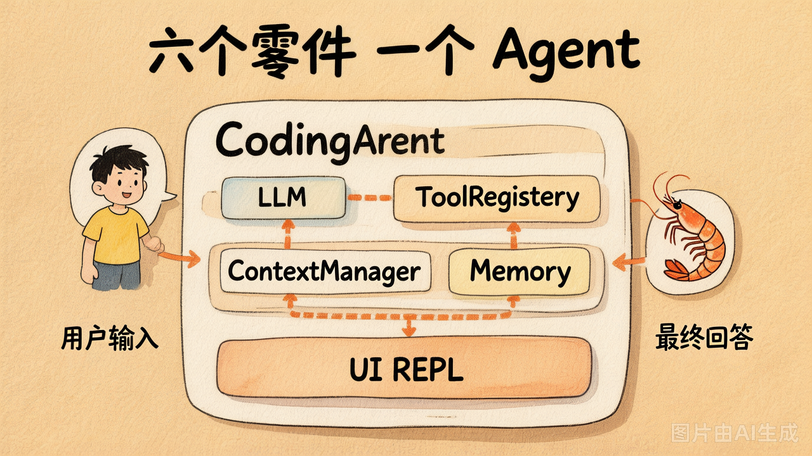
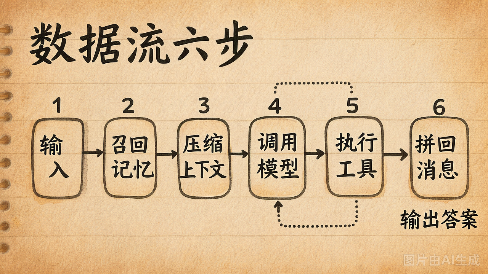
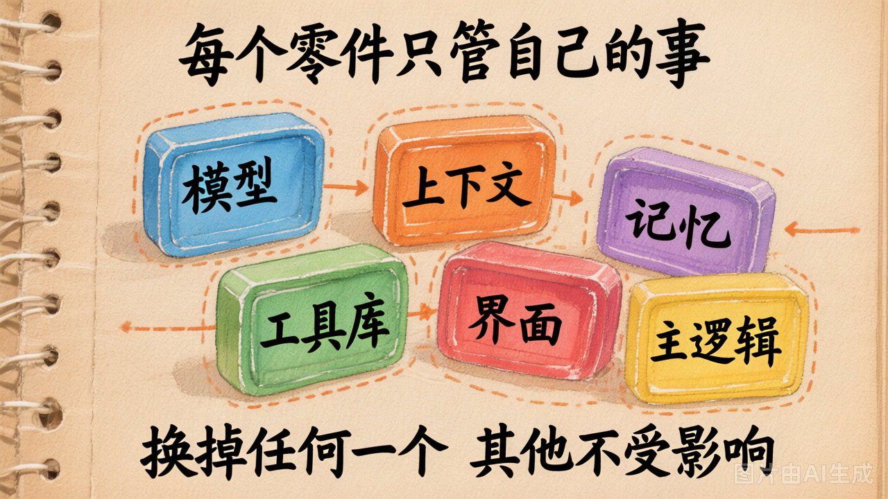
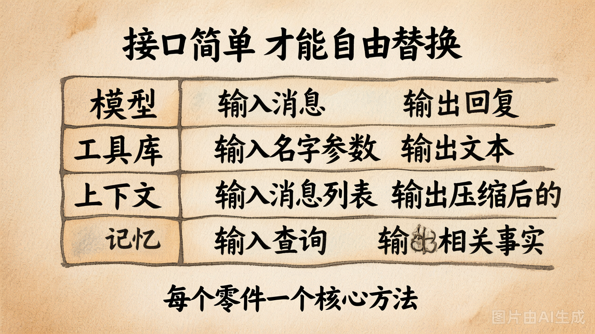

# 第 28 节 · 整合架构：模块边界与数据流

## 一句话回答

> **Day2-Day5 你已经把零件全部车好了。今天不是写新代码，是把这些零件**按一条清晰的数据流**拼装成一台能干真活的机器。**

## 我们手上有什么零件

把 Day2-Day5 的产物在桌面上铺平，长这样：



| 来自哪天 | 零件 | 一句话职责 |
|---|---|---|
| Day2 第 8 节 | `ToolRegistry` | 装饰器注册函数 → 自动 schema → 按名调度 |
| Day2 第 9 节 | Agent Loop | "调 LLM → 看 tool_calls → 执行 → 回灌"的最小循环 |
| Day3 任一范式 | 驾驶模式 | ReAct / Plan-and-Solve / Reflection 三选一 |
| Day4 第 19 节 | `ContextManager` | 分层策略压 messages |
| Day4 第 20 节 | `Memory` | embedding + 余弦做语义召回 |
| Day5 五个工具 | `coding_tools/` | read / list_dir / write / edit / bash |

**今天没有任何"新概念"**——全是组装。

## 一条主线数据流

整合不是"把 6 个文件丢进同一个目录"。整合是**把它们排成一条单向的数据流**：



```
用户输入
    ↓
Memory.search(input)         ← Day4 召回长期事实
    ↓
ContextBuilder.build()       ← Day4 拼 messages（system + 事实 + 历史）
    ↓
LLM.chat(messages, tools)    ← Day2 协议
    ↓
有 tool_calls？
   是 → ToolRegistry.invoke() ← Day5 工具实际跑（read/edit/bash...）
       → 结果回灌到 messages
       → 回到 LLM.chat
   否 → 给用户最终回答
        ↓
Memory.distill()              ← Day4 提炼新事实写回
```

**注意单向性**：数据只往一个方向流。这条线一旦理顺，整套 Agent 就跑得通。

## 模块边界：谁该管什么

整合最容易翻车的是**职责越界**。比如：

- ❌ 在 ToolRegistry 里写 `len(messages) > 20 就压缩` —— 工具注册表不应该懂 messages
- ❌ 在 ContextManager 里写 `if user_input contains '过敏' 就 ...` —— 上下文管理器不该懂业务关键词
- ❌ 在 Agent 类里写 `def read_file(...)` —— 工具不该塞回 Agent 主体

正确的边界长这样：



| 模块 | 它该懂 | 它不该懂 |
|---|---|---|
| `LLM`（Day1）| 怎么发请求、怎么处理流式 | 业务、工具、记忆 |
| `ToolRegistry`（Day2）| 怎么把函数变 schema、怎么按名分发 | messages、用户身份、对话历史 |
| `coding_tools/`（Day5）| 怎么安全地读/写/跑命令 | 谁在调它、调用次数、上下游是谁 |
| `ContextManager`（Day4）| 怎么压 messages 不丢关键事实 | 工具、LLM 的具体协议 |
| `Memory`（Day4）| 怎么 embed、怎么余弦召回 | 当前对话状态、压缩策略 |
| `Agent`（今天）| 怎么把上面 5 个**编排**起来 | 任何一个零件的内部实现 |

**Agent 类是"指挥家"，不是"乐手"。**指挥家不亲自吹小号。

## 接口契约：6 个零件之间怎么"对话"

接口是整合的水龙头——拧紧了不漏水，拧不紧到处都是 bug。



```python
# Agent 看到的 6 个接口（核心方法签名）

class LLM:
    def chat(messages: list[dict], tools: list[dict] | None) -> Message:
        """返回 OpenAI 风格 Message 对象（content + tool_calls）"""

class ToolRegistry:
    def to_schemas() -> list[dict]: ...
    def invoke(name: str, args: dict) -> str: ...

class ContextManager:
    def should_compress(messages) -> bool: ...
    def compress(messages) -> list[dict]: ...

class Memory:
    def search(query: str, k: int) -> list[tuple[float, Entry]]: ...
    def add(text: str) -> None: ...
```

**重点**：所有零件之间**只通过这些方法说话**，不互相 import 内部数据结构。这一条做到了，**任何一个零件以后都能独立替换**——比如把 numpy Memory 换成 pgvector，Agent 一行代码不用改。

## 整合后的目录结构

```
my_coding_agent/
├── llm/
│   └── llm.py              # 把 Day1 的 OpenAI 客户端封装成类
├── tools/
│   ├── registry.py         # Day2 的 ToolRegistry
│   └── coding_tools/       # Day5 的 5 个工具
├── context/
│   └── context_manager.py  # Day4 的 ContextManager
├── memory/
│   └── memory.py           # Day4 的 Memory
├── agent/
│   └── agent.py            # 今天写的：把上面 5 个编排起来
├── ui/
│   └── repl.py             # 第 29 节：交互模式
└── main.py                 # 入口
```

每个目录就是一个"独立可测的零件"。这就是为什么 Day2-Day5 的零件**早就按这个目录形状准备好了**——今天复制 + 改少量代码就行。

## 整合的"接口对不齐"是最常见 bug

新手第一次整合，95% 的 bug 出在**接口对不齐**。比如：

| 翻车现象 | 根因 | 修法 |
|---|---|---|
| `TypeError: argument of type 'NoneType' is not iterable` | `Memory.search()` 在 Memory 为空时返回 `None` 不是 `[]` | 在零件源头返回空列表 |
| LLM 一直循环不停 | 工具失败时 raise 了，没转成字符串 | Day5 第 25 节早就讲了，回去看 |
| `messages` 越来越多直到超 token 限制 | 忘了在 chat 循环里调 `should_compress` | Agent.chat 里加一行 |
| 工具被调了，但 LLM 看不到结果 | 工具结果以 `role=assistant` 加进 messages 而不是 `role=tool` | 严守 Day2 第 7 节的 4 角色协议 |

**调试技巧**：加日志 + 打印每一步 messages 长度。99% 的整合 bug 看一眼 messages 就能找出来。

## 一个最小可跑的 Agent 类骨架

```python
class CodingAgent:
    def __init__(self, workdir: str):
        self.llm = LLM()                              # Day1
        self.tools = build_registry()                 # Day2 + Day5
        self.ctx = ContextManager()                   # Day4
        self.memory = Memory()                        # Day4
        self.messages = [{"role": "system", "content": SYSTEM_PROMPT}]

    def chat(self, user_input: str) -> str:
        # 1. Memory 召回相关长期事实
        relevant = self.memory.search(user_input, k=3)
        if relevant:
            self.messages.append({"role": "system",
                                  "content": _format_facts(relevant)})

        # 2. 加用户输入
        self.messages.append({"role": "user", "content": user_input})

        # 3. 检查是否需要压缩
        if self.ctx.should_compress(self.messages):
            self.messages = self.ctx.compress(self.messages)

        # 4. 工具调用循环（Day2 Agent Loop）
        for _ in range(MAX_TOOL_ROUNDS):
            resp = self.llm.chat(self.messages, tools=self.tools.to_schemas())
            if not resp.tool_calls:
                self.messages.append({"role": "assistant",
                                      "content": resp.content})
                return resp.content

            self.messages.append(_assistant_with_tool_calls(resp))
            for tc in resp.tool_calls:
                result = self.tools.invoke(tc.function.name,
                                           json.loads(tc.function.arguments))
                self.messages.append({"role": "tool",
                                      "tool_call_id": tc.id,
                                      "content": result})

        return "⚠️ 达到最大工具调用轮次"
```

**整个 Agent 类不到 50 行**——因为重活全在 5 个零件里。

> 完整版在 [`lab/demos/my_coding_agent/agent/agent.py`](../lab/demos/my_coding_agent/agent/agent.py)，今天 lab 你的目标就是**把骨架填成完整版**。

## 整合 ≠ 复制粘贴

新手最常见的错觉是"整合 = 把代码全搬过来"。真正的整合做了 4 件事：

1. **统一入口**：所有零件从 `Agent` 类里访问，不再各自 import
2. **拉直数据流**：用户输入 → Memory → Context → LLM → Tools → 回灌 → 输出，**单向**
3. **修接口对齐问题**：5 个零件的方法签名要互相能对上
4. **加错误兜底**：每个零件失败时返回字符串而不是 raise

**今天 lab 的核心练习就是这 4 件事——尤其第 3 件，你会在调试里花一半时间。**

## 小结

| 概念 | 一句话理解 |
|------|-----------|
| 主线数据流 | input → Memory → Context → LLM → Tools → 回灌 → output（单向）|
| 模块边界 | 每个零件只懂自己的事，不越界 |
| 接口契约 | 零件之间只通过方法签名说话 |
| Agent 类 | 编排者，不是干活者 |
| 整合 4 件事 | 统一入口 / 拉直数据流 / 对齐接口 / 错误兜底 |

---

下一节：Agent 整合好了，**怎么让人用**？REPL / Solo / 流式输出三种交互模式。
