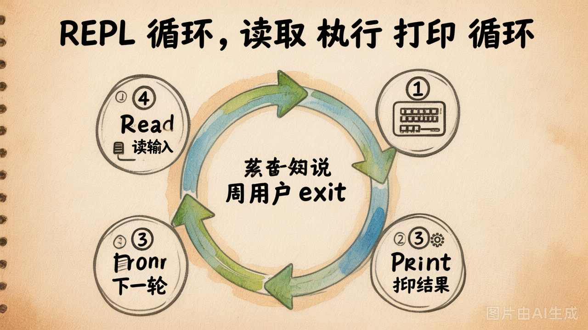
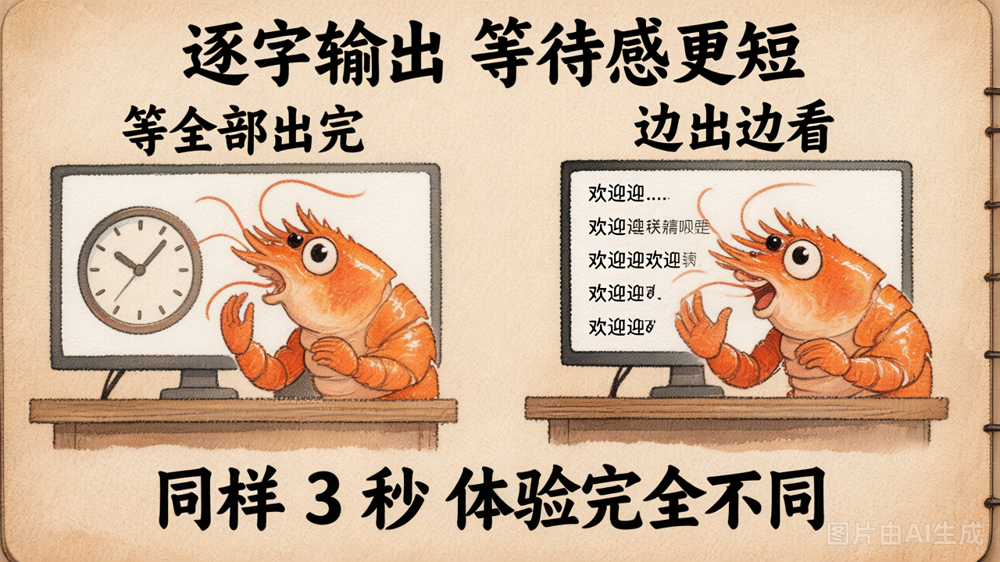

# 第 29 节 · UI 与交互模式：REPL / Solo / 流式输出

## 一句话回答

> **Agent 写得再好，没有趁手的"开口子"也没人用。** 今天讲三种最常见的交互模式，并把流式输出这个"用户体验加分项"装上。

## 三种交互模式

| 模式 | 一句话 | 典型代表 |
|---|---|---|
| **REPL** | 多轮交互，跟 Agent "聊一会儿" | Cursor 侧边栏、Claude Code 终端 |
| **Solo（一次性任务）** | 给一个任务、跑完退出 | CI 脚本、`claude --print "..."`、Cron 任务 |
| **流式输出** | 字一个个吐，不让用户干等 | ChatGPT、Cursor 主面板 |

**这不是三选一，是三件可以同时存在的事**。一个完整的 Coding Agent 通常 REPL + Solo 都要支持，并且都用流式输出。

## 模式 ①：REPL（Read-Eval-Print Loop）

### 形态

```
$ python main.py
🤖 CodingAgent | workdir=. | tools=5

▶ 帮我看看 main.py 里有什么
[工具调用 read("main.py")]
main.py 里是一个简单的 Flask 应用，定义了 ...

▶ 给它加上 /health 路由
[工具调用 edit(...)]
✅ 已添加 /health 路由

▶ /quit
👋 再见
```

### 核心循环



```python
def run_repl(workdir):
    agent = CodingAgent(workdir=workdir)
    while True:
        try:
            user_input = input("▶ ").strip()
        except (EOFError, KeyboardInterrupt):
            break
        if not user_input:
            continue
        if user_input == "/quit":
            break
        if user_input == "/reset":
            agent.reset()
            continue

        answer = agent.chat(user_input)
        print(answer)
```

**真正的 REPL 关注三件小事**：

| 细节 | 为什么必要 |
|---|---|
| 捕获 Ctrl+C | 用户中断当前任务时，不应该把整个进程也杀了 |
| `/reset` 命令 | 长对话跑久了 messages 太长，给用户一个清空按钮 |
| 工具调用要打印出来 | 用户需要看见 Agent 正在做什么，不然像黑盒 |

参考实现：[`lab/my_coding_agent/ui/repl.py`](../lab/my_coding_agent/ui/repl.py)。

## 模式 ②：Solo（一次性任务）

### 形态

```bash
# 跑一次就退出
python main.py --solo "总结 README"

# 结果输出到文件
python main.py --solo "在 src/ 下找出所有 TODO" -o todos.txt

# 走管道（CI/CD 友好）
python main.py --solo "列出依赖" -o - | tee deps.txt
```

### 为什么需要 Solo 模式

REPL 是"交互体验"，Solo 是"自动化能力"。当你需要把 Agent 接进 CI / Cron / 调度脚本时，Solo 模式才是主战场：

- ⏰ 每天凌晨自动审 PR
- 🤖 CI 失败时让 Agent 看错误日志、写一份分析报告
- 📦 上线后让 Agent 给本次发布生成 changelog

REPL 在这些场景里**不能用**——没人坐在终端前回复 Agent 的提问。

### 实现要点

```python
def run_solo(workdir, query, output_file=None):
    agent = CodingAgent(workdir=workdir)
    answer = agent.chat(query)

    if output_file == "-":
        sys.stdout.write(answer)              # 纯文本，方便管道
    elif output_file:
        with open(output_file, "w") as f:
            f.write(answer)
    else:
        print(answer)
```

**关键设计**：Solo 模式下，思考过程（工具调用、调试日志）走 **stderr**，最终结果走 **stdout**——这样用 `>` 重定向时不会被中间过程污染。

```python
# 看到这种写法不要慌：把 ui.console 切到 stderr
if output_file == "-":
    ui.console = Console(stderr=True)
```

参考：[`examples/04-my-agent/main.py`](../../examples/04-my-agent/main.py) 的 `_run_solo_exec`。

## 模式 ③：流式输出

### 为什么必须做

LLM 生成 1000 token 大概要 5-15 秒。如果你**等所有内容都生成完才一次性打印**，用户会觉得：

> "啊？是不是卡死了？"

而流式输出（一个字一个字吐）让用户能**第一时间看到反应**。即使总耗时一样，**感受**完全不同。



### 流式输出的 OpenAI 协议

```python
# 非流式：一次性返回
resp = client.chat.completions.create(model="...", messages=...)
print(resp.choices[0].message.content)

# 流式：返回一个迭代器，每次 yield 一个 chunk
stream = client.chat.completions.create(model="...", messages=..., stream=True)
for chunk in stream:
    delta = chunk.choices[0].delta
    if delta.content:
        print(delta.content, end="", flush=True)
```

**`stream=True` 是唯一的开关**。其余都一样。

### 流式 + 工具调用：一个坑

工具调用的流式数据是**分片到达**的——`tool_call.function.arguments` 在多个 chunk 里被切碎，必须自己拼回来：

```python
tool_calls_buf = {}  # index -> 累积的 tool_call

for chunk in stream:
    delta = chunk.choices[0].delta
    if delta.content:
        print(delta.content, end="", flush=True)

    for tc_delta in (delta.tool_calls or []):
        idx = tc_delta.index
        if idx not in tool_calls_buf:
            tool_calls_buf[idx] = {"id": "", "name": "", "args": ""}
        if tc_delta.id:
            tool_calls_buf[idx]["id"] = tc_delta.id
        if tc_delta.function.name:
            tool_calls_buf[idx]["name"] = tc_delta.function.name
        if tc_delta.function.arguments:
            tool_calls_buf[idx]["args"] += tc_delta.function.arguments
```

> 这段代码看着繁琐，但**不会改**——几乎所有的 LLM 客户端都是这个模式。先跑通一次，以后忘了回来抄。

完整可跑版本：[`lab/demo_30_integration_walkthrough.py`](../lab/demo_30_integration_walkthrough.py) 的 `_chat_streaming` 函数。

## 工具调用的"过程可视化"


光流式吐文字还不够。Agent 调工具时，**用户必须看到 Agent 在干嘛**——不然就跟"卡死"一样：

```
▶ 帮我看 main.py 里有什么

💭 思考: 先读一下文件内容
⚡ read("main.py")
   → from flask import Flask
     app = Flask(__name__)
     @app.route("/")
     def index(): ...
     ...

main.py 里是一个简单的 Flask 应用，包含 ...
```

3 个最简单的可视化技巧：

| 技巧 | 怎么做 |
|---|---|
| 工具调用前打印参数 | `print(f"⚡ {name}({args})")` |
| 工具结果打前 200 字 | `print(f"   → {result[:200]}")` |
| 区分 thinking / 工具 / 回答 | 用 emoji（💭 / ⚡ / 🎯）或 Rich 颜色 |

进阶：用 [`rich`](https://github.com/Textualize/rich) 渲染面板，效果跟 Cursor 几乎一致。`examples/04-my-agent/ui/ui.py` 里有现成的 `print_tool_call`。

## 把三种模式接进同一个 main.py

```python
def main():
    args = parse_args()
    if args.solo:
        run_solo(args.workdir, args.query, args.output)
    else:
        run_repl(args.workdir)
```

只多 2 行就把 Solo 和 REPL 同时支持了。流式输出在两种模式里都开着——它跟"REPL/Solo"是正交的。

## 一个真实的体验对比

跑同样一个任务："读 main.py，加 /health 路由"，给三种 Agent 用户的感受：

| 配置 | 用户感受 |
|---|---|
| REPL + 非流式 + 工具调用不可见 | "怎么半天没反应？卡了？"（实际在跑工具） |
| REPL + 流式 + 工具调用不可见 | "在打字了！但它是不是在乱回？怎么没改文件？" |
| REPL + 流式 + 工具调用可见 | "哦它在 read 文件了 → 在 edit 了 → 改完了。完美。" |

**第三种**才是 Cursor / Claude Code 给你的体验。**今天 lab 至少要做到第二种，第三种是选做。**

## 小结

| 模式 | 一句话 |
|------|-----------|
| REPL | 长对话 / 交互体验 / 必须捕获 Ctrl+C |
| Solo | 一次性任务 / CI 友好 / stderr 装日志、stdout 装结果 |
| 流式输出 | `stream=True` + 拼 chunk / 让用户第一时间看到反应 |
| 工具可视化 | 打印工具名 + 参数 + 截短结果 / 三个 emoji 就够 |

---

理论结束。下面 lab：
- Part 1（80min）：把 6 个零件整合成 `my_coding_agent/`，写完 `agent.py` + `repl.py` + `main.py`
- Part 2（70min）：用你的 Agent 完成 3 个真实任务（读自己 / 补单测 / 找 bug）
- Part 3（15min）：故障排查 + "我的 Agent 跟 Cursor 比差距在哪"
