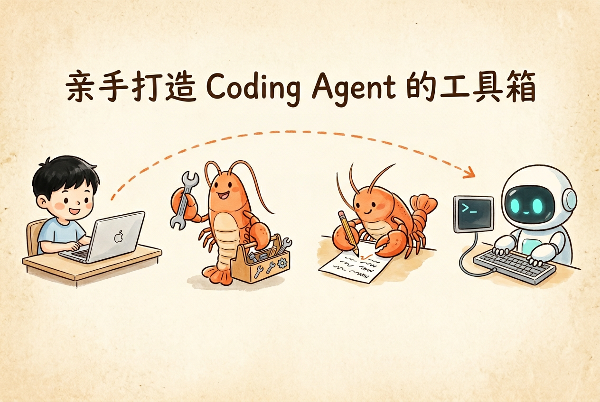

<p align="center">
    
</p>


# 第 6 章 · Coding Agent 工具集

本章目标：为 Coding Agent 实现 5 个核心工具，让 Agent 具备读写文件、搜索代码、执行命令的能力。
产出：`my-agent/coding_tools/` 目录，包含 `read`、`write`、`edit`、`list_dir`、`bash` 五个工具模块。


## 你将学到

- Coding Agent 的核心工作流：理解需求 → 定位代码 → 修改文件 → 验证结果 → 汇报变更，形成 5 阶段闭环
- 工具设计的三条原则：唯一性约束（一个工具只做一件事）、安全闸门（高风险操作需确认）、友好报错（失败时给出可执行的提示）
- `read` / `write` / `edit` / `list_dir` / `bash` 五个工具的实现思路与关键细节


## 内容结构

| 节 | 内容 | 讲义 | Demo |
|----|------|------|------|
| 24 | Coding Agent 工作流 | [24-coding-agent-workflow.md](./lecture/24-coding-agent-workflow.md) | `demo_24_five_stages.py` |
| 25 | 工具设计哲学 | [25-tool-design.md](./lecture/25-tool-design.md) | `demo_25_design_philosophy.py` |
| — | 端到端演示 | — | `demo_26_end_to_end.py` |


## 运行 Demo

在云原生开发环境中执行：

```bash
cd 06-coding-agent-tools/lab
python demo_24_five_stages.py
python demo_25_design_philosophy.py
python demo_26_end_to_end.py
```


## 本章作业

本章作业需要在配套仓库中完成，按以下步骤操作：

> [!TIP]
>
> 📦 **作业仓库**：<https://cnb.cool/xidian/vibe-coding-learning/vibe-agent-exercise>

**操作流程**：

1. **Fork** 作业仓库到自己的账号下
2. 在 `my-agent/` 目录中完成核心代码产出，在 `exercises/` 目录中完成配套填空题
3. **提交 PR**，CI 流水线（`.cnb.yml`）会自动运行测评
4. 全部测试通过（全绿）即视为作业通过检测 ✅，作业完成


## 本章产出

在作业仓库中补全 `my-agent/coding_tools/` 下的 5 个工具文件，让测试通过：

```bash
cd my-agent
python tests/test_coding_tools.py
```


## 配套练习

作业仓库的 `exercises/06-coding-agent-tools/` — 3 道代码填空题（运行 `python exercises/06-coding-agent-tools/ex_*.py` 看到 ✅ PASSED 即通过）。
