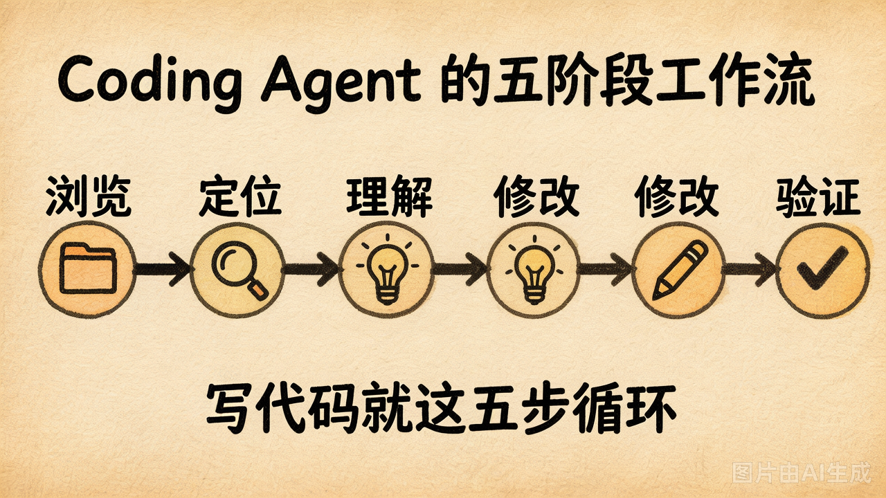
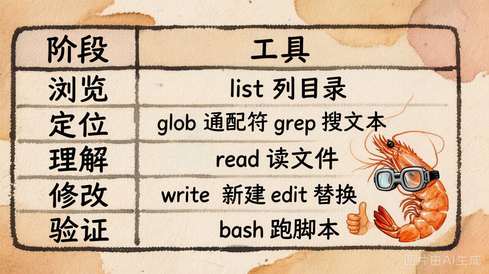

# 第 24 节 · Coding Agent 的工作模式

## 一句话回答

> **写代码的过程归纳成 5 步：浏览 → 定位 → 理解 → 修改 → 验证。Coding Agent 的工具集就是按这 5 步分配的。**

## 五阶段工作流



| 阶段 | 你（人类）会做什么 | 对应的工具类 |
|---|---|---|
| **① 浏览** | 在 IDE 里展开项目目录树 | `list_dir` |
| **② 定位** | Cmd+P 找文件、Cmd+F 搜文本 | `glob`、`grep` |
| **③ 理解** | 打开关键文件读 | `read` |
| **④ 修改** | 写新文件 / 改某一段 | `write`、`edit` |
| **⑤ 验证** | 跑测试 / 跑脚本 | `bash` |

**写代码就是这 5 步循环。**Cursor / Claude Code / Devin 这些产品的核心循环都是这 5 步——只是工具实现得更精致。

## 工具不是按"文件操作"分类的

很多人第一反应是按"动词"分：`open` / `close` / `read` / `write`。**这是错的**。

正确的分类逻辑是**按"Agent 工作流的阶段"分**。比如：

- 为什么不要 `open_file`？因为 LLM 不需要"打开"——`read` 读一次就完事
- 为什么不要 `delete_file`？因为这是高危操作，也不在 5 个阶段里
- 为什么不要 `move_file`？因为模型可以用 `bash` 调 `mv` 完成

**少而精的工具集，比一堆"看似全面"的工具更好用。**

## 阶段映射



按 5 阶段分组：

```
浏览阶段：list_dir
定位阶段：glob / grep
理解阶段：read
修改阶段：write / edit
验证阶段：bash
————————
扩展阶段：todo / webfetch（选做，第7章才用）
```

**今天必做的 5 个**：`list_dir / read / write / edit / bash`。
覆盖了 5 个阶段最低限度的能力。

## 一个真实的"五阶段"实战

任务："把 `main.py` 里的 `greet()` 函数加一句开场白，跑一遍验证。"

```
① list_dir(".")          → 看到 main.py / utils.py
② read("main.py")        → 看到 def greet(): print("hello")
③（无需 grep，已定位）
④ edit("main.py", 
     old_content="def greet():\n    print('hello')",
     new_content="def greet():\n    print('=== 开场 ===')\n    print('hello')")
                          → ✅ 替换成功
⑤ bash("python main.py") → 看到 "=== 开场 === \\n hello"
```

跑一遍 [`demo_24_five_stages.py`](../lab/demo_24_five_stages.py)，**手动**走一遍这 5 步，你能直观感受到工具输出之间的依赖关系。

## 工具的"输入"通常依赖前一个工具的"输出"

```
list_dir("./") 输出 → main.py 这个名字 → read("main.py") 的输入
read("main.py") 输出 → 看到 greet() 函数体 → edit() 的 old_content
edit() 输出 → 知道改成功了 → 决定 bash() 跑测试
bash() 输出 → 看到测试结果 → 决定要不要再修一轮
```

**工具之间不是独立的，是一条数据流。**这就是为什么工具的**输出格式**要给"下一个工具的输入"留好接口：

- `read` 输出**带行号**：方便下一步 grep 报错或 edit 引用
- `list_dir` **区分文件 / 目录**：方便下一步决定 read 还是 list_dir
- `bash` 输出**含 exit code**：方便模型判断"测试通过了没"

工具的输出是"给 LLM 看的 UI"。

## 一个常见误区："让 LLM 写整个文件"

新手常见做法：

```python
# ❌ 让 LLM 一次写整个 main.py
write("main.py", "...500 行内容...")
```

这是反模式，原因：
1. LLM 写长文件 token 消耗高
2. LLM 写长文件容易"突然丢一段"
3. 改一行也要重写整个文件

**正确做法**：用 `edit` 做精确的"局部修改"，`write` 只用来**新建文件**或**整体覆盖**（且默认拒绝覆盖）。

## 动手试试

```bash
cd 06-coding-agent-tools/lab/demos
python demo_24_five_stages.py
```

会自动建一个临时工作区，按 5 阶段顺序调用 5 个工具，把每一步的输出打印出来给你看。

## 小结

| 概念 | 一句话理解 |
|------|-----------|
| 五阶段工作流 | 浏览 → 定位 → 理解 → 修改 → 验证 |
| 工具分类原则 | 按 Agent 工作流阶段分，不是按文件操作分 |
| 工具间关系 | 一条数据流，前一个的输出 = 后一个的输入 |
| 工具输出 | 给 LLM 看的 UI，要带行号 / 区分类型 / 含状态码 |
| 必做 5 个 | list_dir / read / write / edit / bash |

---

下一节：每个工具背后藏着大量的"防 LLM 翻车"设计。**第 25 节会拆 4 个最关键的设计选择。**
