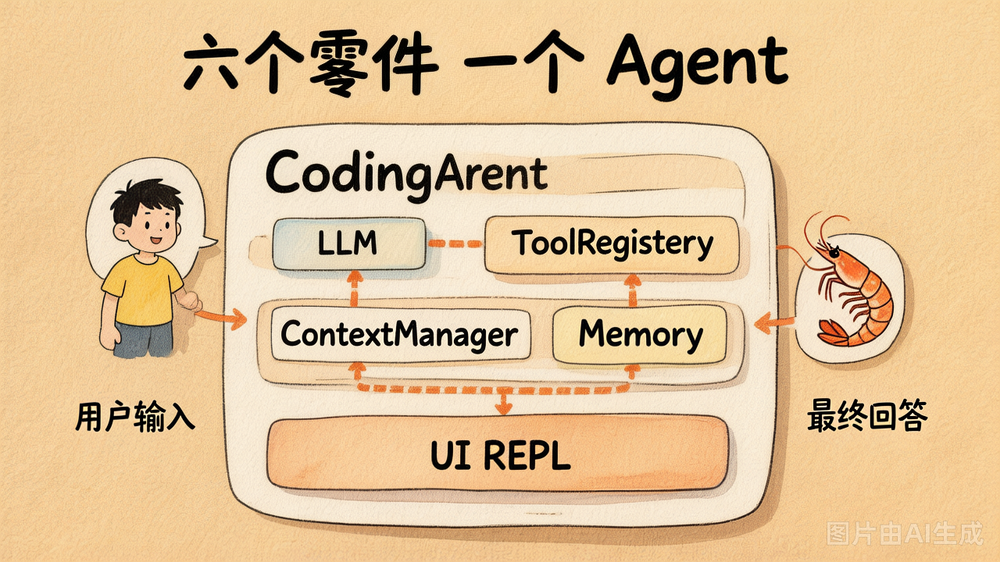
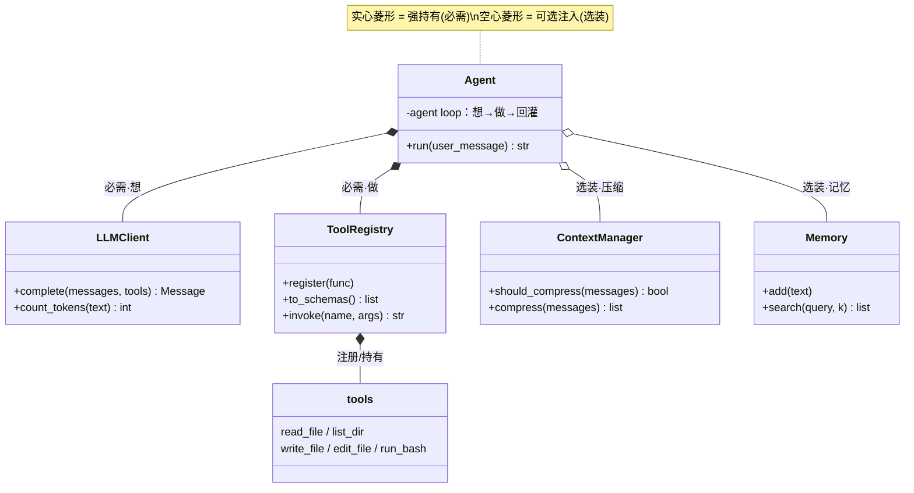
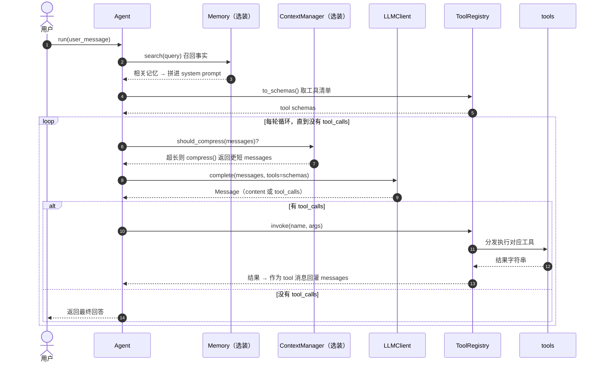
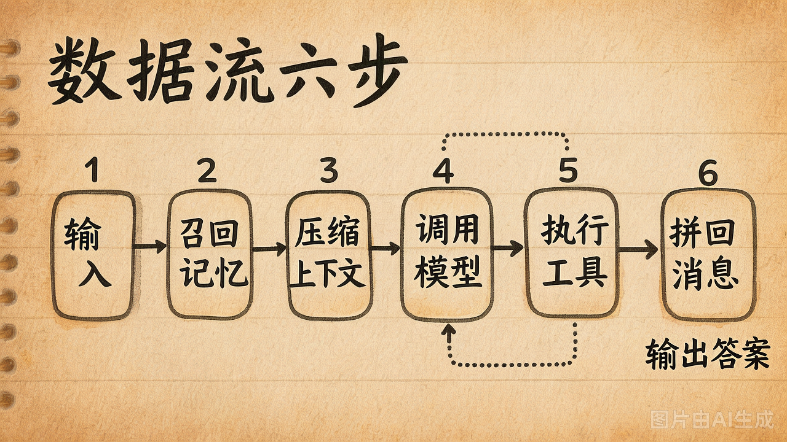
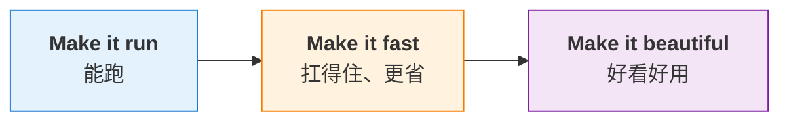
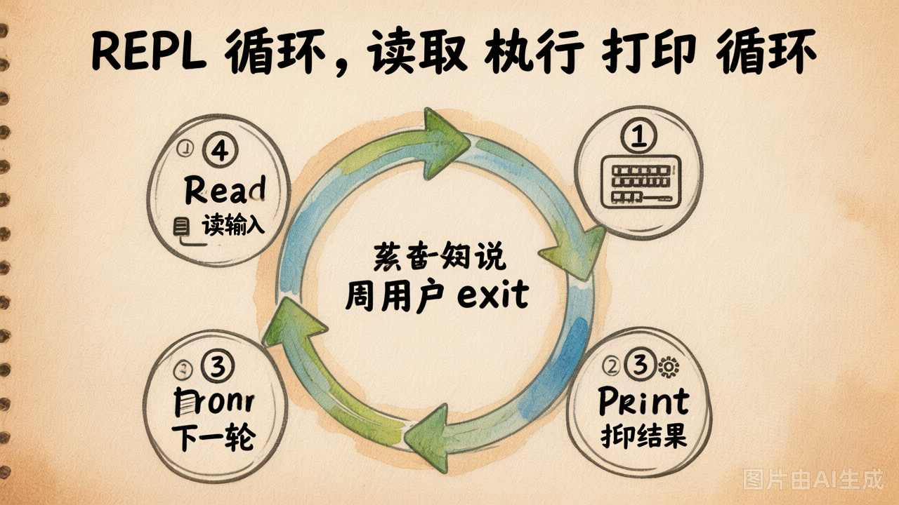

# 第 28 节 · 整合与形态：一步步组装一个 Coding Agent

## 一句话回答

> **第2章-第6章你已经把每个零件都写好了。本章不写新功能，只做两件事：先把这些类一点点拼成一个能干活的 Coding Agent，再聊聊它能长成哪几种形态。**

你手上的零件全部定义在 [`my-agent/interfaces.py`](https://cnb.cool/xidian/vibe-coding-learning/vibe-agent-exercise/-/blob/main/my-agent/interfaces.py) 里——这个文件不用改，只是接口参考。本章就基于这些接口，循序渐进地组装。

---

# Part 1 · 循序渐进组装

## 先回顾：手上有哪些零件



| 来自 | 类 | 核心方法（真实签名） | 职责一句话 |
|---|---|---|---|
| 第1章 | `LLMClient` | `chat(messages) -> str` / `chat_stream(messages)` / `count_tokens(text) -> int` | 跟模型对话、数 token |
| 第2章 | `ToolRegistry` | `register(func)` / `to_schemas() -> list[dict]` / `invoke(name, args) -> str` | 注册工具、生成 schema、按名调用 |
| 第3章 | `Agent` | `__init__(llm, tools, system_prompt="")` / `run(user_message, max_iterations=10) -> str` | **持有 agent loop**：调 LLM → 执行工具 → 回灌 |
| 第4章 | `ContextManager` | `should_compress(messages) -> bool` / `compress(messages) -> list[dict]` | 对话太长时压缩 messages |
| 第4章 | `Memory` | `add(text)` / `search(query, k=3) -> list[tuple[float, str]]` | 存长期事实、按语义召回 |
| 第5章 | 编程工具 | `read_file` / `list_dir` / `write_file` / `edit_file` / `run_bash` | 真正读写文件、跑命令 |

### 整体架构图

组件之间有两种关系，分开看才清楚：**① 结构上谁持有谁**，**② 运行时谁先谁后配合**。

**① 组合关系（谁持有谁）** —— `Agent` 是编排中心，构造时注入其余组件；`tools` 挂在 `ToolRegistry` 名下：



**② 协作时序（一次 loop 里各组件怎么配合）** —— 谁在什么时机被调用、数据怎么流转，一眼看清：



读图要点：

- **持有关系**：`Agent` 强持有 `LLMClient`（想）和 `ToolRegistry`（做）——缺一不可；`ContextManager`、`Memory` 是空心菱形，**可选注入、不改内核**。`tools` 不直接跟 `Agent` 打交道，而是注册在 `ToolRegistry` 名下，由它统一分发。
- **配合次序**：一次 `run` 先（选装）召回记忆、取工具清单，然后进 loop——每轮**先压缩、再想（LLM）、按需做（工具）、回灌**，直到 LLM 不再要求调用工具才收尾。
- **数据主线**：一切围绕 `messages` 流转——记忆拼进它、压缩裁剪它、LLM 读它产出、工具结果又回灌它。

**关键认知**：`Agent.run()` 内部就是第3、4章那套 agent loop——「调 LLM → 看工具调用 → 执行 → 回灌」这件事**第3章已经替你封好了**，本章不用再手写。它的对外契约很简单：**传进一句话，返回最终回答的字符串**。

组装的目标，就是把这些零件按下面这条单向数据流串起来：



```
用户输入 → (Memory 召回事实，拼进 system prompt) → Agent.run() → 最终回答
                                                      │
                                            内部 loop：LLM ⇄ 工具
```

下面一步一步来。组装不是一口气堆到位，而是沿着一条工程惯用的节奏推进：

> **Make it run → Make it fast → Make it beautiful**
> 先让它**能跑**，再让它**扛得住、更省**，最后让它**好看好用**。



这是软件工程里一条很朴素的推进理念：**先解决"有没有"，再解决"稳不稳"，最后才追"好不好用"**。三个阶段层层叠加、互不推翻，我们组装 Agent 也按这个节奏来。下面从 Make it run 开始。

## 第 1 步：三件套，先跑通一次任务

只用第1、2、3、5 章的零件，就已经是一个能读写代码的 Agent 了：

```python
from llm import LLMClient
from tools import ToolRegistry
from agent import Agent
from coding_tools import read_file, list_dir, write_file, edit_file, run_bash

SYSTEM_PROMPT = """你是一个编程助手 Agent，运行在用户的项目目录里。
- 需要信息时先用工具查证，不要凭空假设文件内容或编造 API。
- 改代码前先读相关文件，改动保持最小、可运行。
- 破坏性操作（删文件、跑危险命令）先征得用户同意。
- 回答简洁，用中文。
"""

# 1) 建 LLM 和工具注册表
llm = LLMClient()
tools = ToolRegistry()

# 2) 把第5章的 5 个编程工具注册进去
for fn in (read_file, list_dir, write_file, edit_file, run_bash):
    tools.register(fn)

# 3) 交给 Agent，loop 由它内部负责
agent = Agent(llm, tools, system_prompt=SYSTEM_PROMPT)

# 4) 跑一个任务
print(agent.run("把 utils.py 里的 add 改成支持任意个参数"))
```

跑通这 4 行，你就有了一个**最小可用的 Coding Agent**：它会自己 `read_file` 看代码、`edit_file` 改代码，最后返回一句总结。这是整章的地基。

## 第 2 步：包成 REPL，能连续对话

一次性任务不够用——真实场景是「你一句、它一句」聊下去。把 `agent.run()` 塞进一个 while 循环就行：



```python
def run_repl():
    agent = build_agent()          # 就是第 1 步那套，抽成一个函数
    while True:
        user_input = input("▶ ").strip()
        if not user_input:
            continue
        print(agent.run(user_input))   # 复用同一个 agent 实例
```

> **为什么复用同一个 `agent` 实例？** 多轮对话的上下文（历史 messages）保存在 Agent 内部。只要不重建实例，第二句提问时它还记得第一句聊了什么。每轮 new 一个新 Agent，就会「失忆」。

## 第 3 步：打磨 REPL 的三件小事

上面的循环能用，但很糙。真正的 REPL 要多管三件事：

| 细节 | 为什么必要 | 怎么做 |
|---|---|---|
| 捕获 Ctrl+C / EOF | 用户想中断时，不该把整个进程崩掉 | 用 `try/except (EOFError, KeyboardInterrupt)` 包住 `input()` |
| 退出与重置命令 | 长对话跑久了历史太长，得


能清空重来 | `/quit` 退出；`/reset` 重建一个 agent 实例 |
| 让过程可见 | `run()` 只返回最终结果，中间调了什么工具用户看不见，像黑盒 | 在第3章的 loop 里，执行工具前后各 `print` 一行 |

```python
def run_repl():
    agent = build_agent()
    while True:
        try:
            user_input = input("▶ ").strip()
        except (EOFError, KeyboardInterrupt):
            print("\n👋 再见")
            break
        if not user_input:
            continue
        if user_input == "/quit":
            break
        if user_input == "/reset":
            agent = build_agent()     # 丢掉历史，从头开始
            continue
        print(agent.run(user_input))
```

关于「让过程可见」：因为 `run()` 只把**最终字符串**还给你，中间的工具调用发生在 Agent 内部。想让用户看见，最直接的办法是在你第3章 `Agent.run` 的 loop 里，调用工具前后打印一下：


```python
# 在 Agent 内部的 loop 里（第3章）
print(f"⚡ {name}({args})")               # 调用前：打印工具名和参数
result = self.tools.invoke(name, args)
print(f"   → {str(result)[:200]}")        # 调用后：结果截前 200 字
```

这样用户就能看到「read 文件 → edit 文件 → 改完了」的过程，而不是干等一个结果。

## 第 4 步：接上记忆与上下文压缩（外挂增强）

对话变长、需要跨会话记住事实时，再把第4章的两个类融进来。它们是 Agent 的**外挂增强，不改 Agent 内部**：

```python
memory = Memory()          # 第4章

def run_with_memory(agent, user_input: str) -> str:
    # 召回最相关的 3 条长期事实，拼进这一轮的 system prompt
    facts = memory.search(user_input, k=3)          # -> [(score, text), ...]
    if facts:
        joined = "\n".join(f"- {text}" for _, text in facts)
        agent.system_prompt = SYSTEM_PROMPT + f"\n\n已知用户事实：\n{joined}"

    answer = agent.run(user_input)
    memory.add(user_input)     # 把这轮值得记的写回记忆
    return answer
```

> **`ContextManager` 用在哪？** 它的 `should_compress / compress` 负责在多轮超长对话里压缩历史 messages，避免撑爆上下文窗口。接入点在你第3章 `Agent.run` 的 loop 开头——每轮先判断一次要不要压缩。

至此，一个「有记忆、不爆上下文、过程可见」的 Coding Agent 就组装完了。

## 第 5 步：用 `rich` 让界面好看起来

前面的 `print` 已经能用，但想让 REPL 观感接近 Cursor / Claude Code，可以用 [`rich`](https://github.com/Textualize/rich) 这个包——它能在终端渲染彩色文本、面板、表格、Markdown、语法高亮：

```python
from rich.console import Console
from rich.panel import Panel

console = Console()

# 把工具调用框进彩色面板，结果用灰字弱化
console.print(Panel(f"{name}({args})", title="⚡ 工具调用", border_style="cyan"))
console.print(f"[dim]→ {str(result)[:200]}[/dim]")
```

`rich` 是纯粹的「显示层」升级，一行内核逻辑都不用动——它只是把你 `print` 的地方换成更漂亮的输出。

---

# Part 2 · Coding Agent 的几个形态

Agent 内核组装好了，**同一个内核可以套上不同的「壳」给不同场景用**。参考项目 [`niuma-coder`](https://cnb.cool/xidian/vibe-coding-learning/niuma-coder) 的设计原则就是：**WebUI 与 CLI 共用同一个 Agent 内核，切换零成本、功能对等**。

| 形态 | 一句话 | 典型代表 |
|---|---|---|
| **REPL / CLI** | 多轮交互，跟 Agent「聊一会儿」 | Cursor 侧边栏、Claude Code 终端、`niuma-coder make cli` |
| **Solo（一次性任务）** | 给一个任务、跑完退出 | CI 脚本、`niuma-coder --solo "..."`、Cron 任务 |
| **WebUI** | 浏览器里看 diff、贴截图、演示分享 | `niuma-coder make web` |

**这不是几选一，而是几件可以同时存在的事**：REPL 我们在 Part 1 已经做出来了，下面补上 Solo。

## Solo：一次性任务

REPL 是「交互体验」，Solo 是「自动化能力」。当你要把 Agent 接进 CI / Cron / 调度脚本时，Solo 才是主战场（每天自动审 PR、CI 失败时写分析报告、上线后生成 changelog）——这些场景没人坐在终端前回复 Agent 的提问。

```bash
# 跑一次就退出
python main.py --solo "总结 README"

# 结果输出到文件
python main.py --solo "在 src/ 下找出所有 TODO" -o todos.txt

# 走管道（CI/CD 友好）
python main.py --solo "列出依赖" -o - | tee deps.txt
```

实现就是「不进循环，跑一次就走」：

```python
def run_solo(query, output_file=None):
    agent = build_agent()
    answer = agent.run(query)      # 还是那个 run，一次性
    if output_file == "-":
        sys.stdout.write(answer)              # 纯文本，方便管道
    elif output_file:
        with open(output_file, "w") as f:
            f.write(answer)
    else:
        print(answer)
```

**关键设计**：Solo 模式下，思考过程（工具调用、调试日志）走 **stderr**，最终结果走 **stdout**——这样用 `>` 重定向时不会被中间过程污染。

## 把两种形态接进同一个 main.py

REPL 和 Solo 共用 `build_agent()`，只是「怎么喂任务、怎么收结果」不同。一个 main.py 分流即可：

```python
def main():
    args = parse_args()
    if args.solo:
        run_solo(args.query, args.output)
    else:
        run_repl()
```

只多几行就把两种形态同时支持了。这正是 `niuma-coder`「一个内核、多种形态」的落地方式——WebUI 无非是再加一个把 `agent.run` 接到 HTTP 接口的壳。

---

## 小结

| 步骤 / 概念 | 一句话理解 |
|------|-----------|
| 回顾的零件 | LLMClient / ToolRegistry / Agent / ContextManager / Memory + 5 个工具 |
| 第 1 步 | LLM + Tools + Agent 三件套，`agent.run(任务)` 一次性跑通 |
| 第 2 步 | 塞进 while 循环变 REPL，复用同一 agent 实例保住上下文 |
| 第 3 步 | 打磨：捕获 Ctrl+C、`/quit` `/reset`、在 loop 里 print 让过程可见 |
| 第 4 步 | Memory / ContextManager 作为外挂增强，不动 Agent 内核 |
| 第 5 步 | `rich` 做显示层美化，逻辑一行不动 |
| Solo 形态 | 一次性任务 / CI 友好 / stderr 装日志、stdout 装结果 |
| 一个内核多种形态 | REPL / Solo / WebUI 共用同一 `agent.run`，只换「壳」 |

---

下面进入 lab：把 6 个零件整合成 `my_coding_agent/`，写完 `agent.py` + `repl.py` + `main.py`，再用你的 Agent 完成 3 个真实任务（读自己 / 补单测 / 找 bug）。
