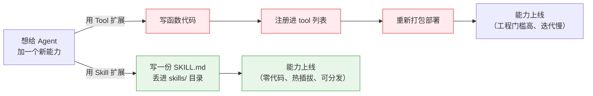
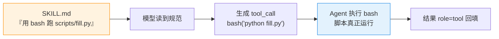
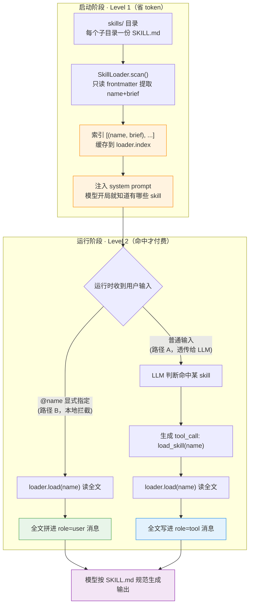

# 第 21 节 · Skills：为什么需要、与 Tool Call 的区别、实现原理

## 一句话回答

> **Skill = 可热插拔的领域知识包（一份 `SKILL.md`）。** 让同一个 Agent 面对不同团队/项目时，自动切换到正确的规范——不改一行代码。

## 一、为什么需要 Skills：一个"扩展性"问题

一个 Agent 的能力早期主要靠 **Tool** 扩展，但 Tool 这条路很重：每加一个能力都要「写函数 → 注册 → 重新部署」翻一次版，门槛高、迭代慢，还和代码库强绑定难以分发。



> **Skills 的解法：把"扩展"从「改代码发版本」降级成「丢一个 `SKILL.md` 文件进目录」。**

- **零代码热插拔**：加个 `.md` 即可，不改代码、不重新部署
- **谁都能写**：会写 Markdown 就能定义 skill，业务同学也能贡献
- **天然可分发**：能力 = 一个纯文本文件，复制即用

一句话：**Tool 扩展要"翻版"，Skill 扩展只要"丢文件"。**

### Skill Hub：从"能力"到"生态"

一旦"能力 = 一个可分发的文件"，就能像装软件包一样共享。于是有了 **Skill Hub**：集中托管、检索、下载 skill 的网站，类似 npm / PyPI / HuggingFace Hub——作者发布，用户搜索后一键下载丢进 `skills/` 目录即用。

它的意义是把扩展性从"单个 Agent"抬升到"整个生态"：

- **复用**：规范一次发布、人人可用，不必重复造轮子
- **共建**：能力边界由"官方内置"变成"社区共建"
- **可移植**：遵循同一 `SKILL.md` 标准的 Agent 都能跑，不被单个产品绑死

> Skills 让单个 Agent 可扩展；**Skill Hub 让整个 Agent 生态可扩展**——这正是 Tool（要写代码、要发版本）很难做到的。


## 二、Skill 与 Tool Call 的关系

Skill 和 Tool 常被拿来比较，但它们不是一回事、更不是替代关系：

> **Tool 是"手"（能执行的动作），Skill 是"脑子里的规矩"（一段该怎么做的知识）。** Skill 负责"按什么标准做"，真正落地的动作仍由 Tool 执行——二者互补。

也正因如此，Skill 本身**不执行任何东西**，下面这点最容易被误解。

### 那 Skill 怎么"执行脚本 / 工具"？——它其实不执行

> **Skill 自己不执行任何东西，真正执行的仍是 Tool（如 `bash`）；Skill 只是用文字告诉模型"跑哪个脚本、怎么跑"。**

skill 目录除了 `SKILL.md`，还能捆绑脚本，正文写清怎么用。执行链路和普通 tool call 一样——脚本虽由 skill 带来，跑它的仍是 `bash` 这只"手"：



一句话：**skill 只是把"标准动作"打包好，执行永远经过 Tool**——再次印证"Skill 定标准、Tool 落地执行"。

有意思的是：**Skills 机制本身正是用两个 Tool 实现的**——`list_skills` / `load_skill`。也就是"用工具去加载知识"。下面就是原理。

## 三、SKILL.md 标准

每个 skill 是一个目录，目录里放一份 `SKILL.md`：**YAML frontmatter（元数据）+ Markdown 正文（完整规范）**。

```markdown
---
name: add-docstring
description: 给 Python 函数添加 Google 风格 docstring
---

# 使用规则

当用户要求"加注释/加文档/补 docstring"时，遵循以下规范：
- Google 风格，第一行简短描述（≤72 字符）
- Args / Returns / Raises 三段
```

| 字段 | 必填 | 作用 |
|------|------|------|
| `name` | ✅ | 唯一标识（= 目录名） |
| `description` | ✅ | 一句话摘要，注入到 system prompt 索引 |

> 更宽松的实现：没有 frontmatter 时，自动取正文第一个非标题非空行当作 brief。

## 四、Agent 实现 Skills 的原理（伪代码）

核心是**两级渐进式加载**：

```
Level 1（启动时，极省 token）：扫描目录 → 只拿 name + 一句话 brief → 注入 system prompt
Level 2（运行时，命中才付费）：加载某个 skill 的 SKILL.md 全文 → 注入上下文
```

先看整体流程图（后面各小节就是对图中每一块的展开）——**启动装索引（Level 1）**，**运行时按需读全文（Level 2）**：



**看图抓三点：**

1. **Level 1（橙）**：启动时扫盘只取 `name + brief` 拼进 system prompt，常驻开销只有几十 token，能力再多也不膨胀。
2. **Level 2（绿/蓝）**：只有命中才 `load()` 读全文。路径 B（`@name`）把全文拼进 `role=user`，一次直达；路径 A（LLM 自主）经 `load_skill` 工具，全文回填到 `role=tool`，多一次往返。
3. **殊途同归（紫）**：无论哪条路径，最终都是让模型"读到完整规范"后再生成输出。

### 4.1 SkillLoader —— 扫描 + 索引 + 按需读全文

关键点：**惰性扫描**（首次用到才做 IO）、**索引缓存**、**防目录穿越**。

```
class SkillLoader:
    def __init__(skills_dir):
        self.root  = abspath(skills_dir)
        self.index = None          # 缓存，首次访问才填充
        self.dirs  = {}            # name → 实际目录

    # ---- Level 1：只读元数据，生成一句话索引 ----
    def list_index():
        if self.index is None:
            self.index = scan()    # 首次调用才真正扫盘
        return self.index          # [(name, brief), ...]

    def scan():
        result = {}
        for child in listdir(self.root):          # 遍历根目录下每个子目录
            if exists(child / "SKILL.md"):
                head  = read_head(child / "SKILL.md")   # 只读前若干 KB
                brief = extract_brief(head)             # frontmatter.description 或正文首行
                result[child.name] = (child.name, brief)
                self.dirs[child.name] = child
            elif exists(child / "skills"):        # 兼容嵌套 skill 包
                for inner in listdir(child / "skills"):  # 内层目录，同上收录
                    ...
        return sorted(result, key=name)

    # ---- Level 2：命中某个 skill 才读全文 ----
    def load(name):
        validate(name)                            # 白名单校验，挡非法字符
        skill_dir = self.dirs[name]
        assert skill_dir is within self.root      # 防目录穿越
        text = read_file(skill_dir / "SKILL.md")
        return Skill(name, brief=extract_brief(text), body=text)
```

### 4.2 把 Loader 暴露成两个 Tool

这样 **LLM 能自己决定何时加载哪个 skill**：

```
def register_skill_tools(tools, loader):

    def list_skills():
        """列出所有可用 skill（name + 一句话）。不确定有哪些能力时调用。"""
        return join_lines("- {name}: {brief}" for (name, brief) in loader.list_index())

    def load_skill(name):
        """按名字加载某个 skill 的完整规范（SKILL.md 全文）。"""
        skill = loader.load(name)
        return "# Skill: {skill.name}\n---\n{skill.body}"

    tools.register(list_skills)
    tools.register(load_skill)
```

### 4.3 启动时把 Level 1 索引拼进 system prompt

```
def build_system_prompt(loader):
    index = loader.list_index()
    if not index:
        return BASE_SYSTEM_PROMPT
    index_text = join_lines("- **{name}**: {brief}" for (name, brief) in index)
    # 模型开局就"知道有哪些 skill 可用"，但只花几十 token
    return BASE_SYSTEM_PROMPT + SKILLS_INDEX_TEMPLATE(index_text)
```

### 4.4 两条运行路径

**路径 A：LLM 自主加载（自动）**

```
system prompt 里已列出 skill 索引
用户："帮这个函数加 docstring"
  → LLM 判断命中 add-docstring
  → 主动调用工具: load_skill("add-docstring")
  → 拿到全文规范 → 按规范生成 docstring
```

**路径 B：用户显式指定（快捷指令）** —— 在调用 LLM **之前**本地拦截：

```
def preprocess(user_input, loader):
    if user_input.startswith("/skills"):      # 本地直接列出，不走 LLM
        return reply(format_skill_list(loader))
    if user_input.startswith("@"):            # 语法：@name <任务>
        name, task = parse(user_input)
        skill = loader.load(name)
        # 把 skill 全文当作"前置规范"拼到任务前面，再送 Agent
        return rewrite("[按以下规范完成]\n{skill.body}\n\n[任务]\n{task}")
    return user_input                          # 原样透传，交给 Agent 正常处理
```

> 两条路径的取舍：**A 省心（LLM 自己判断）**，但多一次工具调用往返；**B 精准（用户点名）**，省往返但要用户知道 skill 名。二者可同时保留。

## 小结

- **Skill = 热插拔的领域规范包**，解决"多项目多规范"下 system prompt 膨胀 + 串台
- **Tool 是能力（动作），Skill 是知识（规范）**；而 Skills 机制本身用两个 Tool（`list_skills`/`load_skill`）实现
- 原理 = **两级加载**：启动只装索引（Level 1，省 token），命中才加载全文（Level 2，按需付费）
- 落地只需三块：`SkillLoader`（扫描/索引/读全文）+ 两个工具 + system prompt 注入索引
