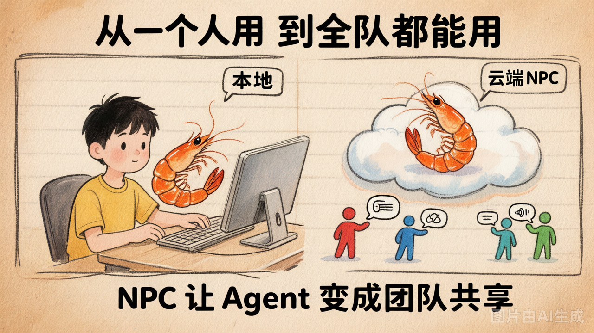

# 第 22 节 · NPC：把 Agent 挂到仓库里干活（流程）

## 一句话回答

> **NPC = 挂在代码仓库里的 AI 角色，有人 @ 它就自动干活。** 跟游戏里的 NPC 一样——你不开口它不动，你一 @ 它就接活、干完把结果回写到评论里。

本节**只讲原理与流程**，不展开 Docker/Pipeline 细节，所有配置与脚本均以伪代码表述。

## 从"本地工具"到"团队协作者"



| | 本地 Agent | 仓库 NPC |
|---|---|---|
| 谁在跑 | 你的电脑 | 云端容器 |
| 谁触发 | 只有你 | 团队任何人（Issue/PR 评论里 @） |
| 何时跑 | 手动启动 | 事件触发（有人 @ 就跑） |
| 结果去哪 | 终端 | 自动回写到 Issue/PR 评论 |

## 整体流程

```
① 有人在 Issue/PR 评论里 @NPC：如「@纯牛码 帮我看看这个 bug」
② 平台匹配到 NPC 事件 → 触发配置好的流水线
③ 流水线拉起你构建好的 Docker 镜像（里面是 Agent + 入口脚本）
④ 平台把评论原文、仓库、Issue/PR 编号等注入为环境变量
⑤ 入口脚本组装 prompt → 驱动 Agent 完成任务
⑥ Agent 通过平台 CLI 把回复以 NPC 身份发布到原 Issue/PR 评论下
```

## 三个配置各管什么

| 配置 | 作用 |
|---|---|
| 角色设定 | 定义 NPC **角色**：名字、头像、人设 prompt（口吻/风格） |
| 事件绑定 | 定义**事件 → 流水线**：哪个角色被 @、跑哪个镜像 |
| 入口脚本 | 容器入口：读环境变量 → 组装 prompt → 驱动 Agent → 保证回写评论 |

**角色设定（伪代码）**

```
NPC:
    默认角色: 纯牛码
    角色列表:
        - 名字:  纯牛码
          头像:  <图片路径>
          人设:  "你用'牛码'自称，叫用户'老板'……"   # 会拼进任务 prompt
```

**事件绑定（伪代码）**

```
定义流水线 npc:
    阶段: 运行镜像 <你的 Agent 镜像>

角色「纯牛码」监听:
    当 Issue 评论中 @ 它       → 跑 npc 流水线
    当 PR   评论中 @ 它       → 跑 npc 流水线
```

## 入口脚本做了什么（NPC 模式核心）

可归纳为 5 步（伪代码）：

```
# 0. 没有事件上下文 → 直通模式（本地 REPL / 单兵用法不变）
若 环境变量.事件 为空:
    直接运行 Agent(命令行参数)  并退出

# 1. 读平台注入的环境变量并校验（评论内容、仓库、事件类型为必需）
读取(评论原文, 仓库, 事件类型, Issue/PR编号, 角色人设 ...)
若 缺少必需项: 报错退出

# 2. 判定资源类型：事件以 issue. 开头 → Issue，否则 → PR；取对应编号

# 3. 组装 prompt:
prompt = 角色人设
       + 指令("先用平台 CLI 查该 Issue/PR 详情，禁止用本地文件替代")
       + 用户输入(评论原文)
       + 强约束("任务完成后必须用 CLI 发评论，这是用户唯一能看到的出口")

# 4. 驱动 Agent（单兵模式，跑完即退；prompt 经 stdin 传入）
运行 Agent --solo  <  prompt
# Agent 期间用 bash 调平台 CLI 查详情、（可选）提 PR

# 5. 兜底：检查输出里是否有"已发评论"的哨兵标记
若 未检测到标记:
    用运行日志内容，自动调用 平台CLI 评论(...)  补发一条
```

关键设计点：

- **prompt 经 stdin 传入**（不走命令行参数），规避参数注入风险
- **回写评论是"任务完成的必经步骤"**：CLI 非交互模式下文本输出无人可见，只有"发评论"才是用户能看到的唯一出口
- **兜底补发**：万一模型忘了发评论，脚本用运行日志自动补一条，保证"有人 @ 就一定有回复"

## 平台注入的关键环境变量

| 变量 | 含义 |
|---|---|
| 事件类型 | `issue.comment` / `pull_request.comment` … |
| 评论原文 | 触发评论的文本 |
| 仓库标识 | `owner/repo` |
| Issue / PR 编号 | 定位要回写到哪条 |
| 角色人设 | 来自角色设定配置 |

## 小结

- NPC = 仓库里的 AI 角色，**@ 它就干活**，结果自动回写评论
- 链路：**评论 @ → 平台事件 → 流水线拉镜像 → 入口脚本组装 prompt → Agent 干活 → CLI 回写评论**
- 三块配置分工：**角色设定**（人设）、**事件绑定**（哪个事件跑哪个镜像）、**入口脚本**（读环境变量→驱动 Agent→保证回评论）
