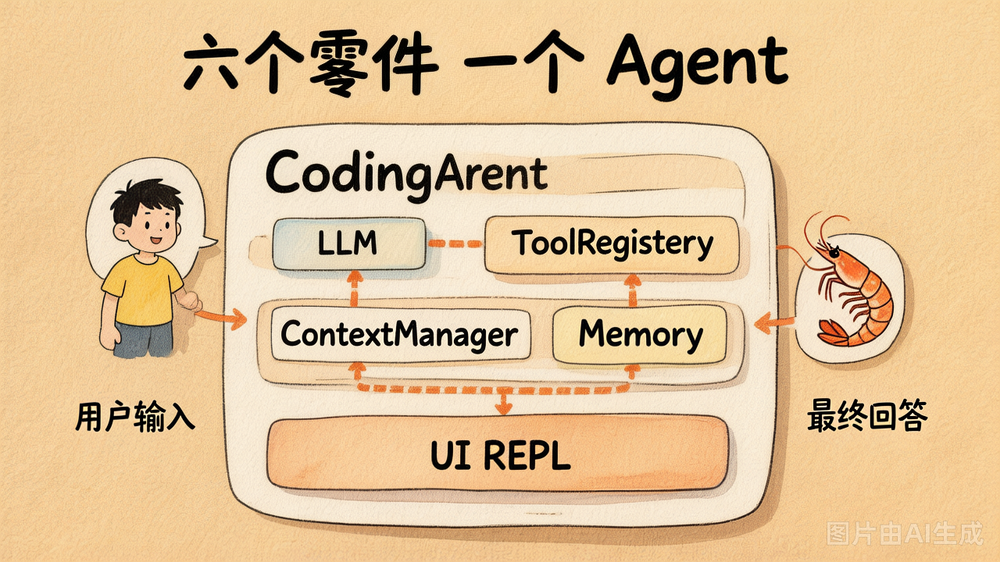
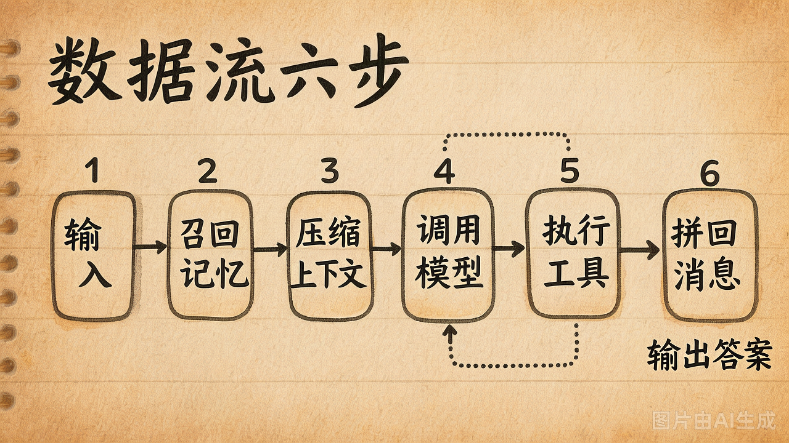

# 第 28 节 · 整合架构：用已有的类组装一个 Agent

## 一句话回答

> **第1章-第5章你已经把每个类都写好了。本章不写新功能，只做一件事：把这些类按一条数据流拼成一个能干活的 Agent。**

## 先回顾：我们手上有哪些类

第1章-第5章的产物，本质就是下面这几个类。它们的接口都定义在 [`my-agent/interfaces.py`](https://cnb.cool/xidian/vibe-coding-learning/vibe-agent-exercise/-/blob/main/my-agent/interfaces.py) 里——这个文件不用改，只是接口参考。



| 来自 | 类 | 核心方法 | 职责一句话 |
|---|---|---|---|
| 第1章 | `LLMClient` | `chat` / `chat_stream` / `count_tokens` | 跟模型对话、数 token |
| 第2章 | `ToolRegistry` | `register` / `to_schemas` / `invoke` | 注册工具、生成 schema、按名调用 |
| 第3章 | `Agent` | `run(user_message)` | **持有 agent loop**：调 LLM → 执行工具 → 回灌 |
| 第4章 | `ContextManager` | `should_compress` / `compress` | 对话太长时压缩 messages |
| 第4章 | `Memory` | `add` / `search` | 存长期事实、按语义召回 |
| 第5章 | 编程工具 | `read_file` / `list_dir` / `write_file` / `edit_file` / `run_bash` | 真正读写文件、跑命令 |

把这几个类的接口签名摆在一起看：

```python
# 来自 interfaces.py（节选）

class BaseLLMClient:
    def chat(self, messages: list[dict], **kwargs) -> str: ...
    def chat_stream(self, messages: list[dict], **kwargs): ...   # 逐 chunk yield
    def count_tokens(self, text: str) -> int: ...

class BaseToolRegistry:
    def register(self, func): ...                 # 装饰器，注册一个工具
    def to_schemas(self) -> list[dict]: ...        # OpenAI tools 格式
    def invoke(self, name: str, args: dict) -> str: ...

class BaseAgent:
    def __init__(self, llm, tools, system_prompt: str = ""): ...
    def run(self, user_message: str, max_iterations: int = 10) -> str: ...

class BaseContextManager:
    def should_compress(self, messages: list[dict]) -> bool: ...
    def compress(self, messages: list[dict]) -> list[dict]: ...

class BaseMemory:
    def add(self, text: str) -> None: ...
    def search(self, query: str, k: int = 3) -> list[tuple[float, str]]: ...
```

**关键认知**：`Agent.run()` 内部就是第2章那套 agent loop。所以「调 LLM → 看工具调用 → 执行 → 回灌」这件事**第3章已经替你封好了**，本章不用再手写。

## 怎么把它们组装成一个 Agent

整合就是**把这些类按一条单向数据流串起来**：



```
用户输入 → (Memory 召回事实，拼进 system prompt) → Agent.run() → 最终回答
                                                      │
                                            内部 loop：LLM ⇄ 工具
```

### 第一步：三件套就能跑（LLM + Tools + Agent）

只用第1、2、3、5 章的类，已经是一个能读写代码的 Agent：

```python
from llm import LLMClient
from tools import ToolRegistry
from agent import Agent
from coding_tools import read_file, list_dir, write_file, edit_file, run_bash

SYSTEM_PROMPT = """你是一个编程助手 Agent，运行在用户的项目目录里。
- 需要信息时先用工具查证，不要凭空假设文件内容或编造 API。
- 改代码前先读相关文件，改动保持最小、可运行。
- 破坏性操作（删文件、跑危险命令）先征得用户同意。
- 回答简洁，用中文。
"""

# 1) 建好 LLM 和工具注册表
llm = LLMClient()
tools = ToolRegistry()

# 2) 把第5章的 5 个编程工具注册进去
for fn in (read_file, list_dir, write_file, edit_file, run_bash):
    tools.register(fn)

# 3) 交给 Agent，loop 由它内部负责
agent = Agent(llm, tools, system_prompt=SYSTEM_PROMPT)

print(agent.run("把 utils.py 里的 add 改成支持任意个参数"))
```

跑通这一步，你就有了一个最小可用的 Coding Agent。

### 第二步：接上第4章的记忆与上下文压缩

对话变长、需要跨会话记住事实时，再把第4章的两个类融进来——它们是 Agent 的**外挂增强**，不改 Agent 内部：

```python
memory = Memory()          # 第4章
ctx = ContextManager()     # 第4章

def smart_run(user_input: str) -> str:
    # 召回相关长期事实，拼进这一轮的 system prompt
    facts = memory.search(user_input, k=3)
    prompt = SYSTEM_PROMPT
    if facts:
        joined = "\n".join(f"- {text}" for _, text in facts)
        prompt += f"\n\n已知用户事实：\n{joined}"

    agent = Agent(llm, tools, system_prompt=prompt)
    answer = agent.run(user_input)

    memory.add(user_input)     # 把这轮值得记的写回记忆
    return answer
```

> `ContextManager.should_compress / compress` 用在多轮、超长对话里压缩历史 messages，避免撑爆上下文窗口；具体接入点取决于你第3章 `Agent.run` 的实现方式。

## 整合时最容易翻的车

新手第一次整合，绝大多数 bug 都是**接口对不齐**：

| 现象 | 根因 | 修法 |
|---|---|---|
| `NoneType is not iterable` | `Memory.search()` 空库时返回 `None` 而不是 `[]` | 在源头返回空列表 |
| LLM 一直循环不停 | 工具失败时 `raise` 了，没转成字符串 | 工具内部 `try/except` 返回错误字符串 |
| messages 越来越长直到超限 | 忘了调 `should_compress` | 在 loop 里加一次检查 |

**调试技巧**：打印每一步的 `messages`，99% 的整合 bug 看一眼就能定位。

## 小结

| 概念 | 一句话理解 |
|------|-----------|
| 回顾的几个类 | LLMClient / ToolRegistry / Agent / ContextManager / Memory + 5 个工具 |
| Agent.run | 第3章已封好 agent loop，本章直接用 |
| 组装第一步 | LLM + Tools + Agent 三件套即可跑 |
| 组装第二步 | Memory / ContextManager 作为外挂增强 |
| 整合的核心 | 把类按单向数据流串起来，对齐接口 |

---

下一节：Agent 组装好了，**怎么让人用**？REPL / Solo / 流式输出三种交互模式。
