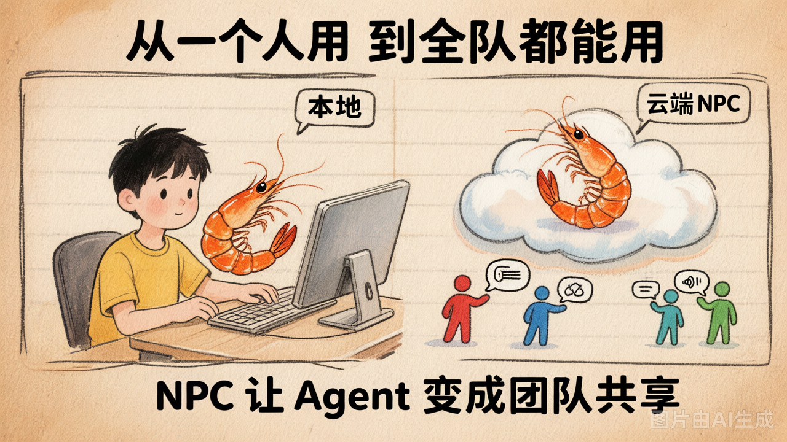

# 第 34 节 · NPC 是什么：仓库里的 AI 角色

## 一句话回答

> **NPC = 挂在代码仓库里的 AI 角色，当有人 @ 它时自动干活。** 跟游戏里的 NPC 一样——你不跟它说话它不动，你一开口它就给你干活。

## 从"本地工具"到"团队协作者"



| | 第6章的本地 Agent | 第7章的仓库 NPC |
|---|---|---|
| 谁在跑 | 你自己的电脑 | 云端容器 |
| 谁能触发 | 只有你 | 团队任何人（在 Issue/PR 评论里 @） |
| 什么时候跑 | 你手动启动 | 事件触发（有人评论时自动跑） |
| 回复到哪 | 终端输出 | 自动回复到 Issue/PR 评论 |
| 知道项目代码吗 | 知道（你指定了 workdir） | 知道（流水线自动 checkout） |

## NPC 的触发机制

```
1. 有人在 Issue 评论里写: @owner/repo(my-agent) 帮我看看这个 bug
2. CNB 平台检测到 @ 了 NPC → 触发 NPC 事件流水线
3. 流水线启动你构建好的 Docker 镜像
4. 镜像里的 npc-entrypoint.sh 拿到评论内容
5. 调 my-agent 处理任务
6. 用 git-cnb 把答案以 NPC 身份回复到原评论下方
```

## NPC 需要什么

| 零件 | 来自哪章 | 作用 |
|---|---|---|
| my_coding_agent | 第6章 | Agent 本体（处理任务的引擎） |
| Dockerfile | 本章写 | 把 Agent 打包成 Docker 镜像 |
| npc-entrypoint.sh | 本章写 | 接收 CNB 事件 → 调 Agent → 回写评论 |
| .cnb.yml | 本章写 | 告诉 CNB 平台"遇到 NPC 事件就跑这个流水线" |
| .cnb/settings.yml | 本章写 | 定义 NPC 角色名和描述 |

## CNB 平台注入的环境变量

NPC 流水线运行时，CNB 会自动注入这些环境变量：

| 变量 | 含义 |
|---|---|
| `CNB_NPC_TRIGGER_CONTENT` | 触发评论的原文 |
| `CNB_REPO_SLUG` | 仓库路径（`owner/repo`） |
| `CNB_ISSUE_IID` | Issue 编号（Issue 评论时有值） |
| `CNB_PULL_REQUEST_IID` | PR 编号（PR 评论时有值） |
| `CNB_WORKSPACE` | 流水线工作目录（已 checkout 代码） |
| `CNB_TOKEN` | 平台自动生成的临时凭证 |

## 动手试试

在脑子里过一遍完整链路：
1. 谁触发？（团队成员在 Issue 评论里 @ NPC）
2. 谁启动容器？（CNB 流水线）
3. 容器里跑什么？（npc-entrypoint.sh → my-agent）
4. 结果怎么回去？（git-cnb 回写评论）

## 小结

- NPC = 仓库里的 AI 角色，@ 它就干活
- 触发链路：评论 @ → CNB 事件 → 流水线 → Docker 容器 → Agent 处理 → 回写评论
- 需要 5 个文件配合：Agent + Dockerfile + entrypoint.sh + .cnb.yml + settings.yml
- 本章后面的 3 节就是依次搞定 Docker + Pipeline + 实操
