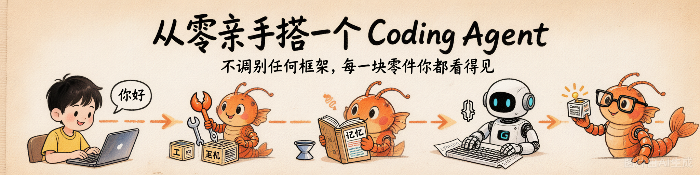

<p align="center">
  
</p>

# Vibe Agent — 从零搭建 Coding Agent

> 从"跟 AI 聊天"到"AI 在你仓库里干活"，亲手搭完每一块零件。

## 项目目标

完成后你能做到：

1. 理解 LLM 的工作原理（next-token prediction、token、向量、幻觉）
2. 用 Python 流式调用 LLM、设计 prompt、估算 token
3. 实现工具注册系统 + Agent 主循环（Function Calling）
4. 区分并实现 ReAct、Plan-and-Solve、Reflection 三种 Agent 范式
5. 从零实现上下文管理与向量记忆系统
6. 搭建完整的 Coding Agent（5 个核心工具）
7. 整合所有模块，部署为 CNB 仓库 NPC

## 内容总览

| 模块 | 主题 | 你的产出 |
|------|------|---------|
| 01 | [认识你的 AI](./01-meet-your-ai/) | `my-agent/llm.py` — LLMClient 类 |
| 02 | [Function Calling 与最小 Agent](./02-tools-and-agent-loop/) | `my-agent/tools.py` — ToolRegistry 类 |
| 03 | [Agent 范式](./03-agent-patterns/) | `my-agent/agent.py` — Agent 主循环 |
| 04 | [上下文与记忆](./04-context-and-memory/) | `my-agent/context.py` + `memory.py` |
| 05 | [Coding Agent 工具集](./05-coding-agent-tools/) | `my-agent/coding_tools/` — 5 个工具 |
| 06 | [整合：完整 Coding Agent](./06-coding-agent-integration/) | `my-agent/main.py` — 零件拼装 |
| 07 | [Skills 扩展 + NPC 上线](./07-skills-and-npc/) | 自定义 Skills + 仓库 NPC |
| 08 | [总结 + 大作业](./08-recap-and-final/) | 复盘与结课 |

## 核心产出：my-agent

逐步实现各模块，最终在模块 06 拼装成完整 Agent：

```
my-agent/
├── llm.py              # 模块01：LLM 客户端
├── tools.py            # 模块02：ToolRegistry
├── agent.py            # 模块03：Agent 主循环
├── context.py          # 模块04：ContextManager
├── memory.py           # 模块04：Memory
├── coding_tools/       # 模块05：5 个工具实现
├── main.py             # 模块06：组装入口
└── tests/              # 各模块的自动化测试
```

搭建路线：

```
01: LLMClient           ─┐
02: ToolRegistry         ─┤
03: Agent Loop           ─┤──→  06 拼装成完整 Agent  ──→  07 加 Skills + 挂 NPC
04: Context + Memory     ─┤
05: Coding Tools × 5     ─┘
```

## 目录结构

```
.
├── 01-meet-your-ai/              # 讲义 + Demo
├── 02-tools-and-agent-loop/      # 讲义 + Demo
├── 03-agent-patterns/            # 讲义 + Demo
├── 04-context-and-memory/        # 讲义 + Demo
├── 05-coding-agent-tools/        # 讲义 + Demo
├── 06-coding-agent-integration/  # 讲义 + Demo
├── 07-skills-and-npc/            # 讲义 + Demo
├── 08-recap-and-final/           # 总结
├── my-agent/                       # ★ 你的核心产出（逐步填空各模块）
├── exercises/                      # 配套练习题（代码填空 + 自动验证）
├── examples/                       # 完整参考实现
└── assets/                         # 封面与全局资源
```

## 学习工作流

```bash
# 1. 看讲义（lecture/）
# 2. 跑 Demo（lab/）
# 3. 补全 my-agent/ 里对应的模块
# 4. 跑测试验证
cd my-agent && python tests/test_llm.py    # 模块01
cd my-agent && python tests/test_tools.py  # 模块02
# ...
```

## 环境准备

本项目使用 [uv](https://docs.astral.sh/uv/) 管理 Python 环境与依赖。

```bash
# 在仓库根目录执行一次，安装所有依赖
uv sync --all-packages
```

## 先修要求

- Python 基础（函数、类、字典、文件读写）
- 命令行基本使用（`cd` / `ls` / `cat` / 环境变量）
- 一台能联网的电脑

不需要提前会：Git、Docker、Agent、提示词工程——这些都会从零讲起。
