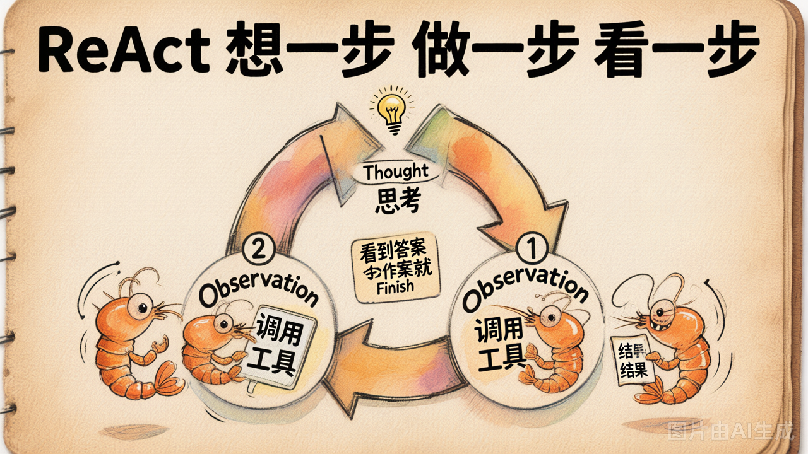

# 第 12 节 · ReAct：Thought-Action-Observation 循环

## 一句话回答

> **ReAct = Reasoning + Acting：让模型每一步先输出一段思考（Thought），再输出一个行动（Action），看到结果（Observation）后回到思考，循环往复。**

它是 2022 年 Yao 等人的论文 [《ReAct: Synergizing Reasoning and Acting in Language Models》](https://arxiv.org/abs/2210.03629) 提出的——**早于 OpenAI Function Calling**。直到今天，ReAct 仍然是被讨论得最多的 Agent 范式。

## 核心循环



模型每一轮的输出长这样：

```
Thought: 我需要先查北京天气
Action: get_weather(city="北京")
```

我们的代码用**正则**把 Action 抠出来执行，把结果作为 Observation 拼回 prompt：

```
Thought: 我需要先查北京天气
Action: get_weather(city="北京")
Observation: 北京 晴 25°C
Thought: 天气晴朗，我可以推荐户外景点
Action: get_attraction(city="北京", weather="晴")
Observation: 故宫、颐和园、长城
Thought: 信息已经够了
Action: Finish[今天北京天气晴朗 25°C，建议去故宫、颐和园或长城]
```

3 轮循环结束。**思考 + 行动 + 观察**反复交替——这就是 ReAct 名字的由来。

## 关键设计：Thought 在不在 prompt 里？

ReAct 的精髓不是"多了个 Action 字段"，是 **每一步把 Thought 也写进去**。Thought 让模型有机会：

- 解释**为什么**调这个工具
- 检查上一轮 Observation 是否符合预期
- 决定**接下来**该做什么

如果不要 Thought 直接输出 Action（"零步推理"），模型在多步任务上的表现会显著变差。**Thought 是一种 chain-of-thought**，是模型在用文本"思考"。

## 跟 Day2 Function Calling 的对比

| 维度 | Day2 Function Calling | ReAct |
|---|---|---|
| 工具调用怎么表达 | OpenAI 协议字段 `tool_calls` | prompt 里约定的 `Action: ...` 字符串 |
| 解析方式 | 直接读结构化字段 | 正则解析 |
| 思考过程 | 没有显式的 Thought | 每步必有 Thought |
| 健壮性 | 高（协议保证） | 低（模型多说一句就崩） |
| 可读性 | tool_calls 是 JSON，对人不友好 | Thought 让整个轨迹很可读 |

**真实工程里**：
- 用 Function Calling **执行**工具（健壮）
- 用 ReAct 风格 prompt **诱导思考**（让模型在 `assistant.content` 里写 Thought，再发 `tool_calls`）

两者**不是二选一**。Day2 demo 里 system prompt 没要求 Thought，但你也可以加上要求："请先输出一段思考再调工具"。

## 为什么 ReAct 至今仍被广泛讨论

1. **直觉清晰**：Thought-Action-Observation 三个词就把 Agent 工作流讲清楚了
2. **prompt 即架构**：不需要框架，复制一段 prompt 就能跑
3. **可解释**：Thought 写在 prompt 里，每一步思考都能看到
4. **是后来很多范式的祖宗**：Plan-and-Solve、Reflection、Tree-of-Thoughts 都是在它的基础上变种

## ReAct 老 paradigm 的脆弱性


写过 ReAct 的人都吃过这些亏：

```python
# 模型乖乖输出
"Thought: ...\nAction: get_weather(city=\"北京\")"
# → 正则能解出来 ✅

# 模型多说了一句
"我先思考一下：\nThought: ...\nAction: ..."
# → 正则可能挂了 ❌

# 模型一次输出两对
"Thought: ...\nAction: ...\nThought: ...\nAction: ..."
# → 该取哪一对？❌

# 模型用了花括号变体
"Action: get_weather('北京')"  
# → 单引号？没有 city= 关键字？❌
```

工程版本要做大量 fallback，每加一种容错就多一道坑。这就是为什么 OpenAI 推出 Function Calling 后大家集体迁移——**协议保证比正则容错可靠 100 倍**。

但**今天我们故意复刻这个老 paradigm**，让你亲身体会下：
- 它的优雅（Thought 让推理可读）
- 它的脆弱（一次模型不规矩就崩）

只有写过这两面，你才会真正理解为什么 Function Calling 是行业拐点。

## 跟 ch01-hello-react 对应

仓库里 [`examples/ch01-hello-react/`](../../examples/ch01-hello-react/) 就是一份**标准 ReAct 实现**——
[`agent.py`](../../examples/ch01-hello-react/agent.py) 100 行不到，带工具调用 + 正则解析 + 多轮循环 + 截断兜底。

可以投屏对照看：注意 `agent.py` 第 26-36 行的"截断多余 Thought-Action 对"——就是为了应对模型一次输出多对的情况。

## 动手试试

```bash
cd day3-agent-patterns/lab/demos
python demo_12_react.py
```

会跑 5 个测试任务（详见 [`toy_agent_base.py`](./toy_agent_base.py) 里 `TASKS`），观察：

1. 模型的 Thought 是否合理？
2. 哪个任务它能正确 Finish？
3. 哪个任务正则解析翻车了？
4. 跟 Day2 demo_09 的最小 Agent（用 tool_calls）相比，每步输出的 token 量怎么变化？

## 小结

| 概念 | 一句话理解 |
|------|-----------|
| ReAct | Thought + Action + Observation 三段循环 |
| 来源 | 2022 年 Yao 等人论文，先于 Function Calling |
| Thought 的作用 | 解释为什么 + 检查上一步 + 决定下一步 |
| 老 paradigm 的痛 | 纯 prompt 约定 + 正则解析 = 脆弱 |
| 今天为什么仍要学 | 直觉清晰 / 是后来很多范式的祖宗 / 真实工程仍混合用 |

---

下一节：ReAct 是"走一步看一步"。如果任务步骤多到一定程度，**先把整盘棋画出来再下** 是不是更稳？→ Plan-and-Solve。
